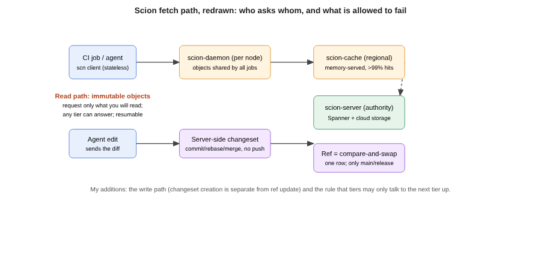

# Title options (recommended first)

1. **Scion: How Anthropic built a source control system for agents that actually works**
2. What the git docs don't tell you about 30,000 merges a day
3. Your CI checkout is the new bottleneck: lessons from Anthropic's Scion

**Subtitle:** Anthropic reports 30,000+ merged changes a day, a 200x smaller footprint than its git mirrors, and one design assumption that explains all of it.

---

[PRAVEEN: 1-2 sentences, optional. Have you seen CI checkouts, merge queues or repo clones become the slow part once AI tooling started producing more changes? Delete this line if not.]

If you have rolled out coding agents on a real codebase, you have probably seen the strange part: the model got faster, and the pipeline around it did not. The code appears in seconds. Then it waits for a checkout, a rebase, a queue slot and a review.

Anthropic just published how that played out at its scale. Merged changes grew from about 2,500 a day in May 2026 to more than 30,000 a day by September, a tenfold rise in four months. Its answer was to replace git for its monorepo.

**Git was designed for clients that go offline. Agents never do.**

That one assumption change drives every design decision in Scion, and it is useful even if you will never run a repo this big.

## Where to find it

The source is Anthropic's engineering post, "Redesigning Source Control at Anthropic", published October 13, 2026 and updated October 15, by Nick G. and the source control team. The Register covered it the same day. I have read the primary post and The Register's report. Every number below is Anthropic's own and has not been independently verified.

## What this post covers

- **The problem:** why a decentralized design strains when clients are machines
- **The six design principles:** the rules Scion is built from
- **How it works:** changesets, refs, derived data, the fetch protocol and the cache tiers
- **My redrawn diagram:** the read and write paths side by side
- **A bridge analogy:** from the systems you already know
- **What the evidence says:** which numbers matter and what they cost or save
- **Three limitations I would name**
- **What to do with this on Monday**

## The problem it solves

Git assumes each client holds a full copy of the repository and may be offline. That is a great fit for people on laptops. Anthropic says nearly all of its clients are now always-online agents and CI jobs.

The scale numbers explain why it hurt. The main branch history is close to 100 GB, and a compressed working copy exceeds 25 GB. CI performs about 25 million checkouts a day, which Anthropic says would be over 600 PB of daily traffic if each fetched naively. To cope, the old setup ran several hundred internal git mirrors at peak.

So the cost was not writing code. It was moving and reconciling it. The Register's summary frames it the same way: code generation is no longer the bottleneck, managing code after it is written is.

## How it works

Anthropic describes six principles: clients are always online, the client and server are asymmetric, source control is a service behind an API, everything scales horizontally, commits are cheap and lock-free, and working copies are optional and sparse. Here is how they show up in the parts.

### Component 1. The changeset

The unit of work is a changeset, an entry in a write-ahead log. Where a git commit points at a whole tree, a changeset lists the files changed relative to its first parent, with content-addressed pointers to compressed blobs. Changesets are created on the server and are immediately available everywhere.

Why it is interesting: cost scales with the size of the change, not the size of the repo. A one-line fix in a 100 GB history costs a one-line fix.

### Component 2. Server-side commits and refs

Commits, rebases and merges happen on the server, so there is nothing to push. Refs are a separate concern: a compare-and-swap update to a single database row (Anthropic names Spanner). The team discourages refs other than main and release branches because globally shared state is a scaling problem.

Why it is interesting: separating "create the change" from "move the pointer" means the expensive part has no lock, and only the cheap part is contended.

### Component 3. Derived data

Blame, path history and commit-graph skip lists are computed from changesets by one generic recursive mechanism, where each value depends on its parents' values. Types can be computed eagerly or lazily, and internals can change without clients noticing.

Why it is interesting: you get to reshape internals later because clients only see an API.

### Component 4. The fetch protocol

The `scn` client does not tell the server what it already has. It asks for the trees and blobs it wants, starting from a root tree and walking missing objects. Each request targets an immutable object, so any cache can answer, and transfers are resumable with no giant packfile response.

Why it is interesting: immutable, addressable requests are what make caching trivially correct.

### Component 5. The three tiers

A `scion-daemon` runs on each node and serves every job there. A regional `scion-cache` streams objects from memory. The authoritative `scion-server` reads from Spanner or cloud storage only on a miss. All tiers speak the same RPCs, and tiering is strictly enforced so a cache failure cannot flood the tier above. Anthropic reports hit rates above 99% per tier.

Why it is interesting: strict tiering is a failure-isolation rule, not just a performance trick.

## The diagram

*Caption: my redrawn version. Anthropic describes the tiers and the changeset model in prose; this view puts the read path (immutable objects, each tier talks only to the next one up) next to the write path (changeset creation separated from the compare-and-swap ref update), which the original post does not draw side by side.*

## The bridge

If you have run web infrastructure, you already know this shape. The read path is a CDN: immutable objects, cache at every tier, origin only on a miss. The write path is an append-only log with a single contended pointer, like a database with a write-ahead log and one leader row. Git was a peer-to-peer system. Scion is a web service that happens to store code.

## What the evidence says

Ranked by what I think matters most for the consumer of the numbers:

1. **200x lower CPU and memory** than the previous mirroring infrastructure (Anthropic's figure). Practical consequence: the several hundred mirrors collapse into a few tiers you can reason about.
2. **Checkouts from minutes to seconds**, roughly two orders of magnitude, with CI alone gaining about 25% CPU capacity. Practical consequence: the queue in front of your agents shrinks, so more of their output lands.
3. **99%+ cache hit rate per tier.** Practical consequence: the authoritative store sees a small fraction of the 25 million daily checkouts.
4. **Five months, seven engineers**, while volume grew tenfold. Anthropic credits agent-assisted development for the speed, including a Claude-written ingestion pipeline rewrite that used 20x less memory and ran 4x faster.

The honest reading: these are self-reported results from one organisation at an extreme point on the curve. They show the design works for them. They do not tell you the break-even point for you.

## Limitations I would name

1. **Not reusable as-is.** Anthropic says Scion is not a replacement for git for general use and does not plan to release it. You get design ideas, not a tool. Adopting something like it also means replacing code review, search and CI integration, as Anthropic did.
2. **Dropping the merge lock moves risk.** Anthropic relies on post-merge and pre-deploy testing and accepts that concurrent changes can conflict, saying Claude usually fixes conflicts faster than humans spot them. That is a claim about their codebase, tests and agents, and I have no independent data for it.
3. **The scale is unusual, and so is the spend.** The Register's author notes that heavy token spending only makes sense when funding is ample. The post's own caveat is that the model suits very large monorepos or heavy agent activity. Most teams are nowhere near 30,000 merges a day.

## Closing

The model did not change. The infrastructure around it did. What sticks is the assumption flip: stop designing for the offline human and start designing for the always-online machine.

**Before you buy more model capacity, measure how long your agents wait for the repo.**

## Now I want to hear from you

1. At what daily change volume did your CI checkout or merge queue become the slowest step, and what did you do?
2. Anthropic drops the global merge lock and accepts post-merge conflicts. Would your test suite catch them in time?
3. Which git operations would you least want to move server-side, and why?

## References

- Anthropic Engineering. "Redesigning Source Control at Anthropic." Oct 13, 2026 (updated Oct 15). https://www.anthropic.com/engineering/redesigning-source-control
- Claburn, T. The Register. Report on Anthropic's source control redesign. Oct 13, 2026. https://www.theregister.com/a/5302943
- TLDR IT newsletter, Oct 15, 2026 (how I first saw the story).

## Further reading

More pieces on the system around the model: [link to hub article]. Follow for the next one. [follow/newsletter CTA]
