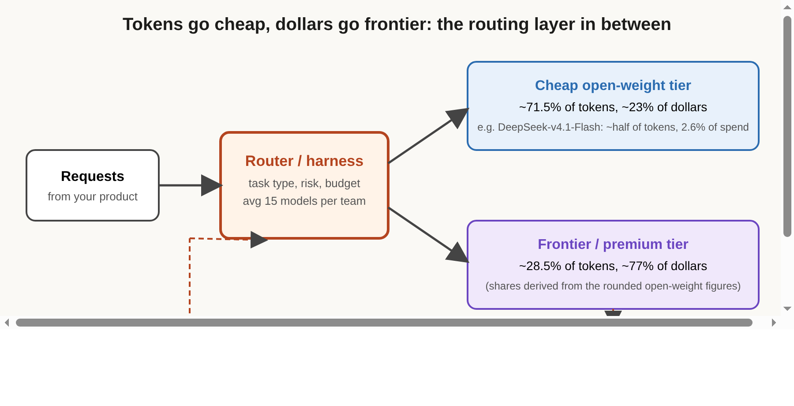

# Title options

1. **(Recommended) The Token–Dollar Gap: what Vercel's gateway data says about routing between open-weight and frontier models**
2. You (probably) don't understand your AI bill: open weights won the tokens, not the dollars
3. Model routing explained: the missing layer between cheap tokens and expensive ones

**Subtitle:** Open-weight models now carry over 70% of the tokens on Vercel's AI Gateway but only about 23% of the spend. Here is what that gap means for anyone building on LLM APIs.

---

If you have ever looked at a token-usage dashboard and a billing dashboard side by side, you have probably felt they were describing two different products. A model that dominates one barely registers on the other.

[PRAVEEN: 1-2 sentences, only if true for you: have you seen your token mix and your bill diverge in your own work?]

Vercel's October AI Gateway index puts a number on that mismatch. According to TLDR's summary of the report, open-weight models handled 71.5% of September's gateway tokens and about 23% of estimated spend. Vercel's own text says "more than seven in ten" tokens and "about one in four" dollars.

**Open weights won the tokens. They did not win the dollars.**

The rest of this post is about why that gap exists, why it is not a contradiction, and why the thing that matters most is the layer that decides where each request goes.

## Where to find it

- Vercel, *AI Gateway Production Index, October 2026*, published October 15, 2026, covering anonymised gateway traffic through September: [vercel.com/blog/ai-gateway-production-index-october-2026](https://vercel.com/blog/ai-gateway-production-index-october-2026)
- Context from earlier months: FourWeekMBA's analysis of Vercel's July and August data: [fourweekmba.com](https://fourweekmba.com/ai-vercel-ai-gateway-open-weight-volume-spend-barbell/)
- Context on a new open-weight release the same week: Meta's [Muse Spark Open announcement](https://research.meta.ai/blog/muse-spark-open) and [model card](https://huggingface.co/meta-models/Muse-Spark-Open-816B-A42B)

## What this post covers

- The data: what the index actually measured, and how to read the headline numbers
- Why tokens and dollars diverge: price per token, model by model
- The routing layer: what 15 models per team implies
- A diagram of the architecture I would draw around this data
- A bridge analogy from storage tiering
- What the evidence says, ranked by what you can act on
- Three limitations I would name
- A closing rule for builders, and three questions for you

## The data: what Vercel measured

The index is built from anonymised traffic through Vercel's AI Gateway, which routes requests from many teams to many providers. Three measurement choices matter for everything below. Spend is estimated at published list prices, not actual invoices. Token volume includes input, output, reasoning, cached-input and cache-creation tokens. And open-weight classification follows the gateway's current model list, which Vercel says is broader than in earlier reports.

The headline figures, all from Vercel's report unless noted:

- September gateway spend was about 13 times December's, an increase of 1,180%.
- Average price per token fell 47% over the same period.
- Open-weight models' share of spend rose from about 5% in June to nearly 25% in September.
- Nearly one in two teams changed its most-used model in September, and almost one in three changed its most-used lab.
- Anthropic's share of total gateway spend fell from 63.7% to 43.9%.

*Takeaway: volume is exploding, unit prices are falling, and loyalty to any single model is thin.*

## Why tokens and dollars diverge

The gap comes down to price per token, and the report shows it model by model.

DeepSeek-v4.1-Flash processed nearly half of September's tokens and took 2.6% of spend. Vercel puts its price per token at about a fifth of the open-weight average. Across all DeepSeek models the split was 58% of tokens and 6.6% of spend.

Now compare Moonshot's Kimi models. They took 3.6% of tokens and 13.2% of spend. Their spend share is about 3.7 times their token share. Same category, opposite shape.

So "open weight" is not one price point. It is a spread. Vercel reports that models priced at least four times the open-weight average drove about two-thirds of the increase in open-weight spend, led by Kimi K3.

Here is my own arithmetic, from the rounded shares. If open weights are about 71.5% of tokens and 23% of spend, then closed models are about 28.5% of tokens and 77% of spend. Dollars per token for the closed group work out to roughly 8.4 times the open-weight group's. That is a derived figure from rounded inputs, so treat it as an order of magnitude, not a measurement.

*Takeaway: the average hides a barbell. A few very cheap models carry the volume, and a few expensive ones carry the revenue.*

## The routing layer: what the multi-model numbers imply

The detail I find most useful for builders is not about any model. It is about teams.

Since December, teams processing at least 10 million tokens used 15 models on average, according to Vercel. At 100 million tokens the average was 26, and at a billion it was 42.

And in September, 68% of teams that increased open-weight spend also increased closed-weight spend. They did not swap one for the other. They added.

That is not a story about open versus closed. It is a story about portfolios. Nobody is running 26 models by hand. Somewhere there is code that decides which request goes where, and that code is the actual product decision.

### Component 1. The router

It takes a request and decides a tier. The inputs are things you know before you call: task type, how costly a wrong answer is, latency budget. The output is a model choice. The interesting design choice is that routing on risk, not on difficulty, is usually easier to specify and audit.

### Component 2. The two tiers

The cheap tier absorbs high-volume, forgiving work. The premium tier takes work where one failure is expensive. Which is which depends on your product, not on a leaderboard.

### Component 3. The acceptance check

This is the piece that Vercel's data cannot show, and I added it to the diagram. If you do not measure whether an output was accepted, you cannot tell whether cheap tokens were cheap. A cheap model that needs three retries and a human review may cost more per accepted result than a premium model that gets it right once. A post that TLDR summarised this week makes the same argument for agent work generally: count briefing, review, correction and failed attempts in the total.

## The diagram

*Caption: My simplified version of the architecture implied by Vercel's data. Shares in the two tier boxes come from the report's rounded open-weight figures; the closed share is derived by subtraction. My version adds the acceptance check at the bottom, which feeds cost per accepted result back into the router. Vercel's index measures tokens and estimated spend, not acceptance.*

## The bridge

Think of storage tiering. Most bytes live on cheap cold storage, and most of your storage bill still comes from the hot tier. Nobody concludes that cold storage "won". They conclude that the tiering policy is where the engineering is.

The router is the tiering policy. The acceptance check is the access-pattern monitor that tells you whether the policy is right.

## What the evidence says

Ranked by how directly you can act on it:

1. **Teams use many models (15 at 10M tokens).** Consequence: build model-agnostic plumbing first. If swapping a model takes a code change, you will not do it as often as these teams do.
2. **Price per token varies by roughly 4x or more inside the open-weight group.** Consequence: do not budget by category. Budget per model, measured on your own traffic.
3. **68% of teams raising open-weight spend also raised closed spend.** Consequence: plan for both bills growing, not for one replacing the other.
4. **Spend is 13x December while price per token fell 47%.** Consequence: unit price drops did not shrink bills, because usage grew faster. Plan for volume.
5. **Nearly half of teams changed their most-used model in a month.** Consequence: a model evaluation is perishable. Re-run it, and keep it automated.

Meta's Muse Spark Open, released the same week, is a useful counterpoint. Its model card lists 816B parameters in total and 42B active, a mixture of 256 experts with 8 active per token. The card says the compressed NVFP4 weights need at least 700 GB of VRAM and the BF16 weights at least 2 TB. Meta's headline benchmarks are its own: on the Artificial Analysis Intelligence Index the card lists 39 for Muse Spark Open against 45 for GLM 5.3 and 44 for Kimi K3. That is Meta's table, not an independent result. My reading, which is an inference and not something either source states: a model that size competes with hosted frontier APIs, not with the small cheap models that carry the token volume. Open weights is a category, and the token flood is coming from its cheapest corner.

## Limitations I would name

1. **The report contradicts itself in places.** Jev's spend share appears as 0.27% in the summary and 0.15% in the body. The report says GPT-6 Luna reached "almost three times" Astra's teams, but its own figures (14.9% and 6.6%) imply about 2.3 times. None of this changes the headline, but it is a reason to read the tables yourself.
2. **It is one gateway, and spend is list price.** The sample is teams that chose to route through Vercel. FourWeekMBA's analysis notes that a developer- and startup-heavy base may underrepresent enterprises on large committed contracts, which would likely pull real spend towards closed models. List-price estimates also ignore discounts and caching deals. I cannot tell you how large either effect is.
3. **Tokens and dollars are not outcomes.** Nothing in the index says whether the cheap tokens produced accepted work. The acceptance check in my diagram is exactly the thing that is missing, and my "barbell" reading of the data is an interpretation, not a finding.

## Closing

The gap between 71.5% of tokens and about 23% of dollars is not a verdict on open weights or on closed models. It is a map of where teams chose to spend money, and the choice is made by whatever sits between the request and the model.

The model did not change. The portfolio did.

The one sticky insight: with teams averaging 15 or more models, the router and its acceptance check are the system. If you take one action this week, log cost per accepted result for your top three request types, split by model.

## Now I want to hear from you

1. If you route between models today, what signal decides the tier: task type, risk, or something else?
2. Have you seen a cheap model cost more per accepted result than a premium one once retries and review were counted? What was the ratio?
3. Vercel reports that almost half of teams switched their most-used model in one month. How often do you re-run your own evaluations, and what triggers it?

## References

1. Charles, A., Arora, H., et al. *AI Gateway Production Index, October 2026.* Vercel, October 15, 2026. https://vercel.com/blog/ai-gateway-production-index-october-2026
2. FourWeekMBA. *Vercel AI Gateway Shows Open Weights Taking the Volume, Anthropic Keeping the Money.* August 22, 2026. https://fourweekmba.com/ai-vercel-ai-gateway-open-weight-volume-spend-barbell/
3. TLDR Dev newsletter, October 16, 2026 (source of the 71.5% / 23% figures and the summary of the human-cost-of-agent-work post). https://tldr.tech/dev
4. Meta. *Muse Spark Open.* October 15, 2026. https://research.meta.ai/blog/muse-spark-open
5. Meta. *Muse-Spark-Open-816B-A42B model card.* Hugging Face. https://huggingface.co/meta-models/Muse-Spark-Open-816B-A42B
6. Cutler. *How to measure the human cost of agent work.* October 2026 (read via TLDR summary). https://cutler.sg/blog/2026-10-measure-agent-review-time

---

**Further reading:** [link to hub article]

If this was useful, follow me for a daily scan of AI engineering news, with one story a week taken apart in depth.
