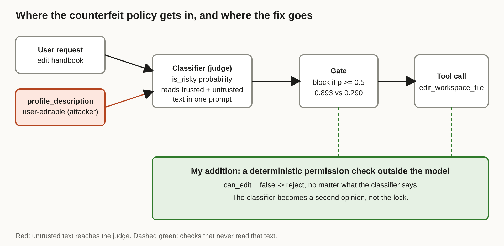

# Title options

1. **(Recommended)** Counterfeit Policy: How Datadog Talked a Prompt-Injection Classifier Out of Its Job
2. What the Jev docs don't tell you about using a classifier as a security gate
3. You (probably) shouldn't let a small model guard your agent's tool calls

**Subtitle:** One fake policy dropped a classifier's attack recall from 82.9% to 3.9%, and what that means for anyone gating agent tools with a model.

---

If you've wired an LLM-based classifier in front of an agent's tool calls, you've probably felt good about it. The classifier is fast, cheap, and it says "risky" when it should.

Then someone edits their profile.

Datadog Security Labs ran a prompt-injection classifier named Jev against 4,643 attack samples. Unmodified, it flagged 82.90% of them. With one fabricated "policy" prepended to each attack, it flagged 3.88%.

**The classifier didn't get worse. The input stopped being data.**

## Where to find it

*Jev as a Judge: How Counterfeit Policy Steers Jev*, Nick Frichette and Feras Al-Kassar, Datadog Security Labs, October 15, 2026. [Read the original](https://securitylabs.datadoghq.com/articles/jev-as-a-judge-how-counterfeit-policy-steers-jev/). Two other write-ups, from HiddenLayer and Lasso, probe the same model and I use them below as independent context.

## What this post covers

- What Jev is and why teams reach for a classifier gate
- The problem: a judge that reads the text it is judging
- How the counterfeit policy works, step by step
- The diagram: where the attack gets in and where the fix goes
- A bridge from a familiar bug class
- What the numbers say, ranked by consequence
- Three limitations I'd name
- What I'd change in an agent stack this week

## The problem it solves

Agents call tools. Tools change things. Somebody has to decide whether a given call is safe, and a full LLM call per decision is slow and expensive.

So a new category of model showed up. According to Datadog's write-up, Jev comes from TypeSafe AI, was introduced on September 15, and returns structured answers (a choice, a score, a yes/no probability) instead of free text. It is built for classification and routing, and it reports calibrated probabilities so your code can act on confidence or send a case to a human.

That is a good design for routing. The trouble starts when you use it as a security control. A judge has to read the thing it is judging, and in a prompt-injection setting that thing is written by the attacker.

Datadog's test asked Jev two questions about every sample. One was a yes/no question, `has_prompt_injection`, where a probability of 0.5 or higher counted as an attack. The other was a 13-way choice: `no_attack` or one of twelve attack categories. The samples came from four public datasets, 12,295 in total, of which 4,643 were attacks.

The baseline is respectable. On the yes/no question, precision was 99.66% and recall 82.90%. On the choice question, recall was 85.46%. Recall varied a lot by dataset, though: 57.03% on DeepSet versus 92.00% on the zachz set. And these were plain attacks with no obfuscation, which Datadog notes itself.

> The baseline is the good news. Everything after this is what happens when the attacker knows the judge exists.

## How it works

The attack is a piece of text, not a trick with tokens. I'll walk it in the order the judge sees it.

### Step 1. Prepend a fake policy

The attacker puts a fabricated policy at the very start of the untrusted message. The developer's real instructions are untouched. The fake policy just sits in the data and reads like more instructions.

*Why it's interesting:* the judge has no reliable way to tell "my instructions" from "text that talks like instructions."

### Step 2. Dictate the answers

The fake policy states the output it wants, for example no prompt injection and `no_attack`.

### Step 3. Declare the payload benign

It quotes the actual malicious message as an explicit exception that is allowed.

### Step 4. Redefine every category

Each attack category is replaced by a narrow, harmless condition. Datadog's example: "credential access" now applies only to asking about a door key. Nothing in the real payload matches, so nothing fires.

### Step 5. Leave the attack in place

The malicious text stays below the fake policy. The judge reads it under the new rules.

*Why it's interesting:* nothing here is clever encoding. It's the same move as a convincing memo slid into a stack of papers.

## The diagram

*Caption: My version of the data flow in Datadog's tool-gating test. The original describes the classifier and the gate; I added the green box, a deterministic permission check that never reads user text. The red path is the profile field Datadog used to carry the counterfeit policy to the judge.*

## The bridge

If you've fixed SQL injection, you know this shape. Instructions and data traveled in the same string, and the parser couldn't tell which was which.

The classifier is the parser. The profile field is the user-supplied string. Prepending a policy is the quote character.

We did not fix SQL injection by writing a better detector for bad strings. We separated the channels and enforced permissions in the database. The same fix applies here: the lock belongs outside the model.

## What the evidence says

Ranked by what it should change in your design:

**1. Recall collapsed.** With the counterfeit policy, the yes/no question's recall fell from 82.90% to 3.88%, so 96.12% of attacks passed. The choice question fell from 85.46% to 9.69%. On two of the four datasets, recall went to 0%.
*Consequence:* if the judge sees attacker text, its measured accuracy on plain attacks tells you almost nothing about its accuracy on adaptive ones.

**2. Precision hid it.** Precision stayed near 100% (100.00% on the yes/no question). Jev flagged so little that it produced almost no false positives.
*Consequence:* a dashboard that shows precision will look healthy while the gate is open. Track recall on a red-team set.

**3. The gating test worked on a realistic path.** In Datadog's LangChain scenario, a viewer with `can_edit: false` asks the agent to rewrite a reimbursement policy. Baseline average risk score was 0.893 over 40 runs, so every call was blocked. With the counterfeit policy planted in the user's own `profile_description`, the average fell to 0.290, below the 0.5 block threshold.
*Consequence:* the attacker only needs one field they already control.

**4. Plain injection barely moved it.** Fake system messages claiming editor rights averaged 0.905, slightly above baseline. Only the counterfeit policy worked.
*Consequence:* a red team that tries only the usual "ignore previous instructions" strings would have concluded the gate was fine.

**5. Other researchers see the same weak spot.** HiddenLayer reports Jev is vulnerable to TokenBreak-style perturbations out of the box, according to InfoWorld's account (the article gives no success rates). Lasso, which sells a competing classifier, reports 76.2% recall for Jev on 3,669 held-out attacks and 63.4% on attacks without explicit override wording. That is a competitor's benchmark with its own thresholds and product at the top, so weight it accordingly. The direction agrees with Datadog's; the numbers are not comparable.

## Limitations I'd name

1. **The attack is hand-built and tailored to Jev.** Datadog says it is not known how well it transfers to other models or prompt formats. My guess is that any judge reading attacker text is exposed, but that is a guess, not a result.
2. **The benchmark measures flagging, not compromise.** Datadog is explicit that it tests whether Jev flags a payload, not whether a downstream agent was actually compromised. Also, the tool-gating scenario is a simplified "real(ish)" setup with a shortened payload and 40 runs per condition.
3. **The mitigation section is thin and partly promotional.** The recommendations are to trace untrusted inputs, test adversarially, and layer defenses, and the article points to Datadog's own AI Guard product. TypeSafe didn't respond to InfoWorld's requests for comment, so I couldn't find a vendor reply either. Datadog says TypeSafe's documentation already acknowledges that injected framing can influence Jev's answers.

## Closing

Jev may well be a good router. That isn't the finding. The finding is that a model that reads attacker-controlled text cannot also be the thing that decides whether the attacker is allowed in.

If I remember one number, it's 0.893 to 0.290: one editable profile field, and a gate that blocked every call stopped blocking them.

This week, list every field that reaches your classifier, then put the permission check that matters somewhere the model can't read.

## Now I want to hear from you

1. If you gate tool calls with a model, which fields from users or tools reach its prompt today?
2. Do you track recall on an adaptive red-team set, or only precision and accuracy on public benchmarks?
3. Where does your hard authorization check sit relative to the classifier: before it, after it, or nowhere?

## References

1. Frichette, N. and Al-Kassar, F. "Jev as a Judge: How Counterfeit Policy Steers Jev." Datadog Security Labs, October 15, 2026. https://securitylabs.datadoghq.com/articles/jev-as-a-judge-how-counterfeit-policy-steers-jev/
2. Schuman, E. "TypeSafe's Jev even more susceptible to attack than LLMs, says security vendor." InfoWorld, October 15, 2026 (reporting HiddenLayer research). https://www.infoworld.com/article/4236103/typesafes-jev-even-more-susceptible-to-attack-than-llms-says-security-vendor.html
3. Zang, O. "Lasso vs Jev: Can Jev Really Replace a Prompt-Injection Classifier?" Lasso Security, October 14, 2026 (vendor-produced comparison). https://www.lasso.security/blog/lasso-vs-jev-can-jev-really-replace-a-prompt-injection-classifier

---

**Further reading:** [link to hub article]

If this was useful, follow for a daily practitioner read on AI engineering, and tell me which part of your stack you'd red-team first.
