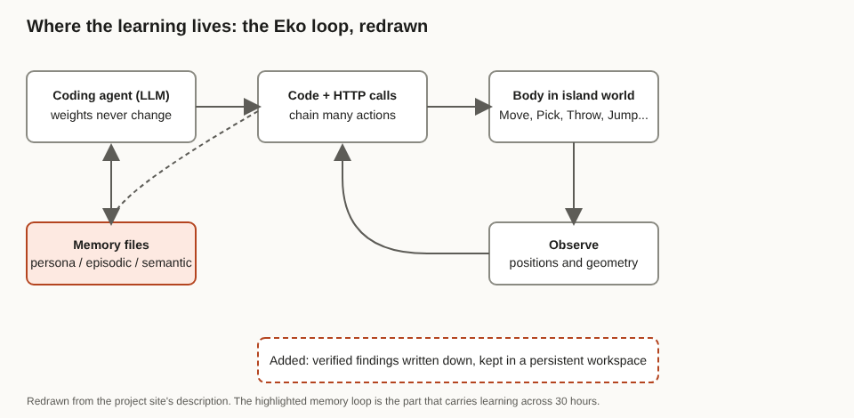

# Title options

1. **(Recommended)** Eko: What MIT's 30-Hour "Play" Experiment Says About Where Agents Actually Learn
2. What the "AI agents play" headlines don't tell you about memory files
3. You (probably) don't need a bigger model. You need a workspace the agent can write to.

**Subtitle:** After 30 hours of aimless play, MIT's agents placed 10.3 objects on a hard-to-reach platform in an hour, versus 3.5 for identical agents with no play. The weights never changed.

---

[PRAVEEN: 1-2 sentences, optional. Have you watched an agent forget what it learned an hour ago, or lose a hard-won fix between sessions in your own work?]

If you've run a coding agent for more than an afternoon, you've probably watched it rediscover the same fact three times. It has no childhood, only a context window.

MIT just ran the opposite experiment. Thirteen coding agents were each dropped into an unfamiliar virtual island for 30 hours with no task and no reward. Then each was tested for one hour on goals it had never been given. On the project's own comparison, agents with that play history placed an average of 10.3 objects on the island's hard-to-reach Spire. Identical agents without it averaged 3.5.

**The model didn't change. The workspace did.**

## Where to find it

*Is this machine playing?* by Nathan Cloos, Antonio Norelli, Daniel Durbin, Jacob Andreas, Daniela Rus and Phillip Isola, submitted to arXiv on 5 October 2026 ([arXiv:2610.07130](https://arxiv.org/abs/2610.07130), cs.AI/cs.LG, CC BY 4.0). It is a preprint, not peer reviewed. The authors also run a [project site](https://machineplaying.org/) with replays. I could not read the PDF's body text in my run, so the setup details and numbers below come from the abstract and the project site; I flag that again under limitations.

## What this post covers

- What the experiment actually did, stripped of the "lobster on an island" colour
- Why "no task" is the interesting part
- How the Eko loop works: code, world, observation, memory
- My redrawn diagram of where learning is stored
- A bridge to something you already do: caching
- What the numbers say, and which one I distrust
- Three limitations I would name
- Questions for you

## What it did

The authors made a modern coding agent the controlling "mind" of a virtual body on an unfamiliar island. They gave it only a minimal instruction; per the project site it was to be curious. There was no task, reward, or named activity. Reporting from [Gizmodo](https://gizmodo.com/researchers-stranded-an-ai-agent-on-a-virtual-island-things-got-very-weird-2000825998) describes the agent as powered by Claude Code, in a body with a few blocks, one large rock, a ring, and a tall Spire that a simple jump can't reach.

Over 30 hours the agents climbed, stacked blocks into towers, drew mandalas, reinterpreted sports, and ran small experiments on the physics. Similar activities showed up across all thirteen agents, but each agent's history diverged. Gizmodo adds that six agents independently found that releasing a block mid-jump throws it farther.

The authors then ask a deliberately provocative question: does this meet classical criteria for play, and could play become a way to develop machines?

*Takeaway: the headline is "agents play". The engineering story is what the agents kept.*

## The problem it targets

Most agents are built by deciding in advance what they should practise and what counts as progress. The newsletter excerpt of the paper's framing, from [Luiza's Newsletter](https://www.luizasnewsletter.com/p/can-ai-agents-play), puts the alternative as a rich, safe world where the agent chooses what is interesting and knowledge accumulates from the history that follows.

For practitioners, the closest analogue is the benchmark-shaped loop: define a task, run the agent, score it. That tells you what an agent can do on the task. It tells you little about what it can pick up when nobody is grading.

## How it works

### Module 1. The body interface

Eko controls its body through an HTTP server that it reaches with terminal commands, according to the project site. The actions are MoveTo, Pickup, Throw, Jump, Stop, Place, and Observe, and Observe returns positions and geometry for every entity.

Why it's interesting: because the agent writes code, it can chain many actions in a script instead of paying one model round trip per action. The cost model of the loop changes.

### Module 2. The workspace

Eko has a persistent workspace of three files: a persona file, an episodic memory log, and a semantic memory file for verified knowledge. The system prompt describes the workspace, and an API file documents the world interface.

Why it's interesting: the split mirrors what many of us do by hand. Raw history goes in one place. Things the agent has checked go in another.

### Module 3. The loop

The agent acts, observes, and writes down what held up. The project site states that learning came from writing knowledge into memory files, not from changing model weights.

Why it's interesting: this is learning without training. It is also the part most worth stealing.

## The diagram

*Caption: My version of the Eko loop. The original describes the pieces in prose; I've drawn the memory files as a two-way link with the agent, because that loop, not the body, is what carries 30 hours of experience into the test hour.*

## The bridge

Think of the memory files as a cache. The model is the compute. Play is the cache warm-up run.

Cold cache, same hardware: 3.5 objects on the Spire. Warm cache, same hardware: 10.3. Nobody would call the CPU faster.

## What the evidence says

The project site compares 13 agents with 30 hours of experience against 13 identical agents with none. Each got one hour in a fresh world on four goals. Here is what the site reports, ranked by how much I trust it as a signal:

- **Objects on the Spire:** averages of 3.5 (max 12) without play and 10.3 (max 16) with it, roughly 3x. Practical meaning: the accumulated knowledge transferred to a goal-directed task the agent never saw.
- **Five-block towers:** 2.5 (max 6) versus 5.0 (max 16), a doubling.
- **Throw onto the Spire:** a time-remaining measure where higher is faster, 14.4 minutes versus 35.1. Practical meaning: it got there sooner.
- **Tallest tower:** 12.1 (max 15) versus 11.2 (max 19). The chart labelling was ambiguous in what I could read, and it does not clearly support the trend. I wouldn't lean on it.

Three of four goals favour play. The fourth is a wash or worse. That is a fair result for a first paper, and worth reporting as exactly that.

## Limitations I'd name

1. **I couldn't read the paper's body.** The PDF text wasn't extractable in my run, so the numbers are from the project site and the architecture from the site and press. Check the figures against the PDF before you quote them.
2. **"Play" is an interpretation.** Gizmodo's reporting calls out the risk of anthropomorphizing, and a summary at [Let's Data Science](https://letsdatascience.com/news/mit-study-explores-agent-play-on-virtual-island-0f9551e4) notes that the work doesn't establish curiosity, intent, or real-world autonomy. Memory-file notes written during aimless activity may simply be a form of exploration with logging.
3. **One world, 13 agents, a preprint.** The island is small and simple, there is no control that gets the same 30 hours with a task assigned (that I could find), and I found no independent reproduction. Whether this transfers to a real codebase is untested.

## Closing

The interesting claim isn't that machines can play. It's that useful capability accumulated somewhere other than the weights, in files the agent wrote itself.

If you build agents, that is your lever. Give the agent a place to record what it verified, keep the raw log separate from the checked facts, and measure transfer on tasks it didn't practise.

This week, add a verified-facts file to one of your agents and test it on a task it has never seen.

## Now I want to hear from you

1. If your agent kept a verified-facts file for a month, what would go in it that never makes it into your prompts today?
2. Would you trust an agent that learned from 30 hours of unsupervised exploration, and what guardrails would you set first?
3. What's the right control for this study: the same 30 hours with an assigned task, or the same agent with a hand-written memory file?

## References

- Cloos, N., Norelli, A., Durbin, D., Andreas, J., Rus, D., Isola, P. *Is this machine playing?* arXiv:2610.07130, 2026. https://arxiv.org/abs/2610.07130
- Project site. https://machineplaying.org/
- Wright, W. Gizmodo, 15 Oct 2026. https://gizmodo.com/researchers-stranded-an-ai-agent-on-a-virtual-island-things-got-very-weird-2000825998
- Let's Data Science, 15 Oct 2026. https://letsdatascience.com/news/mit-study-explores-agent-play-on-virtual-island-0f9551e4
- Luiza's Newsletter, edition 336. https://www.luizasnewsletter.com/p/can-ai-agents-play

---

**Further reading:** [link to hub article]. If this was useful, follow me for a daily read on what changes how we build with AI.
