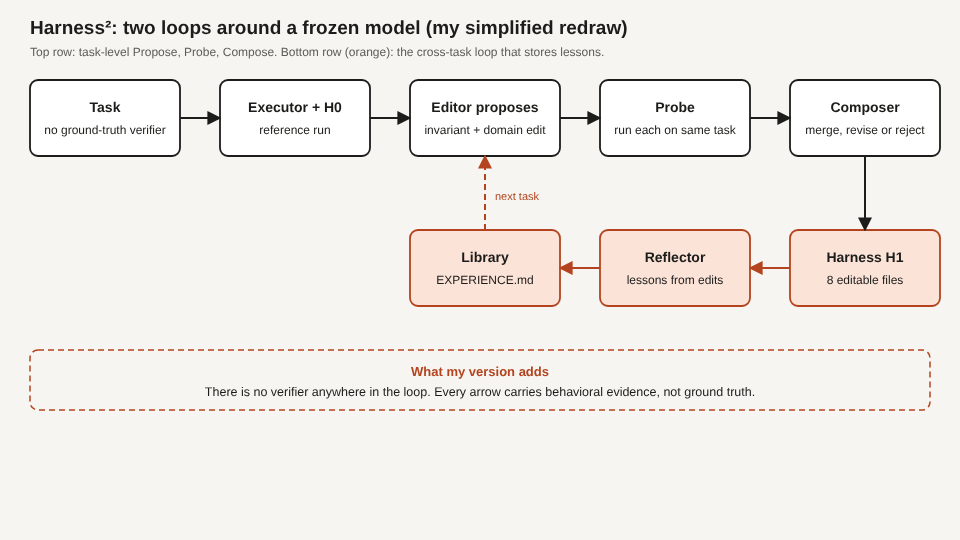

# Title options

1. **(Recommended)** Harness²: How Google Research built an agent that rewrites its own harness without touching the model
2. What the "self-improving agent" headlines don't tell you about Harness²
3. You (probably) don't need a better model. You need a harness that can edit itself.

**Subtitle:** One pass of Harness² lifted GLM-5 by 11.8 points on a legal-agent benchmark with frozen weights. Here is the loop that did it, and the three places I'd push back.

---

[PRAVEEN: 1-2 sentences, optional. Have you hand-tuned a system prompt, a skills folder or a guardrail file for an agent and watched the gain vanish on the next task type?]

If you've run a coding or office agent for more than a week, you've probably done the ritual. The agent fails, you open the system prompt, add a rule, add a skill, tweak a guardrail, and run it again. Nothing in the model changed. Your files did.

Google Cloud AI Research just automated that ritual. In Harness², a single refinement step took GLM-5 from 59.6% to 71.4% on the Harvey Legal Agent Benchmark (LAB). That is 11.8 points, with frozen weights and no ground-truth grader in the loop.

**The model didn't change. The harness did, and the harness edited itself.**

## Where to find it

*Harness²: Recursive Agent Harnessing for an Open World*, by Ruiyao Xu, Yanfei Chen, Zhongying CuiZhu, Bhavana Dalvi Mishra, Yifei Ming, Han Yu, Rujun Han, Chen-Yu Lee and Tomas Pfister, all at Google Cloud AI Research (the corresponding author is also at Northwestern University). Submitted to arXiv on 9 October 2026 ([arXiv:2610.14224](https://arxiv.org/html/2610.14224v1)). Code is on [GitHub](https://github.com/google-research/harness2) under Apache 2.0. It is a preprint, and the numbers below are the authors' own.

## What this post covers

- The problem: why agent harnesses get tuned by hand, and why that doesn't transfer
- Module 1. The executor and the eight files a harness is made of
- Module 2. Propose, Probe, Compose: the task-level loop
- Module 3. The experience library: the loop that remembers
- My redrawn diagram of both loops
- A bridge to something you already run: canary deploys
- What the ablations and baselines say
- Three limitations I'd name

## The problem it solves

An agent is a model plus everything wrapped around it. The paper treats that wrapper as eight editable files in the runtime: the system prompt, guardrails, memory, skills, tool guidance, scripts, subagents and a middleware plugin. Most teams edit those files by hand.

Automating the edit is hard for two reasons the authors name. Open-world tasks, like drafting a legal memo or an office deliverable, have no ground-truth verifier you can run. And harnesses tuned for one task type tend not to generalize to the next.

The baselines show the naive route is risky. Harness Scaling, one of three comparison methods, ended up below the unmodified base harness in 7 of 12 benchmark and configuration pairs. ReasoningBank, a memory-style baseline, landed up to 6.6 points below base on coding tasks. More machinery around the model is not automatically better. **Tuning a harness blind can make it worse.**

*Takeaway: the hard part isn't editing the harness. It's deciding which edits to keep without a grader.*

## How it works

### Module 1. The executor

The model runs under an off-the-shelf agent runtime. The paper uses OpenCode and Codex as runtimes, with Gemini 3.5 Flash and GLM-5 as the models. Weights stay frozen. Only the eight harness files can change.

A first run under the starting harness, which I'll call H0, produces a reference execution. Everything that follows is judged against it.

*Why it's interesting: the baseline run is the control group. The method never needs a score, only a comparison.*

### Module 2. Propose, Probe, Compose

This is the task-level loop, and it's the core of the paper.

**Propose.** An editor model reads the reference run and proposes two candidate edits. One is an invariant edit, meant to help agentic work across domains. The other is domain-specific. The default editor is Claude Opus 4.8, per the paper, which also tests the same model acting as both executor and editor.

**Probe.** Each candidate harness runs on the same task under matched conditions. The system then contrasts each candidate's behavior with the reference run.

**Compose.** A composer reads that evidence and decides, edit by edit, whether to merge, revise, adopt or reject. The output is the final harness for this task. When the recursion budget k is above one, an agentic selector chooses among anonymized deliverables. The paper's main comparison uses k = 5 in parallel.

*Why it's interesting: it replaces "did the score go up?" with "did the behavior change in a way that looks better?" That is a weaker signal, and the authors say so.*

### Module 3. The experience library

The second loop works across tasks. After a task, a reflector extracts lessons from the edits that were adopted. Adopted harnesses and lessons go into a library, with an EXPERIENCE.md file. The next task starts with that library in the editor's context. The library starts empty for each benchmark stream.

*Why it's interesting: the first loop fixes this task. The second one is how a fix for task 3 helps task 30.*

## The diagram

*Caption: my simplified redraw from the paper's text and the repo README, not a copy of its figure. My version adds one thing: a note that no verifier appears anywhere. Every arrow carries behavioral evidence, not ground truth. The dashed arrow shows the library feeding the editor on the next task.*

## The bridge

If you run services, you already know this pattern. The reference run is production traffic. Each probe is a canary. The composer is the promotion gate. The library is your postmortem folder.

The difference is that a canary usually has a metric to watch. Here the "metric" is a model reading two transcripts. **Harness² is canary deploys for prompts, without the dashboard.**

## What the evidence says

All numbers below are means over three runs with shuffled task order, from the paper.

**The headline gains.** On the single-step setting (k = 1), GLM-5 under OpenCode went from 64.2 to 75.7 on WorkBuddy-Bench (+11.5) and from 20.6 to 24.2 on JobBench. On LAB it went from 59.6 to 71.4. Gemini 3.5 Flash gained less: 72.4 to 77.5 on WorkBuddy-Bench. Practical consequence: the weaker model gained more. If you run a cheaper model, a tuned harness is where the first points are.

**More budget helps, modestly.** At k = 5 in parallel, GLM-5 under OpenCode reached 79.6 on WorkBuddy-Bench and Gemini reached 80.8. That is another 3 to 4 points over one step. Practical consequence: the first pass is the big win, and each additional pass costs more and returns less.

**Ablations.** On Gemini 3.5 Flash under OpenCode at k = 1, removing the library cost 3.1 points on WorkBuddy-Bench and 1.8 on JobBench. Removing scoping cost 2.9 and 3.7. Removing composition cost 1.6 and 1.9. No single part carries the method. The library matters most on one benchmark, scoping on the other. Practical consequence: if you build a cut-down version, skipping the memory or the scoping step each costs you roughly three points.

**What the agent does differently.** On JobBench, average tool calls per task rose from 27.4 to 32.8, about 20% more. The tool-error rate fell from 14.4% to 9.1%. A case study in the paper shows one task going from 43.1 to 77.8 after the improver added a verification guardrail and a reconciliation skill. Practical consequence: the gain comes partly from the agent checking its work more, which costs steps.

*Takeaway: the lift is real in the authors' setup, it's largest for the weaker model, and it isn't free.*

## Limitations I'd name

**1. The evidence is the authors', and it hasn't been independently replicated.** I found no replication in this run. The benchmarks are WorkBuddy-Bench, JobBench and LAB, and the editor in the headline setup is Claude Opus 4.8, a model outside the executor pair. The paper also reports improvements when one model plays both roles, but I only read the aggregate statement of that result, not the per-model tables.

**2. Without a verifier, the edits can be wrong.** The authors say probe evidence is not verification and name run-to-run variability and shared model biases. Their appendix reports nine regressions, caused by choosing a weaker candidate, carrying an incorrect premise across candidates, or plain variability. Recursion also did not close the gap between runtimes: on WorkBuddy-Bench the GLM-5 gap between OpenCode and Codex grew from 0.2 to 1.3.

**3. The cost and the attack surface are underreported.** The paper gives no dollar or token totals in the portions I read, only step and tool-call counts. It does say extra compute is a limitation. One of the eight editable files is guardrails.md, the file that holds hard constraints. The paper says every edit is a reviewable diff and a validator discards invalid harnesses. The README adds that executors have unrestricted network access and that Codex runs with its sandbox disabled, so it advises configuring restrictions before evaluating. If you copy this pattern, put a human in front of guardrail edits.

## Closing

The pitch of Harness² isn't a smarter model. It's that the harness is a program you can search over, and that a model can propose, test and merge changes to it. The part that sticks is the order of operations: compare behavior to a reference first, and decide second.

If you build agents, run your next harness change the way this paper does. Keep the old run, run the new one on the same task, and read both transcripts before you merge.

## Now I want to hear from you

1. If an agent edited its own skills folder overnight, which of the eight files would you let it touch without review, and which would you lock?
2. The probe step compares two runs with no grader. Where in your own agent work is "looks better in the transcript" a good enough merge gate, and where is it dangerous?
3. The weaker model gained more. Would you rather spend your budget on a bigger model or on a refinement loop around a smaller one, and what would change your mind?

## References

1. Xu, R., Chen, Y., CuiZhu, Z., Dalvi Mishra, B., Ming, Y., Yu, H., Han, R., Lee, C.-Y., Pfister, T. (2026). *Harness²: Recursive Agent Harnessing for an Open World.* arXiv:2610.14224. https://arxiv.org/html/2610.14224v1
2. google-research/harness2 (code and README, Apache 2.0). https://github.com/google-research/harness2
3. Latent Space, "[AINews] not much happened today," 20 October 2026 (inbox newsletter that surfaced the release). https://www.latent.space/p/ainews-not-much-happened-today-f09

## Further reading

More of my write-ups: [link to hub article]. If this was useful, follow me here on Medium for the next daily breakdown.
