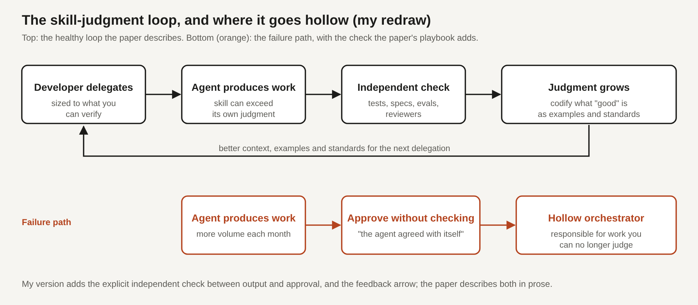

# Title options

1. **(Recommended)** The Hollow Orchestrator: what Microsoft's 331-developer study says about AI, speed and judgment
2. What your AI productivity dashboard can't tell you about your developers
3. Faster, Further, Afresh: a three-zone test for what AI is really changing on your team

**Subtitle:** Only 45% of the AI gains developers described were plain speed-ups. The risk the authors name is approving work you can no longer judge, and here is how I'd guard against it.

---

[PRAVEEN: 1-2 sentences, optional. Have you ever merged an agent's change and later realised you couldn't have explained why it was right?]

If you lead or work in an engineering team that adopted AI coding tools, you've probably seen the same chart: pull requests up, cycle time down, everyone busy. The chart says the engine is spinning faster. It doesn't say what the engine is now doing.

A new paper from Microsoft and Oregon State researchers asked 331 Microsoft developers one plain question: what can you do now because of AI that you couldn't do before? Only 45% of the answers were "the same work, faster." Another 36.9% described work that had been out of reach, and 12.4% described work that didn't exist before, mostly directing agents and setting the standards their output has to meet.

**Speed was never the whole story. The scarce thing is the judgment to know when the output is right.**

## Where to find it

The paper is *"To Boldly Go Where No One Has Gone Before" What Has AI Let Developers Unlock?* by Rudrajit Choudhuri, Jenna L. Butler, Christian Bird, Carmen Badea, Brian Houck and Anita Sarma, posted to arXiv (2610.23708, cs.HC) on October 16, 2026. I found it through the DX Engineering Enablement newsletter, which published a write-up of it on October 21 alongside DX's Q3 State of AI Impact report.

## What this post covers

- **The problem:** why throughput metrics can't tell you what AI changed
- **How the study works:** the survey, the three zones, the loop
- **The diagram:** my redraw of the skill-judgment loop and its failure path
- **The bridge:** a mental model from code review
- **What the evidence says:** what the numbers support, and what they don't
- **Limitations I'd name:** three
- **What I'd do on Monday**

## The problem it solves

Most AI productivity measurement counts output: pull requests, lines, cycle time. DX's Q3 report, drawn from more than 500 companies, shows median weekly complexity-weighted PR throughput going from 1.43 in Q4 2025 to 2.51 in Q3 2026, which DX describes as 75.5% growth over four quarters.

That is real. It also can't separate three different things. A task can get faster. A task can become cheap enough to attempt for the first time. Or a new kind of task can appear. All three produce pull requests, and all three look like "more output."

The same DX report shows where the extra output lands. Median time to first review was 40 minutes for teams with 20-40% AI-written code and 82 minutes for teams at 80% or more. Generation got cheap. Review didn't.

*Takeaway: a throughput chart measures the engine, not the destination.*

## How it works

The researchers invited 4,000 randomly sampled Microsoft developers and analysed the 331 responses with reflexive thematic analysis, using a human-in-the-loop, multi-model AI council. The answers fell into three zones.

### Zone 1. Faster (45%)

Familiar work, accelerated: documentation, tests, root cause analysis. One respondent said they could do everything they do without AI, only quicker. Another now runs two or three tasks in parallel while waiting on the model.

Why this is interesting: even here, the work reorganised around the speed. The gain is real, but it still has to pass review, testing and delivery.

### Zone 2. Further (36.9%)

Work that was out of reach, split by the DX write-up into two kinds. About 24% of responses described going past a skill or capacity limit, like a backend engineer now covering end-to-end work. Another 12.7% described work that was never worth the effort. One respondent said an automation took an hour and saved 80 hours of manual work that nobody would ever have spent.

Why this is interesting: that gain is invisible to speed metrics. Nobody "saved" 80 hours; the work simply got done.

### Zone 3. Afresh (12.4%)

New work built around AI: supervising agents, building context for them, defining what "done" means. Respondents described building tools that check agent output against explicit criteria, and tools that split a large agent-written change into smaller, logically grouped chunks for review.

Why this is interesting: this is the execution layer around the model. The model is the same; the harness of checks, context and standards is the work.

### The loop, and how it fails

Across all three zones, developers said they learned from the AI while also teaching it, capturing expertise as specifications, examples, tests and standing instructions. The authors borrow Vygotsky's zone of proximal development and call this two-way scaffolding. Their central idea is the skill-judgment nexus: AI can supply skill beyond what it can reliably judge, and the developer has to bridge that gap.

The loop can stall. A developer approves more work each month without becoming better able to judge it. The authors call that state the **hollow orchestrator**: keeping responsibility for work you can no longer reliably understand.

## The diagram

*Caption: My simplified redraw. The top row is the healthy loop the authors describe; the orange row is the failure path. My version adds an explicit independent check between the agent's output and your approval, and draws the feedback arrow that carries standards back into the next delegation.*

## The bridge

Think of code review on a team where the reviewer stopped reading the diffs. The approvals keep coming, the dashboard stays green, and nothing in the process tells you the reviewer has gone hollow.

The agent is the author. The independent check is the reviewer who still reads. The hollow orchestrator is the reviewer who clicks approve.

## What the evidence says

Here is what I'd lean on, in order of how directly it supports the claim.

**The three-zone split (45 / 36.9 / 12.4).** Strongest, as a description. More than half of the described gains were not "same work, faster," so a speed-only metric misses most of what respondents reported. Consequence: ask your own people the same question before you build a business case on cycle time.

**First-review wait (40 to 82 minutes).** From the DX report page, associated with AI code share. Consequence: if you raise agent throughput without raising reviewer capacity, you move the queue, not the output.

**The quality warning.** The DX newsletter says the share of time on new capabilities rose only from 57% to 59% over four quarters, and that median quarter-over-quarter change failure rate rose by roughly 0.5 points from Q2 to Q3. I could only find these two figures in the newsletter, not on the report page I retrieved, so treat them as single-source. The author is explicit that there's no evidence yet tying them to eroding judgment.

*Takeaway: the descriptive result is solid; the hollow-orchestrator risk is a hypothesis to watch, not a finding.*

## Limitations I'd name

1. **One company, self-selected respondents.** 331 answers came from 4,000 invitations at Microsoft. The people who answer a survey about AI may differ from the people who don't, and Microsoft's tooling and culture may not match yours.
2. **The risk is argued, not measured.** The hollow orchestrator is a conceptual warning grounded in respondent quotes. Nothing I retrieved shows judgment declining or links it to a quality metric.
3. **The source itself is hard to audit.** The responses were analysed with a multi-model AI council plus human oversight, a defensible method for a study about AI but one that is harder to check, and the arXiv page lists no released data or code.

## Closing

The model didn't change. What changed is where the work sits. Output got cheaper, and the expensive part moved to defining "done" and checking it.

The one insight I'd keep: you can count output without understanding what AI changed.

If you only do one thing, size each delegation to what you can verify, and put a check in front of the approve button that isn't another agent agreeing with the first one.

## Now I want to hear from you

1. In your team, which zone would most of your AI-assisted work fall into, and how would you know?
2. What is your rule for how much agent-written change one person can approve in a day without reading it?
3. Which independent check do you trust most when an agent says "done": tests, a spec, an eval or a human reviewer?

## References

- Choudhuri, R., Butler, J. L., Bird, C., Badea, C., Houck, B., Sarma, A. *"To Boldly Go Where No One Has Gone Before" What Has AI Let Developers Unlock?* arXiv:2610.23708, 2026. https://arxiv.org/abs/2610.23708
- DX. *Q3 2026 State of AI Impact in Engineering.* https://getdx.com/report/state-of-ai-impact-in-engineering-q3-report/
- DX Engineering Enablement newsletter. *AI made developers faster. Is their judgment keeping up?* October 21, 2026. https://newsletter.getdx.com/p/ai-made-developers-faster-is-their

---

**Further reading:** [link to hub article]

If this was useful, follow me for a daily look at AI engineering and the systems around the models.
