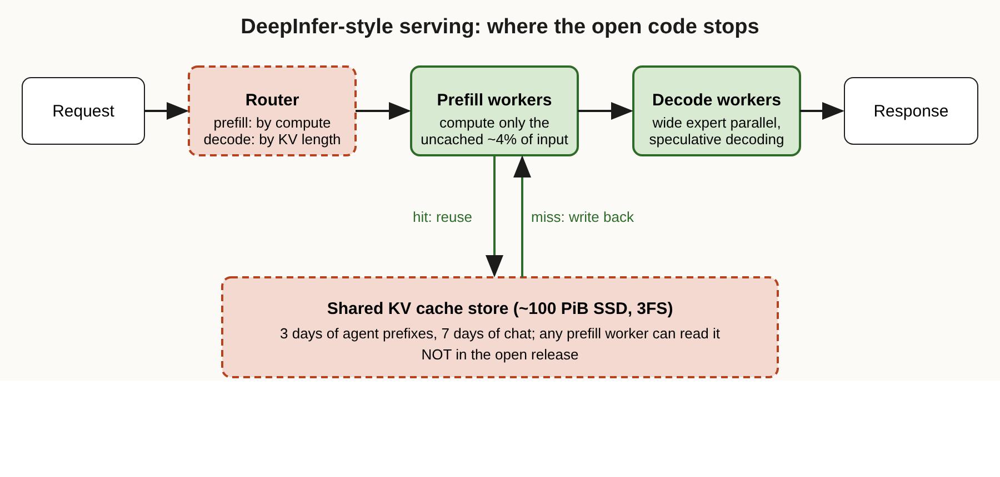

# Title options

1. **(Recommended)** DeepInfer: what DeepSeek open-sourced, and the cache layer it kept
2. What DeepSeek's "fully open source" inference engine doesn't tell you about serving agents
3. 96% cache hits: the number behind DeepSeek's serving economics

**Subtitle:** 96% of the input tokens DeepSeek serves come from cache, and the cache store and router are the parts that aren't in the release.

---

[PRAVEEN: 1-2 sentences, optional. Have you watched an agent's bill or latency balloon because it re-sent the same long context every turn?]

If you've run an agent in production, you've probably seen the pattern: every turn re-sends the system prompt, the repo context, the tool outputs and the whole history, and you pay to process all of it again. The model isn't the problem. The repeated prefix is.

This week DeepSeek open-sourced DeepInfer, the inference engine behind its V4.1 Flash model. According to AINews' write-up of DeepSeek's engineering report, one production cluster serves 155 trillion tokens a day, and 96% of the input tokens are cache hits.

**The engine is the part you can download. The cache is the part that makes it pay.**

I'll walk through what's in the release, what isn't, and what it means if you build on top of other people's inference.

## Where to find it

The code is the [deepseek-ai/DeepInfer](https://github.com/deepseek-ai/DeepInfer) repository (Apache-2.0). The production numbers come from DeepSeek's engineering report, which I read only through [Latent Space's AINews of October 21](https://www.latent.space/p/ainews-deepseek-deepinfer-open-source) and the TLDR AI newsletter of the same day. I did not open the report itself, so every production figure below is DeepSeek's claim as relayed by AINews, not something I checked or anyone audited.

## What this post covers

- **The problem:** why agent traffic is mostly repeated tokens
- **What's in the repo:** the engine, and what it's built on
- **How the serving path works:** router, prefill, decode and the cache store
- **The diagram:** my redraw, marking where the open code stops
- **The bridge:** a CDN analogy
- **What the evidence says:** the numbers and what vLLM reportedly found
- **Limitations I'd name:** three
- **Now I want to hear from you**

## The problem it solves

An agent doesn't send one prompt. It sends a growing transcript. Each turn repeats the instructions, the files it read, the tool outputs and its earlier answers, then adds a little more.

Computing attention state for all of that on every turn is wasteful. The standard fix is to cache the key-value (KV) state of a prefix and reuse it. The hard part is doing that at scale: the cache has to be large, it has to last longer than a user's pause between turns, and any worker has to be able to read it.

AINews reports DeepSeek's answer is a shared store of about 100 PiB of SSD that keeps agent prefixes for three days and chatbot prefixes for seven. Because the cache is shared, a prefill request doesn't have to land on the machine that served the last turn. **Takeaway: for agents, the serving problem is mostly a caching problem.**

## What's in the repo

The README describes DeepInfer as a large-scale inference framework for DeepSeek models, built largely on vLLM with ideas from SGLang and TensorRT-LLM. It currently supports DeepSeek-V4.1-Flash on NVIDIA SM100 GPUs and Huawei Ascend 950 NPUs.

The feature list reads like a serving checklist: attention data parallelism, context parallelism, MoE expert parallelism with expert load balancing, adaptive speculative decoding called DSpark, bounded sliding-window attention replay, asynchronous scheduling, batch-invariant inference and structured output.

The README is also direct about what's missing. A complete service still needs a KV cache system, prefill/decode disaggregation (it says the latter is mostly implemented in the engine) and load balancing across data-parallel replicas for prefill and decode. **Takeaway: it's an engine release, not a service release.**

## How the serving path works

The pieces below come from AINews' summary of DeepSeek's report. I'm describing the design as reported, not as I verified in code.

### Component 1. The router

Prefill and decode are scheduled differently. Prefill work is allocated by estimated attention compute rather than raw request length, with chunk sizes varied to fit a time budget. Decode routing balances the number of running requests and the accumulated KV length, because request count alone misses memory pressure.

Why it's interesting: a "tokens per batch" view of load treats a cached 100k-token prefix and a fresh one as the same.

### Component 2. Prefill workers

Because cached prefixes live in shared storage, prefill routing doesn't need cache affinity. Any free worker can fetch a prefix and compute only the new part. With a 96% hit rate, that new part is a small fraction of the input.

A second trick targets short-lived state. Sliding-window attention state stays in host memory, and when it's missing DeepSeek reports rebuilding it from only the latest 128 tokens, which it says nearly halves total prefill computation. That is an approximation, and AINews flags that its validity is model-specific.

### Component 3. Decode workers

Decode uses wide expert parallelism, spreading MoE experts across large groups of accelerators, and periodically replicates popular experts to reduce waiting from routing skew. The cost is extra memory. DSpark adapts how many draft tokens to verify, which DeepSeek reports gave a 6% throughput gain over always verifying five.

### Component 4. The cache store

This is the part not in the release. AINews describes persistent block KV in a separate 3FS storage cluster, loaded asynchronously so transfers overlap computation. The repository's own note that a KV cache system isn't included matches this. **Takeaway: the pieces that cost the most to operate are the ones kept closed.**

## The diagram

*My redraw. The original material describes components in prose; this version shows the data flow around the shared cache store and shades what the repo says it doesn't ship (router and cache store) against what it does (prefill and decode engine). The hit/miss loop is my addition.*

## The bridge

If you've run a website, you already know this. The prefill GPUs are your origin servers. The shared KV store is the CDN. The hit ratio is what decides whether you need 4% of the origin capacity or 100%.

Nobody compares CDN-fronted sites by origin server speed alone. The same applies here.

## What the evidence says

All of these are first-party claims relayed by AINews, not independently audited:

- **155T tokens/day from one cluster, 96% input cache hits.** Most of the headline is cached input. It's not 155T freshly computed tokens. Consequence: your cost depends on your hit rate, not DeepSeek's.
- **400 ms average time to first token, about 230 output tokens/s per request, 300 for coding.** Reasonable for interactive agents, but AINews notes these come through a secondary summary.
- **$38 revenue per accelerator-hour at off-peak prices.** That's revenue, not profit. AINews lists estimates using hardware costs of $5-10 an hour that land at roughly 74-87% before other costs, and notes they omit the SSD fleet, networking, idle capacity and engineering. Consequence: don't quote "80% margins" without the caveats.
- **vLLM reports decode throughput within 6% of DeepInfer on GB200 in a matched configuration.** This is relayed only by AINews and comes from a competing engine team. It suggests the engine isn't unreachable, but it says nothing about the cache and routing, which AINews points out.

Ranking what matters: cache hit rate first, routing and cache locality second, decode-engine tuning third. That ordering is my reading of the numbers, not DeepSeek's.

## Limitations I'd name

1. **"Fully open source" overstates it.** DeepSeek's announcement uses that label, while the repo lists the cache system and load balancing as not included. You can run the engine; you can't reproduce the service.
2. **I haven't seen the primary report.** Every production number here comes through a newsletter summarising community translations and posts. Until you read the report, treat them as claims.
3. **The economics lean on a cache-heavy workload.** A 96% hit rate suits long agent sessions that resend growing context. A workload of short, unique prompts won't look like this, and the sliding-window shortcut is described as model-specific.

## Closing

The model didn't change how this works. The system around it did. The takeaway I'd keep: serving cost for agents is set by how much you avoid recomputing, and DeepSeek kept the layer that does that.

If you run agents on someone else's inference, log your own cached-token share this week and see what it is.

## Now I want to hear from you

1. What share of your agent's input tokens are cache hits today, and how do you measure it?
2. Would you pay for longer cache retention (3 days versus 30 minutes) if your sessions pause overnight?
3. If an engine release omits the cache and router, is it open enough for your team to depend on?

## References

- DeepSeek, [DeepInfer repository](https://github.com/deepseek-ai/DeepInfer), Apache-2.0, 2026.
- Latent Space, [AINews: DeepSeek DeepInfer](https://www.latent.space/p/ainews-deepseek-deepinfer-open-source), October 21, 2026 (covers Oct 19-20).
- TLDR AI newsletter, October 21, 2026 (DeepInfer and the DeepSeek V4.1 Flash deployment write-up).

---

Further reading: [link to hub article]

If this was useful, follow me for a new breakdown of the AI engineering stack each day.
