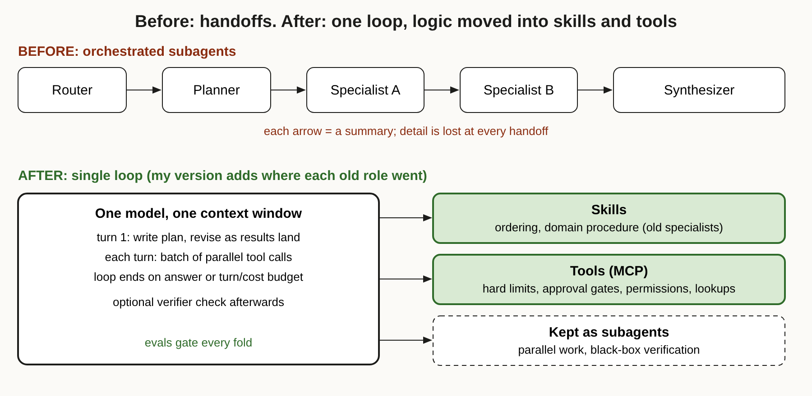

# Title options

1. **Fold the Subagents: What Anthropic's single-loop advice means for your agent architecture** (recommended)
2. What the docs don't tell you about "agent folding"
3. One loop, many skills: the missing layer between your router and your model

**Subtitle:** One customer's agent ran about 2x faster as a single loop, and a separate study cut review cost 97.7% without touching the task. The common thread is the harness, not the model.

---

If you've built a multi-agent system, you've probably watched a detail die in a handoff. The router summarised the request, the planner summarised the router, and by the time the specialist saw it, the shipping date was gone. [PRAVEEN: 1-2 sentences, optional. Have you seen a handoff drop context in your own agent work?]

Here is the number that made me stop. According to Anthropic, one customer found a single agent loop ran about 2x faster than its multi-agent harness. And AI21 reported cutting the cost of GitLab Duo Code Review from $0.589 to $0.0135 per pull request, mostly by changing the harness around the model.

The model didn't change. The architecture around it did.

## Where to find it

- Anthropic, *Building agents: When to fold subagents into your main agent loop*, Diane Sarkis, claude.com, October 22, 2026. [Link](https://claude.com/resources/articles/building-agents-when-to-fold-subagents-into-your-main-agent-loop)
- AI21 Labs, *How we cut GitLab Duo Code Review's cost by 98%*, Stephane Benayoun, October 22, 2026. [Link](https://www.ai21.com/blog/gitlab-case-study/)

## What this post covers

- **The problem**: why orchestrated subagents leak context
- **How a single loop works**: the pattern, step by step
- **Where the old logic goes**: skills, tools and code
- **How to migrate**: evals first, then fold one at a time
- **The bridge**: a feedback-controller view
- **What the evidence says**: the 2x claim and AI21's cost table
- **Limitations I'd name**: three
- **Questions for you**

## The problem it solves

Anthropic's article starts from a common enterprise pattern: an agent made of a router, a planner, and several domain subagents, each with its own context, tools and instructions. Anthropic's Applied AI team says that in several deployments, folding these into one main loop improved quality and cut cost and latency.

The failure modes it lists will look familiar. Details get lost in handoffs. Subagents multiply with no clear owner. Every team adds rules to its own prompt, and the rules conflict. Teams run evals on their own subtask, so leadership sees diluted scores. One company with a dozen specialist subagents struggled to keep a consistent brand voice.

The article ties this to Conway's law: the agent architecture ends up mirroring the org chart.

**Takeaway: if your agent diagram looks like your org chart, suspect the diagram.**

## How it works: one loop

The pattern is plain. One model and one context window run an open-ended tool loop. The harness sets turn and cost budgets and write gates.

### Step 1. The plan lives inside the loop

On the first turn the model writes a plan, then revises it as results come back. The planner is no longer a separate component. It is the same agent doing the work.

### Step 2. Parallel tool calls

Each turn, the model emits a batch of tool calls. The harness runs them in parallel and returns raw results, not summaries. That is the key difference from the subagent design, where each result is compressed before the next stage sees it.

### Step 3. The loop ends on an answer or a budget

The model decides whether to call more tools, ask the user, or answer. An optional goal or verifier check can run afterward.

### The diagram

*My version adds something the article describes only in prose: where each old role went. Routing and planning disappear into the loop. Specialists become skills. Hard limits become tools. A few subagents stay.*

## Where the old logic goes

This is the part I'd bookmark. Anthropic gives each kind of logic a home:

- **Skills** hold ordering and domain procedure: how a team does the work.
- **Tools** hold hard limits like validation and approval gates, per-user permissions, and mid-conversation lookups such as memory. Tools can return readable refusals, so one loop can serve users with different access.
- **Code** still handles cheap, almost always needed steps (entity resolution is the example) and mechanical work inside tools.

Two numbers shape the design. The article says tool choice tends to degrade beyond roughly 30 to 50 tool definitions in the system prompt, so use tool search and deferred loading. And it says Claude Code's system prompt was cut by over 80% for more advanced models, partly through progressive disclosure.

**Takeaway: don't delete the logic. Move it to the cheapest place that can enforce it.**

## How to migrate without breaking things

Anthropic's order matters more than the pattern.

1. **Build task-completion evals first.** About 10 golden examples is enough to start. Grade the final message against a rubric. Track routing accuracy while an orchestrator exists; after folding, track whether the right skill loaded.
2. **Merge, then call-as-tool, then fold.** Merge specialists that chain on each other's output. Call subagents as tools so the main agent keeps the conversation. Then fold them one at a time, comparing evals with and without each.

The example worth remembering: in a sample support agent, folding one subagent cut latency but broke a shipping-date check. The main agent answered from the order lookup and never consulted the shipping specialist. The regression showed up in only one of two runs, so Anthropic says to run each task more than once.

**Takeaway: a fold is a refactor. Ship it behind tests, and run the tests twice.**

## The bridge

Think of the loop as a feedback controller. The model is the controller. Tools are sensors and actuators. Skills are the control law written down. Budgets and write gates are the safety limits.

A multi-agent pipeline, by contrast, is an open chain of controllers passing messages. Every handoff is a lossy channel.

## What the evidence says

Be careful here, because the primary source is thin on numbers. Anthropic's own article gives few quantitative results. The 2x speedup comes from one unnamed customer, and phrases like "often at lower cost" carry no figures.

That is why I paired it with AI21's study, which is independent and has a full table. On Martian's Code Review Bench (50 public PRs, 173 golden comments), AI21 measured a baseline of 46.4% F1 at $0.589 per PR, using Claude Sonnet 5 across a four-stage harness.

- Compaction alone (rule-based trimming of file context and diffs): 47.2% F1, $0.475 (-19.4%).
- DeepSeek V4 Flash on every stage: 48.4% F1, $0.086 (-85.3%).
- DeepSeek on every stage plus compaction: 47.2% F1, $0.0135 (-97.7%).

The surprise is why compaction mattered even after the model swap. The DeepSeek deployment had a 256K-token limit. Without compaction, 3 of 50 PRs overflowed it, triggering 11 fallback calls to Sonnet that made up 77% of the remaining cost. Compaction shrank the largest prompt from 480K to 109K tokens.

Practical consequence: the cheapest model only stays cheap if the harness keeps every request inside its window. In AI21's words, the model sets the price and the harness decides whether you get to use it.

The two studies are different experiments. AI21 optimised cost within a fixed four-stage pipeline; it did not test single-loop folding. I'm using it as evidence that harness choices dominate the bill, not as proof of Anthropic's claim.

## Limitations I'd name

1. **The source is the vendor.** Anthropic's article promotes its own migration kit and skills tooling, and its headline quantitative claim is one anonymous customer. Treat the direction as plausible and the magnitude as unmeasured.
2. **AI21 tuned and scored on the same 50 PRs.** The authors say so themselves. Generalisation to other codebases is untested, and GitLab has since moved Duo Code Review to Sonnet 5.5, so the exact settings are already dated.
3. **The advice has an expiry date.** Anthropic says architecture advice shifts as models improve, and ties part of the argument to models since Opus 4.5 handling more in one loop. A weaker model may still need the scaffolding you're about to delete.

## Closing

The thesis again: the value isn't in how many agents you wire together. It's in what the loop around one model lets it see, do, and be stopped from doing.

If you remember one thing, remember the shipping-date regression. Folding made things faster and quietly broke a rule that used to pass.

Before you delete your next subagent, write the one test that proves the rule it enforced still holds, and run it twice.

## Now I want to hear from you

1. Which of your subagents exist because of a real context limit, and which because of how your teams are organised?
2. If you folded your busiest specialist into a skill tomorrow, what is the one must-not-break rule you'd write the eval for?
3. At what tool count did tool selection start failing for you, and did tool search fix it?

## References

1. Sarkis, D. *Building agents: When to fold subagents into your main agent loop.* Anthropic (claude.com), October 22, 2026. https://claude.com/resources/articles/building-agents-when-to-fold-subagents-into-your-main-agent-loop
2. Benayoun, S. *How we cut GitLab Duo Code Review's cost by 98%.* AI21 Labs, October 22, 2026. https://www.ai21.com/blog/gitlab-case-study/
3. TLDR Dev newsletter, October 23, 2026 (how I found both items).

---

**Further reading:** [link to hub article]. If this was useful, follow for a daily practitioner's read on AI engineering.
