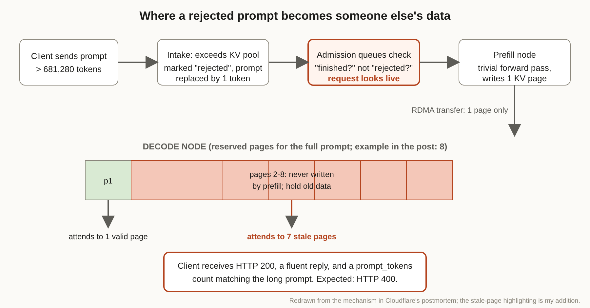

# Title options

1. **The Workers AI KV Cache Leak: how a rejected prompt came back as someone else's data** (recommended)
2. What Cloudflare's GLM-5.3 postmortem teaches anyone serving long-context models
3. A 200 that should have been a 400: the KV cache page bug behind 155 leaked responses

**Subtitle:** A cache pool 65% the size of the context window, a status code that said "success," and 155 responses that carried other customers' data.

---

[PRAVEEN: 1-2 sentences, only if true: have you ever shipped an LLM endpoint where tests passed on status codes but nobody read the outputs?]

If you've run a model behind an API, you've written the test that sends a huge prompt and checks for a 200. It passes, you move on, and you feel fine about long context.

Cloudflare ran that test too. On Workers AI, GLM 5.3 was deployed with a 1,048,576-token context window but a KV cache pool of only 681,280 tokens, and the long-context tests came back successful. According to Cloudflare's postmortem, 155 responses between August 27 and September 9 exposed data from other customers.

**The model didn't leak. The memory around it did.**

## Where to find it

*Cross-Request KV Cache Exposure in GLM-5.3 on Workers AI*, Cloudflare blog, coordinated publication October 26, 2026: https://blog.cloudflare.com/kv-cache-exposure-remediation/. I also read the public SGLang issue and pull request history that touches the same failure (references below).

## What this post covers

- **The setup:** why a pool smaller than the context window mattered
- **The bug:** how a rejected request kept moving through the system
- **The diagram:** my redraw of the failure path, with the stale pages marked
- **The bridge:** why this is an old memory-safety bug in new clothes
- **The evidence:** the timeline, the numbers, and what Cloudflare changed
- **Limitations I'd name:** three things the public record doesn't settle
- **Closing:** the one check I'd run on your own serving stack this week

## The setup: two numbers that disagreed

Inference engines keep a KV cache: the attention keys and values for every token already processed, so each new token doesn't recompute the past. Memory for it is carved into fixed-size pages.

Cloudflare says SGLang sizes that pool from whatever GPU memory is left after loading weights. Nothing enforced that the pool agreed with the advertised context length. For GLM 5.3, the prefill GPUs held 681,280 tokens of cache while the model advertised 1,048,576. The pool was about 65% of the window.

Cloudflare noticed the mismatch before launch. Its long-context tests returned success with no error frames, and the team read that as proof the engine handled the gap. The postmortem calls this wrong: the tests checked status codes and performance, not whether the output was correct.

Takeaway: an advertised limit and a physical limit are two different numbers, and somebody has to own the gap.

## The bug: a rejected request that looked alive

The setup is disaggregated serving: prefill (read the prompt) runs on one set of nodes, decode (generate) on another, with the KV cache moved over RDMA through Mooncake.

When a prompt exceeded the pool, SGLang marked the request rejected and swapped the prompt for a single placeholder token. On one node that works: you get an error.

In disaggregated mode, per Cloudflare, the admission queues asked whether a request was *finished*, not whether it was *rejected*. The rejected request still looked live. Prefill ran a trivial forward pass and shipped one page of cache.

Meanwhile the decode node had reserved pages for the full prompt. Cloudflare's example uses eight. It got a transfer-complete signal, started generating, and attended over the seven pages prefill never wrote. Those pages held whatever earlier requests left behind, including other users' prompts and outputs.

The client saw HTTP 200, a coherent reply, and a `prompt_tokens` count matching the long prompt. Nothing looked wrong.

Takeaway: the failure produced a *plausible success*, which is the one failure mode status-code tests cannot see.

## The diagram

*Figure 1. My redraw of the failure path described in Cloudflare's postmortem. My version adds what the prose leaves implicit: the decode node's reserved-but-unwritten pages, drawn in red, and the gap between "one page transferred" and "eight pages read." The page counts use Cloudflare's eight-page example.*

## The bridge

If you've written C, you already know this bug. Allocate a buffer, don't zero it, read past what you wrote. The allocator hands you memory with a previous tenant's data in it.

Here the buffer is a KV page, the "allocation" is decode's page reservation, and the unwritten read is attention. The model is the innocent party. It faithfully attends to whatever memory it's pointed at.

(That mapping is my analogy, not Cloudflare's. The public SGLang bug report describes the symptom as decode generating from incomplete KV cache; the stale-data angle is Cloudflare's finding.)

## What the evidence says

Here's the timeline Cloudflare published, in UTC:

- **Aug 27:** GLM 5.3 launches with the undersized pool.
- **Sep 8, 23:11:** Gadi Evron of Knostic reports it through HackerOne.
- **Sep 9, 13:22:** incident declared; the leak reproduced within 25 minutes using two accounts.
- **Sep 9, 14:00:** model set private, oversized requests return HTTP 400.
- **Sep 9, 14:35:** root cause identified; **19:40:** model back to public.

That's roughly 20 hours from report to restore. Cloudflare found no evidence of deliberate exploitation; the affected request timing and volume matched ordinary long-context use.

The independent trail matters because it shows the engine bug predates the incident. SGLang issue #30233, filed July 6, describes aborted prefill requests causing decode to generate garbage from incomplete KV cache, with a reproduction where a 284,937-token prompt exceeded a 284,922-token limit by 15 tokens. Cloudflare says it found that issue while investigating.

What Cloudflare changed, ranked by how much I think each matters:

1. **Size the pool to the context window.** The prefill pool now holds about 2.04 million tokens, roughly twice the context length, so valid requests never reach the rejection path. Consequence: you pay for GPU memory you "waste," and you remove the whole bug class from the happy path.
2. **Patch the rejection path.** Rejected requests are now retired at the disaggregation admission queue with their original error, before any allocation or transfer. The related upstream PR #38935 reports the decode side previously waited out a 300-second timeout in a test, and now returns a 400 immediately.
3. **Defence in depth.** Deferred KV page release, bounded Mooncake transfer batches, load-balancer changes so disconnects don't abort mid-transfer, deployment checks, and per-transfer KV checksums behind a flag.

Takeaway: the cheap fix is arithmetic; the durable fix is making the wrong state unrepresentable.

## Limitations I'd name

**1. It's a self-report with no outside audit that I could find.** The count of 155 comes from Cloudflare. I found no independent press coverage or third-party verification, only the public SGLang tracker. That's normal for a postmortem, but it is one party's account of its own incident.

**2. The upstream record is muddy.** Issue #30233 was closed by an inactivity bot on September 5, three days before Evron's report. And in PR #38935, the author states the stale-KV symptoms predate an earlier fix and don't reproduce on main, while the PR's own stated purpose is avoiding wasted work and latency. Cloudflare lists that PR among its upstream fixes. From public pages alone, I can't tell you which commit closed the data-exposure path. Check the version you run, not just the PR titles.

**3. The post leaves the blast radius soft in the parts I retrieved.** It gives the number of responses and the prompt-length threshold, but I didn't see what kinds of data were exposed or how many customers were affected. "155 responses" is a count of leaks, not of consequences.

## Closing

Everyone will remember "KV cache leak." The sturdier lesson is smaller: the system said 200 and was wrong, and the only test that would have caught it was one that read the answer.

Your harness (limits, admission checks, page ownership, output tests) is part of the product. The model is the component that did exactly what it was told.

If you serve models yourself, this week: print your KV pool size from engine startup logs, compare it to your advertised context length, and add one test that sends an oversized prompt and asserts the *error*, not just the absence of a crash.

## Now I want to hear from you

1. Do your long-context tests assert on the content of responses, or only on status and latency? What would it take to add a canary that checks content?
2. Cloudflare sized its pool at about twice the context window. Is paying for that headroom the right trade for your workload, or would you rather enforce the limit at the proxy?
3. Disaggregated prefill/decode splits page ownership across machines. Who owns correctness of that handoff on your team: the engine, the platform, or nobody?

## References

1. Cloudflare. "Cross-Request KV Cache Exposure in GLM-5.3 on Workers AI." Cloudflare blog, October 26, 2026. https://blog.cloudflare.com/kv-cache-exposure-remediation/
2. SGLang issue #30233, "PD disaggregation: aborted prefill requests (input too long) cause decode to generate garbage from incomplete KV cache," opened July 6, 2026. https://github.com/sgl-project/sglang/issues/30233
3. SGLang PR #38935, "[PD] Do not admit intake-rejected requests to a PD handoff," merged September 16, 2026. https://github.com/sgl-project/sglang/pull/38935
4. SGLang PR #36988, "[VLM] Retire aborted disaggregated prefill results," merged September 6, 2026. https://github.com/sgl-project/sglang/pull/36988
5. TLDR Dev, October 27, 2026 (how I first saw the story). https://tldr.tech/dev

---

**Further reading:** [link to hub article]. If this was useful, follow for a daily practitioner read on the systems around the models.
