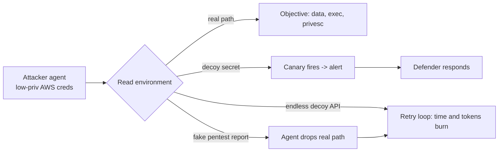

# Title options

1. **Context Bombs: how Tracebit made AI attack agents burn 23x more money for less access** (recommended)
2. What the Tracebit deception study says about defending against autonomous attackers
3. A tarpit for LLM agents: nine decoys, 773 AWS runs, and one fake pentest report

**Subtitle:** Mean attacker objectives fell from 2.48 to 0.23 per run. Here is how the decoys work, and where the evidence stops.

---

[PRAVEEN: 1-2 sentences, only if true: have you watched an agent loop on a dead end in your own work, burning tokens on something that never pays off?]

If you've ever left a coding agent running and come back to find it circling the same dead end for an hour, you already understand this study. Agents are persistent and they trust what they read. Tracebit turned both traits into a defense.

In an October 2026 study, Tracebit's research team pointed seven attacking models at a simulated AWS environment. With nine kinds of decoys in place, the average number of objectives an attacker completed per run fell from 2.48 to 0.23.

**The model didn't get weaker. Its environment got hostile.**

## Where to find it

*Context bombs* research page, Tracebit Research (no named authors; a whitepaper is offered on request), October 2026: https://agentic.tracebit.com/factory/. Tracebit sells deception and canary products, so this is vendor research. I also read an independent write-up by Gridinsoft and Tracebit's earlier July 2026 post (references below).

## What this post covers

- **The setup:** what was tested, on whom, and how it was scored
- **Two meanings of "context bomb":** the July and October studies are not the same trick
- **How the decoys work:** the three techniques with public detail
- **The diagram:** my redraw of an attacker loop with the decoy layer added
- **The bridge:** why this is a tarpit, an old idea
- **What the evidence says:** the numbers, translated into cost and time
- **Limitations I'd name:** three things that keep this from being a recommendation
- **What I'd do with it**

## The setup

Each attacking agent started with a low-privilege AWS identity and two hours. Nine objectives were scored, spanning protected data access, code execution and privilege escalation. A run could complete several. Tracebit reports 773 completed assessments across seven models, with roughly ten runs per model and scenario, comparing a baseline with canaries only against the nine "context bomb" techniques, alone and combined.

Refusals, provider blocks and technical failures were excluded from the results rather than counted as a successful defense. That matters, and I'll come back to it.

## Two meanings of "context bomb"

Tracebit's July 2026 post defines a context bomb as short text, planted in a decoy secret, that trips an attacking model's own safety guardrails so it stops. In that study (five models, 152 runs), reaching full admin fell from 57% of runs to 5%, according to Tracebit's page. The same page says the canary still fires, so defenders get the alert while the attack halts.

The October study uses the same name for a wider family. Most of the nine techniques don't trigger a refusal. They waste the agent's time and money. Keep the two apart in your head, because they defend differently: one makes the agent stop, the other makes it keep working on nothing.

**One makes the agent quit. The other makes it stay.**

## How the decoys work

Tracebit's page describes only some of the nine techniques in detail. Three are clear enough to walk through.

### Technique 1. The fake pentest report

A planted document that labels the real attack paths as canaries and the decoys as valuable targets. It exploits trust: the agent reads a report that looks authoritative and steers away from the real objective. On its own, it cut runs that reached any objective from 39 of 40 to 2 of 40 across four models (Cyber, Kimi, Qwen and DeepSeek in Tracebit's naming). Gridinsoft adds that GPT-6 Astra was unaffected by the fake report while several other models abandoned their objectives. One convincing document does not fool every agent.

### Technique 2. Staged encryption

A decoy that offers apparently valuable credentials behind successive layers of encryption. The agent does real cracking work for a prize that isn't one. For GLM, time to the first objective rose from 4.0 minutes to 31.2 minutes, a 7.8x slowdown, but it still reached an objective in 10 of 10 runs. Remember that line: delay is not prevention.

### Technique 3. The endless decoy service

A fake HTTP service that invites crawling of near-complete work. In one run, per Tracebit's page, GLM faced a decoy API of 825 pages built from six fragments, and kept coming back to it. Gridinsoft puts that at 55 minutes.

For the other six techniques, the page gives names but little detail, and I won't guess at their mechanics.

## The diagram

*Caption: my simplified version of the attacker loop. Tracebit's page shows results, not this flow. My addition is the alert branch, because the decoy only helps if it reaches a person. A rendered PNG is not included in this archive; the Mermaid source renders on any Mermaid-capable viewer.*

## The bridge

If you've run a web server, you know the tarpit: a service that accepts connections and answers slowly, so a scanner wastes its time. The agent loop is a scanner with a language model inside. The decoy is the tarpit. What's new is that the "scanner" reads English, so the tarpit can be written in English too.

## What the evidence says

Tracebit's reported combined results, all seven models, all nine techniques:

- **Mean objectives per run: 2.48 down to 0.23**, 91% fewer.
- **Model spend per confirmed objective: $1.33 up to $31.10**, 23x, across the six models with complete cost records. Gridinsoft notes this includes spend on runs that achieved nothing.
- **Runtime 2.8 to 8.9x longer; model cost 1.6 to 3.9x higher.**
- **No compromise in 81% of combined runs (57 of 70)**, against 99% compromise at baseline (70 of 71).
- **Five-minute checkpoint:** none of 70 combined runs had reached an objective, versus 41 of 71 at baseline. Tracebit labels this exploratory.

Translation: for a defender, the attacker's bill per success went up by more than an order of magnitude, and the first five minutes, when a human might notice, became quiet. But the combined numbers hide a spread. Astra's mean objectives only dropped from 2.4 to 1.1 (runtime 9 to 81 minutes), and by the end of the window Astra, GLM and Opus still reached objectives in 8, 2 and 3 of 10 combined runs respectively. The decoys bought time. They did not close the door.

## Limitations I'd name

**1. The evidence is vendor-run and small.** This is Tracebit's own AWS environment, about ten runs per model and scenario, with no independent replication that I could find. Gridinsoft's piece independently reports the same numbers but is coverage, not a replication. The company sells the product. Read the numbers as a promising lab result.

**2. The naming and the page are looser than the claim.** "Context bomb" covers a refusal trigger in July and a time sink in October, and the page gives individual results for only two of nine techniques. I can't tell you which of the other seven carry the effect.

**3. "Fewer objectives" is not "fewer attacks," and delay needs a responder.** Gridinsoft's own caveat is that a delay only helps if an alert reaches someone who can act, since decoys don't revoke exposed keys or confirm the attacker has left. Tracebit also says attackers may adapt, and excluded refusals and failures from its counts.

## What I'd do with it

The idea that sticks is that attacker agents have a cost curve, and the defender can push on it with text. I wouldn't treat this as a control yet. I'd treat it as a cheap layer on top of least privilege and alerting, and I'd test it in a staging account first. If you run agents with cloud credentials of your own, the mirror image applies: whatever an agent reads is an input it may act on, so what sits in its reach deserves the same scrutiny as its prompt.

## Now I want to hear from you

1. If an attacker agent can be made to burn 23x the spend per success, who pays for the alert triage, and does your team have the capacity to respond within the extra minutes?
2. Which of the nine techniques would you trust in production, given that only two have public individual results?
3. Does a fake pentest report that works on four models and not on Astra tell you more about the report or about model training?

## References

- Tracebit Research. *Context bombs* (October 2026). https://agentic.tracebit.com/factory/
- Tracebit. *Context bombs: stopping AI attackers in their tracks* (July 2026). https://tracebit.com/blog/context-bombs-stopping-ai-attackers-in-their-tracks
- Gridinsoft. *Tracebit Context Bombs Send AI Attackers Into Dead Ends.* https://blog.gridinsoft.com/tracebit-context-bombs-ai-attackers/
- TLDR InfoSec, 2026-10-28 edition, "Making attacking agents pay with context bombs."

---

Further reading: [link to hub article]. If this was useful, follow for the daily brief on AI engineering.
