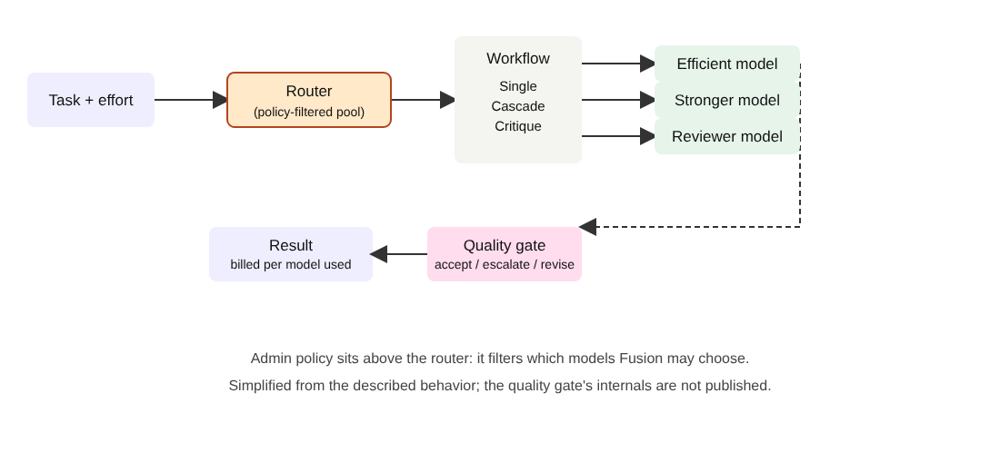

# Title options
1. **Copilot Fusion: How GitHub built a model router that nearly matches Opus at half the cost**  *(recommended)*
2. What the Copilot Fusion launch doesn't tell you about picking models
3. Copilot Fusion explained: the missing layer between your prompt and the model picker

**Subtitle:** $5.59 per task versus $11.42, for a score about two points lower — and why the model picker is turning into a runtime decision.

---

If you've ever caught yourself flipping between a cheap model for routine edits and a heavyweight for the hard bug, you've done a router's job by hand. [PRAVEEN: 1-2 sentences — how often do you switch models mid-task in your own work, and what does it cost you?]

Here's the number. Artificial Analysis benchmarked GitHub's new Copilot Fusion at its max setting and measured **$5.59 per task**, against **$11.42** for Claude Code running Opus 5.5 at max. The overall score landed about two points lower. Token use was roughly half.

**The model didn't change. The decision about which model runs did.**

## Where to find it

- GitHub changelog: [Route and orchestrate models with GitHub Copilot Fusion](https://github.blog/changelog/2026-10-28-route-and-orchestrate-models-with-github-copilot-fusion/) (Oct 28, 2026)
- Independent benchmark: [Artificial Analysis, Oct 28, 2026](https://artificialanalysis.ai/articles/github-copilot-fusion-orchestrates-anthropic-and-openai-models-to-balance-performance-and-cost)
- Context: [Microsoft's Copilot harness post](https://blogs.microsoft.com/blog/2026/10/28/introducing-the-microsoft-copilot-harness-unlocking-the-potential-of-truly-multi-model-agentic-work/) and [GitHub Universe 2026 recap](https://github.blog/news-insights/company-news/github-universe-2026-evolving-every-layer-of-the-stack/)

## What this post covers

- The problem: manual model switching and what it costs
- How Fusion works: three workflows, three effort levels
- My redrawn diagram, with the quality gate made explicit
- A bridge analogy from systems you already know
- What the numbers say, and what they don't
- Three limitations I'd name
- Questions for you

## The problem it solves

Most teams pick one model and live with it. Pick the strongest and you overpay on routine work. Pick the cheap one and you babysit hard tasks. The alternative, switching by hand, costs attention and nobody does it consistently.

GitHub's changelog frames Fusion as the fix: you choose Fusion instead of a model, and Copilot decides which models to use and how they work together for each prompt. AT&T told GitHub it removed the need to switch to stronger models for complex tasks and back for routine ones. That's a customer quote relayed by the vendor, so weigh it accordingly.

**Takeaway: model selection is overhead, and overhead is what a harness is for.**

## How it works

GitHub describes Fusion as combining two things: multi-model orchestration from Project HydraFusion and Copilot's auto model selection. From the changelog, here's the shape.

### Component 1. The effort level

You don't pick a model. You pick an effort: Standard, High, or Max. Standard targets versatile models for everyday coding; High, more capable models for harder reasoning; Max, the most capable models for the most demanding work. This is the interface choice I find most interesting. It replaces "which model?" with "how much do I care?", a question a developer can actually answer.

### Component 2. The router

For each prompt, Fusion decides the model set and the workflow. Artificial Analysis lists the pool used in its test as Claude Opus 5.5, Claude Sonnet 5.5, GPT-6 Astra and GPT-6 Sol. Admins constrain it: Fusion only draws from models enabled in enterprise and organization policy, and admins can disable a model for Fusion without disabling it elsewhere.

### Component 3. The three workflows

- **Single:** one model handles the task.
- **Cascade:** an efficient model drafts; a quality check either accepts the draft or escalates to a stronger model.
- **Critique:** one model drafts, another reviews, and the original model revises.

Why this is interesting: cascade turns cost into a conditional. You pay for the strong model only when the cheap model's output fails a check. Critique spends extra calls to buy cross-model error correction.

### Component 4. Billing

You pay each underlying model at its standard rate. No Fusion surcharge is described in the changelog, and paid plans get 30% off model costs for a limited time.

## The diagram

*Caption: My version makes the quality gate an explicit box and puts admin policy above the router. GitHub's changelog names the gate in the cascade workflow but doesn't publish its internals, so treat that box as a placeholder for "a check we can't see."*

## The bridge

Fusion is a load balancer with a retry policy. The router is the balancer, the cascade's quality check is the health check, and escalation is the failover to a bigger instance. The effort level is your SLO. If you've ever tuned an autoscaler to trade latency against spend, you already understand the knob.

## What the evidence says

Artificial Analysis tested only the max setting, in the Copilot CLI, on its Coding Agent Index v2.0, which weights three benchmarks equally.

| | Copilot Fusion (Max) | Claude Code + Opus 5.5 (Max) |
|---|---|---|
| Cost per task | $5.59 | $11.42 |
| Tokens per task | ~7.2M | roughly 2x that |
| Overall index | ~2 points lower | baseline |
| Terminal-Bench 4.0 | 71 (top of chart) | n/a in source |
| FrontierCode | 51 | 56 |

What these mean in practice:

1. **Cost.** Roughly half the spend per task. At 1,000 agent tasks a month, the gap in these figures is about $5,800. That's my arithmetic on their averages, not a measured result.
2. **Tokens.** Half the tokens means less context churn, which usually means less latency. AA didn't report time. GitHub says about 40% less time per task; that figure is the vendor's.
3. **Quality is uneven.** It leads on Terminal-Bench 4.0 and trails by five points on FrontierCode. The aggregate hides that. If your work looks like FrontierCode, the two-point headline may understate your gap.

**Takeaway: the savings are real in aggregate, but check the benchmark that looks like your work.**

## Limitations I'd name

1. **One setting, one client, no error bars.** AA tested Max in the Copilot CLI and reports no statistical uncertainty or repeat-run details. A two-point gap could sit inside run-to-run noise.
2. **Opaque routing.** Neither source breaks down which subtasks went to which model, or what the cascade's quality check actually measures. You can't tune what you can't see, and you can't audit why a task escalated.
3. **The source is also the seller.** The headline comparison is published by the vendor and a benchmarker. The AA article is independent of GitHub, but the "40% less time" and "half the tokens" claims in GitHub's changelog aren't independently confirmed in what I retrieved.

## Closing

The pattern here is bigger than one product. Microsoft's post the same day describes a harness supporting 20+ models that can route work to the best-suited one, so teams don't re-evaluate models themselves. The product being sold is the loop around the models.

Not the model. Not the prompt. The router.

If you build agents, the actionable part is cheap: log cost and outcome per task today, so you can test a cascade of your own before you adopt anyone else's.

## Now I want to hear from you

1. Would you trust a cascade's quality check on your codebase? What would you need to see in its logs?
2. Is "effort level" the right abstraction, or do you still want to pin a model for reproducibility?
3. If Fusion's 5-point FrontierCode gap matched your workload, would the 2x cost saving still win?

## References

- GitHub. "Route and orchestrate models with GitHub Copilot Fusion." Changelog, 2026-10-28. https://github.blog/changelog/2026-10-28-route-and-orchestrate-models-with-github-copilot-fusion/
- Artificial Analysis. "GitHub Copilot Fusion orchestrates Anthropic and OpenAI models to balance performance and cost." 2026-10-28. https://artificialanalysis.ai/articles/github-copilot-fusion-orchestrates-anthropic-and-openai-models-to-balance-performance-and-cost
- Schuchman, T. and Fedorov, V. "Introducing the Microsoft Copilot harness." Microsoft Blog, 2026-10-28. https://blogs.microsoft.com/blog/2026/10/28/introducing-the-microsoft-copilot-harness-unlocking-the-potential-of-truly-multi-model-agentic-work/
- GitHub. "GitHub Universe 2026: Evolving every layer of the stack." https://github.blog/news-insights/company-news/github-universe-2026-evolving-every-layer-of-the-stack/

---
**Further reading:** [link to hub article] · Follow for a daily teardown of what's actually changing in AI engineering.
