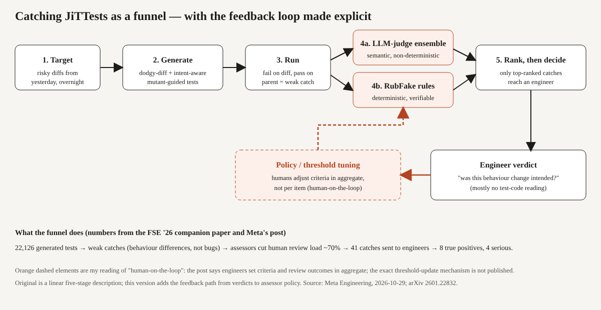

# Title options
1. **Catching JiTTests: How Meta built a bug-catching test generator that engineers actually answer**  *(recommended)*
2. What Meta's JiTTesting post doesn't tell you about LLM-generated tests
3. Catching JiTTests explained: the missing layer between test generation and a pull request

**Subtitle:** Assessors cut human review load by about 70% — and only 8 of 41 flagged diffs were real bugs. Here is why that's still a good result.

---

If you've ever had an LLM generate tests for a diff, you've probably watched most of them fail for reasons that have nothing to do with a bug. [PRAVEEN: 1-2 sentences — have you seen generated tests produce noise you stopped reading? What did it cost you?]

Here's the number. In Meta's FSE 2026 companion paper on just-in-time catching tests, rule-based and LLM-based assessors cut human review load by about **70%**. Of the 41 candidate catches that reached engineers, **8** were confirmed as real bugs, and **4** of those would have caused serious failures in production.

**The test generator isn't the product. The filter stack is.**

## Where to find it

- Paper: [Just-in-Time Catching Test Generation at Meta](https://arxiv.org/abs/2601.22832) (arXiv 2601.22832, Jan 30, 2026; FSE Companion '26). Matthew Becker and co-authors, including Mark Harman.
- Engineering post: [Catching Bugs Before They Land: JiTTesting's Human-on-the-Loop Approach at Full Scale](https://engineering.fb.com/2026/10/29/security/catching-bugs-before-they-land-jittestings-human-on-the-loop-approach-at-full-scale/) (Oct 29, 2026; Thummala, Zeng, Harman, Liu, Liu).
- Independent coverage: [InfoQ, Apr 17, 2026](https://infoq.com/news/2026/04/meta-jit-testing-ai-detection). It re-reports Meta's own material; it is not independent verification.

## What this post covers

- The problem: why a test that fails is usually not a bug
- Stages 1–3: targeting, generation, and the "weak catch"
- Stages 4–5: the two-judge filter and the human-on-the-loop decision
- My redrawn diagram, with the feedback path made explicit
- A bridge analogy from systems you already run
- What the numbers say, and what they don't
- Three limitations I'd name
- Questions for you

## The problem it solves

Most LLM-generated tests are *hardening* tests. They pass when written and guard against future regressions. A *catching* test is the opposite: it's meant to fail on a change, so the bug surfaces before the code lands.

The catch is the false positive. The paper's authors name false-positive failures as the main obstacle, because each one costs a developer time. A failing test only tells you behaviour changed. It doesn't tell you the change was wrong.

The scale makes this worse. Meta's backend runs to hundreds of millions of lines of code, according to the paper. At that size, a noisy signal is worse than none.

**Takeaway: generating failing tests is easy. Generating failing tests someone trusts is the work.**

## How it works

Meta's post describes five stages. I'll walk them in pipeline order.

### Stage 1. The Targeter

Not every diff gets tests. The system picks diffs submitted the previous day that look risky, using a mechanism the post says is similar to Meta's Diff Risk Score, and runs overnight on spare capacity. The paper says it's limited to eligible changes.

Why it's interesting: the compute budget is spent where a bug is most expensive, not spread evenly.

### Stage 2. The Generators

Two diff-aware workflows produce candidate tests.

- **Dodgy diff** treats the diff itself as a mutant, a deliberately flawed copy of the parent code. Mutation-guided LLM generation then looks for tests that tell the diff and its parent apart.
- **Intent-aware** has an LLM infer what the change is for, from the code, title, and summary. It lists the risks that intent creates, builds mutants for those risks, and generates tests meant to kill each one.

Why it's interesting: the second workflow spends tokens on *what could go wrong given what the author meant*, not just on what changed.

### Stage 3. The Runner

Generated tests run against the real diff. A test that fails on the diff but passes on the parent is a **weak catch**. The paper is careful here: a weak catch is a behavioural difference, not necessarily a bug. A **strong catch** is one that reflects unintended behaviour.

### Stage 4. The Two Judges

This is the stage I'd put on a whiteboard. Weak catches go to two assessors that fail in opposite ways.

- **LLM-as-judge ensemble.** Several LLMs read the test, the failure message and trace, the parent-to-child diff, and the inferred intent, then call it likely true or false positive. Meta's post says these judgments are non-deterministic and hard to verify.
- **RubFake.** A deterministic, rule-based assessor with verifiable verdicts.

Why it's interesting: one judge understands semantics, the other can be audited. Neither is trusted alone.

### Stage 5. The Human-on-the-Loop decision

The combined ranking decides whether to contact an engineer at all. Per Meta's post, humans are not reviewing every output. Engineers set criteria and review outcomes in aggregate, and they mainly confirm whether an observed change was intended, rarely reading test code.

**Takeaway: five stages, and four of them exist to make the fifth one cheap.**

## The diagram

*Figure 1. My redrawn version of the pipeline. Meta's post describes five linear stages. I split stage 4 into its two judges and added the dashed feedback path from engineer verdicts to assessor policy. That path is my reading of "human-on-the-loop"; the post doesn't publish the exact mechanism for updating thresholds.*

## The bridge

If you run production alerting, you already know this system. The generators are the noisy detectors. The two judges are alert deduplication and a rules engine. The engineer is the on-call who only gets paged when the score clears a bar.

Nobody tunes alerting by reading every alert. They tune the thresholds. That's what "on the loop" means.

## What the evidence says

Numbers from the paper, with what each one means for you:

- **22,126 generated tests analysed.** Code-change-aware methods produced about 4x more candidate catches than hardening tests, and about 20x more than tests that fail by coincidence. *Consequence: aiming tests at the diff matters more than generating more tests.*
- **~70% less human review load** from the assessors, per the paper's abstract. An alphaXiv summary of the paper ties this to a manual study of 600 weak catches. *Consequence: the filter stack is the main cost saver, and it's the part you can copy.*
- **41 reported, 8 true positives, 4 serious.** The paper's own sample. *Consequence: even with filtering, expect roughly one real bug per five outreach messages. Budget engineer trust accordingly.*
- **Intent-aware vs dodgy diff:** per the alphaXiv summary, at least one weak catch on 49 of 617 diffs (7.9%) versus 26 of 654 (4.0%). *Consequence: intent inference roughly doubles yield, but of weak catches, not of confirmed bugs.*

From Meta's post: 589 engineers engaged, 60% true-positive rate as reported by those engineers, 74 serious privacy bugs caught at the diff stage in the first half of 2026, and a 20% reduction in privacy SEV occurrence over the same period.

Which component matters most? The numbers don't give an ablation by stage, so I can't rank them honestly. The 70% review-load figure is the strongest evidence that the assessors carry the system.

## Limitations I'd name

1. **The blog's headline rates are self-reported and thin.** The 60% true-positive rate comes from engineers who engaged, and the post gives no precision, recall, or per-stage filter numbers. The alphaXiv summary notes that the paper's 98%-plus precision for spotting false positives is inflated by class imbalance: a classifier that calls everything a false positive scores well too.
2. **The sample behind "caught real bugs" is small.** Eight confirmed catches out of 41. The authors themselves say there are too few data points to generalise about how often bugs are severe, and that weak catches are behavioural differences, not bugs. Some statistical comparisons are uncorrected for multiple tests.
3. **It's one company's setting.** Overnight spare compute, high-risk diffs only, an early deployment. The post says the approach needs more computational steps than LLM or agent review and offers no evidence beyond Meta. Cost and latency are not reported.

## Closing

The surprise isn't that an LLM can write a test that fails. It's that Meta put the engineering into deciding which failures deserve a human. The generator can change next quarter. The assessor stack, the targeting, and the human-on-the-loop policy are what you'd keep.

The insight that sticks: **a catching test is only as valuable as the filter that decides to show it.**

If you're adding LLM-generated tests to your CI this quarter, build the cheap deterministic filter first and measure your own true-positive rate before you add a second model.

## Now I want to hear from you

1. If your team got one catching-test alert per week, what true-positive rate would keep you reading it?
2. Would you trust an LLM-judge ensemble as the only filter, or does it need a deterministic partner like RubFake?
3. Which of your repo's changes are "risky" enough to deserve overnight compute, and who decides?

## References

1. Becker, M., Chen, Y., Cochran, N., et al. *Just-in-Time Catching Test Generation at Meta.* arXiv:2601.22832, 2026; FSE Companion '26. https://arxiv.org/abs/2601.22832
2. Thummala, S., Zeng, S., Harman, M., Liu, W., Liu, E. *Catching Bugs Before They Land: JiTTesting's Human-on-the-Loop Approach at Full Scale.* Engineering at Meta, Oct 29, 2026. https://engineering.fb.com/2026/10/29/security/catching-bugs-before-they-land-jittestings-human-on-the-loop-approach-at-full-scale/
3. alphaXiv overview of arXiv:2601.22832 (used for the 600-diff study, 7.9% vs 4.0%, and precision caveat; the paper PDF could not be text-extracted in this run). https://www.alphaxiv.org/overview/2601.22832
4. Kumili, L. *Meta's JiT testing* (InfoQ, Apr 17, 2026). https://infoq.com/news/2026/04/meta-jit-testing-ai-detection

---

**Further reading:** [link to hub article] · Follow for a daily AI-engineering brief.
