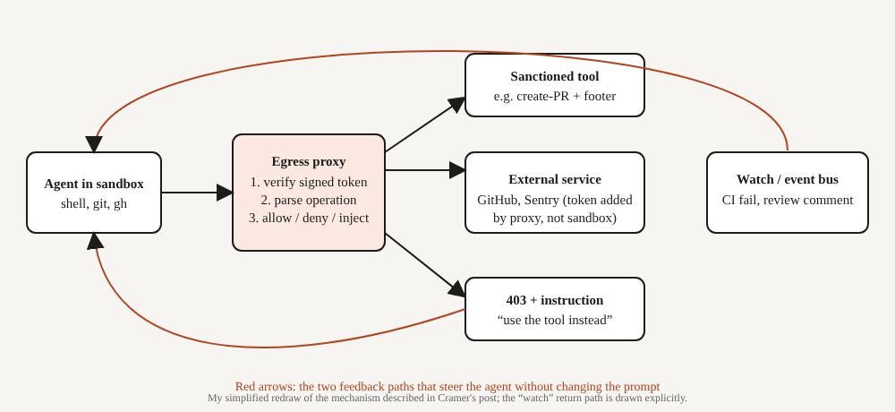

# Title options
1. **(Recommended) The Egress Proxy Pattern: How Sentry's Junior agent is steered without a single extra prompt line**
2. What the agent docs don't tell you about forcing agent behavior
3. A little determinism: the missing layer between prompts and permissions

**Subtitle:** One proxy, two feedback paths, zero benchmarks, and a pattern any team shipping coding agents can steal this week.

---

If you've ever written "ALWAYS add the footer" into an AGENTS.md file and watched the agent skip it on the third run, you know the problem. [PRAVEEN: 1-2 sentences, have you seen an agent ignore a standing instruction in your own work?]

David Cramer's answer, published October 29, is to stop asking. His open-source Slack agent, Junior, sends **every outbound request through one proxy**, and that proxy decides what actually happens.

**The model didn't change. The wiring around it did.**

The post publishes no benchmark, so I won't invent one. What it gives you is a mechanism, and the mechanism is the interesting part.

## Where to find it

David Cramer, ["A Little Determinism"](https://cra.mr/a-little-determinism), October 29, 2026. Cramer describes Junior as Sentry's internal open-source, Slack-enabled coding agent. The [repository](https://github.com/getsentry/junior) is tagged non-production.

## What this post covers

- The problem: why more constraints usually mean a weaker agent
- Module 1: the egress proxy and credential isolation
- Module 2: denial as a steering signal
- Module 3: watches, events that come back as messages
- A redrawn diagram with the feedback loops made explicit
- A bridge analogy
- What the evidence does and doesn't say
- Three limitations I'd name
- Questions for you

## The problem it solves

Cramer wants the agent to behave the way he would, without being reminded. In Junior's case, pull requests should always carry a footer and a co-author line, and feedback on those PRs (failing checks, review comments, rebases) should be handled automatically.

His view is that prompts, skills and AGENTS.md files rarely get this done reliably, and that adding constraints tends to make reasoning models less capable. So the question becomes: how do you enforce specific behavior while leaving the agent free everywhere else?

*Takeaway: if a rule must always hold, a prompt is the wrong place for it.*

## How it works

### Module 1. The egress proxy

Junior's agent works in a sandbox with a shell, git and the GitHub CLI. Every outbound request passes through a man-in-the-middle proxy before it reaches GitHub, Sentry or anything else.

Two things follow. First, the sandbox holds no tokens: the proxy checks policy and then injects the right credential. Second, the proxy can read GraphQL payloads, so it sees *which operation* is being attempted, not just which host. Each sandbox request also carries a signed, short-lived token naming the acting user, conversation and expiry. Junior's own tools declare their operation explicitly, while raw shell requests never do, which is how the proxy tells sanctioned calls from improvised ones.

Why it's interesting: the identity of the caller is established by infrastructure, not by what the model claims.

This isn't unique to Junior. Vercel's changelog describes a sandbox firewall that adds or replaces headers on outbound HTTPS requests so API keys stay outside the sandbox (I saw this in a search-result summary of the changelog, not the full page).

### Module 2. Denial as a steering signal

When the agent runs `gh pr create`, the request is a createPullRequest GraphQL mutation. The proxy rejects it with a 403. The error message is written for the model: it says to use Junior's own PR tool, which handles idempotency and the footer, and it states that this is a routing denial, not a permissions failure.

The agent reads that, retries with the right tool, and the output is predictable. The same trick handles repository selection: a clone attempted on the wrong sandbox image is rejected with an instruction to call a workspace-switching tool first. The proxy also blocks things the credentials would technically allow, such as approving a PR.

Why it's interesting: the error message is the prompt, delivered at the exact moment it's relevant.

### Module 3. Watches

The second path runs the other direction. An agent subscribes to events on a resource, and matching events are injected back into the conversation as user messages with a special marker. Junior subscribes automatically to failing CI checks, review comments, approvals, change requests, merges and closures. Cramer argues this replaces polling loops, which waste tokens.

Martin Alderson, in an independent post the same day on [making agents fast](https://martinalderson.com/posts/making-agents-fast/), makes a related point: a `sleep` loop in an agent's trace suggests it needs an async completion signal. Two authors, same conclusion, different problems.

Junior's own docs confirm the behavior from the outside: the GitHub section describes keeping a PR moving by handling CI failures, review comments and the merge ping. They don't describe the proxy or the watch internals, so the mechanism rests on Cramer's account.

Why it's interesting: the agent doesn't remember to check. The environment taps it on the shoulder.

## The diagram

*Caption: My version draws the watch path as a first-class return arrow. In the post it appears as a feature; here it is the second half of the control loop, alongside the 403 path.*

## The bridge

If you've built web backends, you already know this. The egress proxy is an API gateway. The 403 with an instruction is a validation error with a helpful message. Watches are webhooks.

The agent is just another client. You wouldn't trust a client to follow your docs; you'd enforce it at the gateway.

## What the evidence says

Honestly: very little, quantitatively. There are no benchmarks, success rates or before-and-after metrics. Cramer's evidence is that footers and co-author lines show up consistently, and that feedback handling worked without re-prompting in the cases he describes. He says the time saved from fewer context switches is large but gives no figure.

So what can you act on? Rank the three ideas by how cheaply you can test them:

1. **Credential injection.** Cheapest and the most defensible on security grounds alone. Fewer secrets in the sandbox is a win regardless of agent quality.
2. **Instructive denials.** Cheap to try for one rule you currently enforce by prompt. Measure compliance before and after.
3. **Watches.** Most infrastructure, but it directly removes polling, which Alderson's post flags as a token and latency cost.

*Takeaway: treat this as a hypothesis you can test in a day, not a result.*

## Limitations I'd name

1. **No measurements.** The post is a design report. Nothing here tells you how often the agent still routes around the proxy, or what it costs in retries.
2. **Steering, not security.** Cramer himself says the clone guard can be bypassed and that he is steering the agent, not stopping it. Don't mistake instructive denials for a hard boundary.
3. **Cost and maturity.** Cramer says running Junior costs thousands per month in inference and compute, and the repository is labelled non-production. This is a pattern to borrow, not a product to adopt.

One more caveat on my side: the proxy internals come from one author's description. I could not corroborate them from Junior's public docs.

## Closing

The thesis again: the model didn't change, the wiring did. The most reliable agent instruction I read this week isn't an instruction at all. It's a 403 with good manners.

Pick one rule your agent breaks, move it from the prompt to the boundary, and measure it.

## Now I want to hear from you

1. Which rule would you move from a prompt to an enforced boundary first, and how would you measure compliance?
2. Is an instructive 403 a hack or the right abstraction for steering agents? Where does it break?
3. If your agent used watches instead of polling, how much of your current token spend would disappear?

## References

- Cramer, D. "A Little Determinism." October 29, 2026. https://cra.mr/a-little-determinism
- Alderson, M. "Making agents fast: what I've learnt over the last 12 months." October 29, 2026. https://martinalderson.com/posts/making-agents-fast/
- Sentry. Junior repository (README). https://github.com/getsentry/junior
- Vercel. "Safely inject credentials in HTTP headers with Vercel Sandbox" (changelog; seen via search result only). https://vercel.com/changelog/safely-inject-credentials-in-http-headers-with-vercel-sandbox

---

**Further reading:** [link to hub article]

If this was useful, follow for a daily breakdown of what actually matters in AI engineering.
