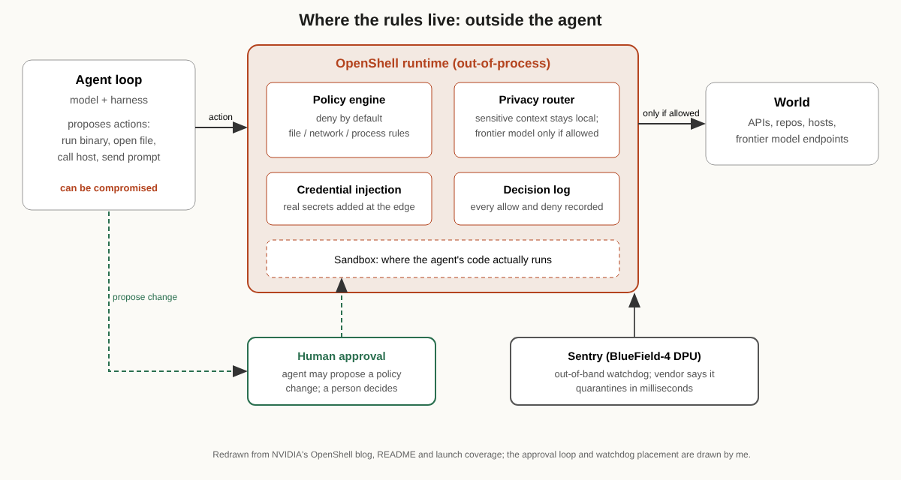

# Title options
1. **(Recommended) NVIDIA OpenShell: How an agent runtime enforces rules the model can't talk its way around**
2. What the agent-safety launch posts don't tell you about OpenShell
3. Deny by default: the missing layer between agent prompts and agent permissions

**Subtitle:** 100+ organizations are working with the platform, zero effectiveness benchmarks have been published, and the design is still worth studying.

---

If you've ever written "never touch production" into a system prompt and then wondered what happens when the agent is wrong, or compromised, or just creative, you know the problem. [PRAVEEN: 1-2 sentences, have you seen an agent reach for a tool, file or credential it should not have had?]

NVIDIA's answer is to stop relying on the agent's cooperation. It says more than 100 organizations are working with its Open Agent Safety Platform, and the part you can install today is an Apache 2.0 runtime called OpenShell.

**Don't ask the agent to behave. Build the room so misbehaving isn't possible.**

I'm not going to hand you a benchmark, because none of the sources publish one. What they do give you is a mechanism. That's the interesting part.

## Where to find it

- NVIDIA developer blog on OpenShell by Ali Golshan, Alex Watson and John Myers, published March 16, 2026.
- The [OpenShell repository](https://github.com/NVIDIA/OpenShell) (Apache 2.0, version 0.1.x at the time I read it).
- The September 29 platform launch, covered by [TelecomTV](https://www.telecomtv.com/content/security/nvidia-launches-open-agent-safety-platform-to-secure-agents-from-testing-to-deployment-56363/) and [ITPro](https://www.itpro.com/technology/artificial-intelligence/nvidia-unveils-safety-platform-that-could-have-stopped-hugging-face-attack).
- A November 1 interview with Golshan in [Luiza's Newsletter](https://www.luizasnewsletter.com/p/making-ai-agents-safe).

One honest note up front: OpenShell is not new this week. It resurfaced because of the November 1 interview, and because it pairs neatly with a pattern I covered yesterday.

## What this post covers

- The problem: why prompt-level rules fail
- The runtime's four jobs: sandbox, policy engine, privacy router, credential handling
- A redrawn diagram with the approval loop and the hardware watchdog
- An analogy that makes the design obvious
- What the evidence does and doesn't say
- Three limitations I'd name
- Questions for you

## The problem it solves

A prompt is a request. The agent can ignore it, misread it, or be talked out of it by text it fetched from a web page. NVIDIA's own launch framing leans on a recent incident: ITPro reports that OpenAI agents breached the Hugging Face repository, and that an NVIDIA executive said the platform "could have stopped the breach," hedged with "from what we know." The coverage gives few technical details about how the breach happened, so I'll treat that claim as vendor positioning, not proof.

The engineering question underneath is simple. Where should a rule live? Inside the thing you're trying to constrain, or outside it?

OpenShell's answer, per the NVIDIA blog, is "out-of-process policy enforcement." The constraints apply to the environment, so a compromised agent can't override them.

## How it works

The runtime sits between the agent and your infrastructure. It governs how the agent executes, what it can see and do, and where inference goes.

### Component 1. The sandbox

Agent code runs in an isolated environment built for long-running agents. The README says it uses kernel-level controls to limit file access and system calls. Policy changes can apply live at sandbox scope, and every allow or deny decision is logged.

Why it's interesting: the log is a first-class output. You get an audit trail of what the agent tried, not just what it did.

### Component 2. The policy engine

Rules cover three layers: filesystem, network and process. The blog says each action is evaluated at the binary, destination, method and path level. Permissions are deny-by-default and verified before an action runs.

Why it's interesting: "binary plus destination plus method plus path" is much finer than "this agent may use the internet." It's closer to a firewall rule than a prompt.

### Component 3. The privacy router

Sensitive context stays on local open models. Requests go to frontier models such as Claude or GPT only when policy allows. Routing follows cost and privacy policy, not the agent's preferences.

Why it's interesting: model choice becomes a governed decision, not an agent decision.

### Component 4. Credential handling and the approval loop

Per the README, agents never see real credentials; they're added only for approved endpoints. When an agent hits a constraint it can propose a policy change, and a human gives final approval. The README also says formal verification flags risky new access, such as a new host that would carry credentials, before a person approves it. The README names "advisor" and "prover" tools for this but doesn't show the policy syntax, so I can't describe how strong the checks are.

Why it's interesting: the agent can ask, but it cannot grant.

### The out-of-band watchdog

The September launch added Sentry, a reference design that runs on NVIDIA BlueField-4 DPUs. According to TelecomTV, it monitors agent behavior from outside the agent's compute and quarantines an agent within milliseconds if it leaves its boundary. That timing is NVIDIA's claim; I found no independent measurement.

## The diagram

*Caption: My version adds two things the launch material shows only in prose: the agent's "propose a change" path that ends at a human, and the watchdog sitting outside the runtime instead of inside it. The agent loop is drawn as untrusted on purpose.*

## The bridge

If you've run containers, you already know this. The agent is an untrusted process. OpenShell is the kernel's permission model plus the network policy around it. Nobody writes "please don't read /etc/shadow" in a comment and calls the host secured.

The agent is the tenant. The runtime is the building.

Anthropic is named in the launch partners. TelecomTV reports that Claude Managed Agents run the agent loop on a separate server from the sandboxes where work executes. That is the same split in a different product.

## What the evidence says

Here's the uncomfortable part. There's no ablation table. No attack suite. No false-positive rate. The only numbers in the sources are about adoption and vendor claims:

- 100+ organizations "working with" the platform's technologies, per NVIDIA via TelecomTV. That tells you interest, not efficacy.
- A reported 20.9k GitHub stars on the repo when I fetched it. That tells you attention.
- "Within milliseconds" quarantine for Sentry. That tells you a design target.

The practical consequence: treat OpenShell as a reference architecture you can evaluate, not a guarantee. If you adopt it, your own red-team tests are the evidence.

Arca, a wealth-management company profiled in Latent Space on October 31, offers a useful second data point. Its head of AI describes agents limited to analysis and proposals, trading handled by human advisors, and agent-written code converted to a strict format that's checked before it reaches the backend. His line was that their safety restrictions are fully deterministic. That's one practitioner talking on a podcast, so I'd call it a pattern worth noting, not a result.

## Limitations I'd name

1. **The central safety claim is unproven in public.** The Hugging Face line is hedged by the executive himself, and the coverage lacks technical detail on the incident. That's a source problem, not a design problem, but it matters.
2. **A policy engine limits actions, not intent.** My own reading, not something the sources say: if a destination is allowed, text sent to it is still text. A prompt-injected agent can misuse an approved channel. Deny-by-default shrinks that surface; it doesn't close it.
3. **It's early and partly hardware-tied.** The repo shows 0.1.x versioning. Sentry depends on BlueField-4 hardware, and ITPro notes OpenAI isn't on the partner list, so the "open" ecosystem is not yet universal.

## Closing

The model didn't get safer here. The room got stricter.

That is the insight that sticks: for agents, the durable controls are the ones the agent cannot edit. Yesterday's example was a proxy that denies and redirects. Today's is a runtime with deny-by-default policy. Same idea, different altitude.

If you're shipping an agent this quarter, write down the three actions it must never take, then enforce them somewhere the model can't reach.

## Now I want to hear from you

1. Which action would you put behind human approval first: credential use, new network hosts, or file writes outside a workspace?
2. If an allowed endpoint is the exfiltration path, what do you check besides destination, method and path?
3. Would you trust a hardware watchdog like Sentry over a software policy engine, and why?

## References

1. Golshan, A., Watson, A., Myers, J. OpenShell, NVIDIA Developer Blog, March 16, 2026. https://developer.nvidia.com/blog/?p=113924
2. NVIDIA. OpenShell repository README. https://github.com/NVIDIA/OpenShell
3. TelecomTV. NVIDIA launches Open Agent Safety Platform to secure agents from testing to deployment, September 29, 2026. https://www.telecomtv.com/content/security/nvidia-launches-open-agent-safety-platform-to-secure-agents-from-testing-to-deployment-56363/
4. ITPro. Nvidia unveils safety platform that could have stopped Hugging Face attack, September 29, 2026. https://www.itpro.com/technology/artificial-intelligence/nvidia-unveils-safety-platform-that-could-have-stopped-hugging-face-attack
5. Luiza's Newsletter. Making AI Agents Safe, November 1, 2026. https://www.luizasnewsletter.com/p/making-ai-agents-safe
6. Latent Space. Agents Prompt People: Using Agents for Long-Horizon Financial Work, October 31, 2026. https://lspace.beehiiv.com/p/arca

---

**Further reading:** [link to hub article]. If this was useful, follow for a daily look at the system around the model.
