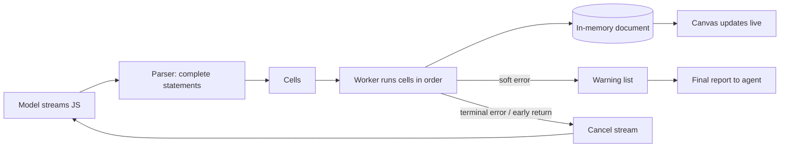

# Title options
1. **Framer Harness 2: how a design agent started running its code before the model finished writing it** *(recommended)*
2. You (probably) don't understand why agents are collapsing to one `exec` tool
3. Execute-as-you-stream: the missing layer between code generation and agent latency

**Subtitle:** Up to 33% cheaper and 20% faster per Framer, with no model change, and what the research says about why.

---

If you've built an agent that edits something real (a document, a repo, a canvas), you've watched it do the same dance. The model emits a command. You run it. The result goes back into the prompt. The model thinks again. Repeat forty times. [PRAVEEN: 1-2 sentences, have you seen agents burn turns on repetitive edits in your own work?]

Framer's new Harness 2 attacks that loop. Framer reports the agent is up to **33% cheaper and 20% faster**, and I want to be careful here: the post gives no baseline or task set for those figures. Treat them as the vendor's claim.

The model didn't get smarter. The harness stopped waiting for it to finish.

## Where to find it

- Framer engineering post, "Harness 2" (dated Nov 2, 2026 in the page header): https://framer.com/blog/harness-2/
- It builds on the paper *Executing as You Generate: Hiding Execution Latency in LLM Code Generation* (Sun et al., arXiv 2604.00491, April 2026).
- Independent framing: Phil Schmid's "code mode" post on agents collapsing toward one `exec` tool.

## What this post covers

- The problem: one command per model turn
- Module 1: from a DSL to real method calls
- Module 2: cells that run while code streams
- Module 3: early cancellation and soft errors
- Module 4: an in-memory document copy
- A redrawn diagram of the loop
- The bridge: a CPU pipeline
- What the evidence says (and doesn't)
- Three limitations I'd name

## The problem it solves

Harness 1 used a DSL. The model emitted commands to create nodes and set properties, and edits showed up as they arrived. That feels fast, but each change needed its own command. Repetitive edits, reads that feed writes, and multi-step workflows all forced a return trip to the model, according to Framer.

Every return trip costs you twice: tokens for the re-read context, and wall-clock time for another generation.

Schmid describes the same wall from the tool-calling side. Standard tool calling allows one action per turn, or a flat batch of independent calls, and each result re-enters the prompt before the model reasons about the next step. His fix is one `exec(code)` tool: the model writes a short script that chains the actions inside a sandbox.

**Takeaway:** the unit of work should be a program, not a call.

## How it works

### Module 1. Method calls instead of a DSL

Harness 2 drops the DSL for calls like `tree.get()`, `tree.patch()` and `tree.insert()`. Why this is interesting: loops, conditionals and live reads come free, because the model is now writing ordinary JavaScript. Per Framer, external agents such as Claude Code or Cursor get the same tools and can submit one MCP program that runs inside Framer.

### Module 2. Cells that run while code streams

As code streams in, the harness parses complete statements, groups them into "cells," and runs them in order in a Web Worker. Top-level `await` is transpiled so it works in classic scripts, and bindings persist across cells. Comments such as `// @step` become progress events.

Why it's interesting: users see canvas changes before generation ends. Latency is hidden behind generation instead of added after it.

### Module 3. Early cancellation and soft errors

The agent checks preconditions before dependent work. A terminal error, or an early return like "no changes needed," cancels the rest of the stream, which keeps edits already applied and saves output tokens on code that would never run. Recoverable write errors don't stop the program: the harness clamps out-of-range values, skips unsupported properties, and reports warnings at the end so the agent fixes problems without repeating successful writes.

Why it's interesting: errors are split into "keep going" and "stop now." That distinction is the whole reliability story.

### Module 4. An in-memory document copy

A copy of the document lives in the worker, so reads and writes are synchronous. That removes repeated `await`s and speeds traversal of large documents. Patches use dot-notation paths and sparse arrays to cut output tokens on nested properties.

## The diagram

*Caption: my simplified version of Framer's pipeline. I added the warning list and the cancel edge back to the model, which the post describes in prose but its timeline diagrams (labelled illustrative) don't show as a loop. Export to PNG before uploading to Medium.*

## The bridge

If you know CPU pipelines, this is the same idea. The model is the fetch stage, the worker is the execute stage, and cancellation is a pipeline flush. Overlapping stages doesn't make any single instruction faster. It stops the units sitting idle.

**Takeaway:** the speedup is overlap, not a faster model.

## What the evidence says

Two sources, very different strength.

**Framer's numbers.** Up to 33% cheaper and 20% faster; 39% fewer cached input tokens per message on average; and a tool-step reduction that the post states two ways (the intro says "2x fewer," the wrap-up says 43%) without reconciling them. The post reports no measured quality loss. I'd read these as directional.

**The research.** The Eager paper (arXiv 2604.00491) runs chunks of Python while the model is still generating. In its controlled setting it reports hiding 83-100% of execution time behind generation, with end-to-end savings of up to 35%, and it reports early error interruption lifting repair success by up to 44 percentage points on data-centric benchmarks. I retrieved these through a search summary of the abstract, and a secondary summary quoted different headline figures, so check the paper before quoting a number.

**Practical consequence.** If your agent's turns are mostly short edits, the savings come from fewer round trips. If a single generation dominates, overlap hides less. Rank the components by what they remove: fewer round trips first, early cancellation second, the in-memory copy third. That ranking is my inference from the mechanisms, not something either source measured.

For the wider pattern, Schmid cites one reported case: Factory said switching its Droid harness to code mode improved Terminal-Bench accuracy by 3.5 points and cut model spend by 15%. One case, vendor-reported.

## Limitations I'd name

1. **The headline numbers have no baseline.** "Up to 33%" says best case, and the post doesn't name the task set. The step-count figure appears as both 2x and 43%.
2. **Rollback is thin.** Cancellation keeps edits already applied, and the post describes nothing beyond that. For a design canvas that's fine. For a database or production repo it isn't.
3. **The research is a different setting.** Eager targets Python code interpreters under controlled conditions, while Framer runs JavaScript in a Web Worker. They share an idea, not a measurement. Schmid also notes his own sandbox snippet isn't secure by itself and recommends isolated runtimes for untrusted code.

## Closing

The pattern showing up in three places this week (Framer, Eager, code mode) is the same: stop making the model narrate each step, and let it hand the harness a program. Intelligence stays in the model. Latency, cost and error handling live in the system around it.

If you build agents, measure your round trips per task this week. That number tells you whether any of this helps you.

## Now I want to hear from you

1. How many model round trips does your agent make per task, and how many are pure repetition?
2. If you stream-execute model code, which errors should cancel the run and which should only warn?
3. Would you trust early cancellation on a system without cheap undo?

## References

- Framer. "Harness 2." 2026. https://framer.com/blog/harness-2/
- Sun, Z., Lin, Z., Chen, Z., et al. *Executing as You Generate: Hiding Execution Latency in LLM Code Generation.* arXiv:2604.00491, 2026. https://arxiv.org/abs/2604.00491
- Schmid, P. "Why agents are soon only going to have 1 tool" (code mode). https://www.philschmid.de/code-mode

## Further reading

[link to hub article]. Follow for the daily AI engineering brief: https://praveenjoshi01.github.io/daily-ai-brief/
