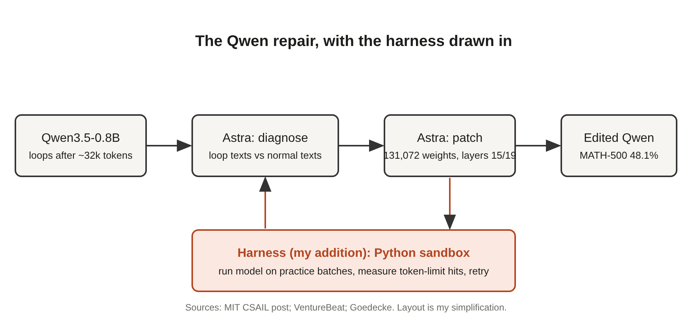

# Title options

1. **Weight-Space Programming: What GPT-6 Astra actually did to Qwen's weights** *(recommended)*
2. You (probably) don't understand the 0.016% edit that took Qwen from 7.9% to 48.1% on MATH-500
3. Weight-space programming explained: the missing layer between a model and its harness

**Subtitle:** A frontier model patched 0.016% of a small model's weights and MATH-500 jumped 6×. Here is what that number does, and does not, prove.

---

*[PRAVEEN: 1-2 sentences, optional. Have you watched a small model burn its whole token budget in a repetition loop in your own work? What did you do about it?]*

If you've run a small open model on long reasoning tasks, you've probably watched it start repeating itself and never stop. The answer was never wrong. It just never ended.

That failure is the whole story behind a result that went around on November 2: a researcher team at MIT CSAIL reports that GPT-6 Astra edited **0.016% of Qwen3.5-0.8B's weights**, and MATH-500 accuracy went from **7.9% to 48.1%**.

> The model didn't learn more math. It stopped repeating itself.

That line is my thesis, and the rest of this piece is the evidence for it, plus an honest look at what is still impressive.

## Where to find it

The primary source is the MIT CSAIL post ["Sparks of Weight-Space Programming"](https://rikiyat.github.io/blog/weight-space-programming/) by Rikiya Takehi, Jayden Teoh, Alex Zhang and Omar Khattab, published November 2, 2026. It is a blog-format research report, not a peer-reviewed paper. The authors released logs on GitHub and the edited model on Hugging Face, according to the post.

## What this post covers

- **The claim**: what the authors say Astra did
- **How the Qwen fix works**: the diagnose, patch, test loop
- **My version of the diagram**: with the harness drawn in
- **The bridge**: why this is closer to a hotfix than to training
- **What the numbers say**: what 6× really measures
- **Three limitations I'd name**
- **Questions for you**

## The claim

The authors argue that a frontier LLM can work directly on a network's weights, with no gradient descent and no optimizer, a practice they call weight-space programming. The post bundles several experiments: identifying which game a small policy network was trained on from its raw weights, fixing a stuck driving policy by changing 3.5% of its weights (0% to 100% success), writing game-playing networks from scratch, and the Qwen repair.

The Qwen result is the one that travelled. The post reports MATH-500 going from 7.9% to 48.1%, GSM8K from 13.8% to 67.1%, and IFEval from 21.0% to 62.3%.

## How the Qwen fix works

According to the post and to VentureBeat's coverage, Astra traced the model's reasoning loops to specific MLP directions and removed a direction associated with repetition from selected components in layers 15 and 19. The patch touched 131,072 weights.

### Step 1. Diagnose

Astra needed to know why a 0.8B model failed on math it should mostly handle. Sean Goedecke's analysis of the post explains the underlying problem: the model wasn't generally bad at math. It got stuck in loops after about 32k tokens, so any task needing more than that failed.

### Step 2. Find the loop direction

Goedecke describes what Astra did as essentially standard steering: write looping and non-looping reasoning texts, compare their activations, find which weights contribute to the difference, and trim the largest contributors. He links it to the abliteration technique used in the Heretic project. Astra wrote four such text pairs.

### Step 3. Patch and test

Here the harness matters. Astra had Python access for this task, and Matthew Honnibal's critique points out that it also ran the model on up to 50 batches of practice problems. VentureBeat reports the strongest attempt took 50 evaluation requests, 158 conversational turns, 80 Python runs and 20.3 hours, including 4.7 hours waiting out a service outage.

## My version of the diagram

*Caption: My version of the pipeline. The original post's headline emphasises "just looking at the raw weights". My diagram adds the part the Qwen result actually depended on: a Python sandbox and a batch-evaluation loop that tell Astra whether each candidate patch worked.*

## The bridge

If you know feature flags, this is a hotfix. The model is the deployed binary. The repetition direction is the bad code path. Astra is the engineer who finds it and patches it, and the eval batches are the smoke test before shipping.

Goedecke's version of the same idea: editing weights is like an LLM modifying compiled binaries. A neat trick, he argues, but the better route is still improving training.

## What the numbers say

The most useful number in the coverage is not 48.1%. It is the fraction of MATH-500 responses that hit the token limit: **93.0% before, 33.1% after**, per VentureBeat. That is the loop, measured directly.

What that means in practice:

- **MATH-500 6×**: the model finished far more answers. Most of the gain is completion, not new knowledge. VentureBeat's own caveat says the sixfold rise reflects reduced repetition, not six times more mathematical knowledge.
- **0.016% of weights**: tells you the edit was surgical, not that the capability is cheap. The strongest run cost 20.3 hours of agent time.
- **Where it didn't work**: the authors report Astra could not improve Gemma 3 270M, which rarely loops. Their own reading is that editing can remove obstacles to an ability but cannot add abilities a model lacks.
- **Game networks**: Honnibal notes the headline win over a PPO network trained for 500M steps holds on Breakout (517 vs 25) but not Seaquest (53 vs 89) or Asterix (53 vs 55).

Honnibal's broader point is that only some experiments (1, 2 and 4, on networks of 17K to 172K weights) used raw weights alone; the Qwen result used Python and test runs. Combining them into one story suggests a deeper unified capability than the evidence supports.

## Limitations I'd name

1. **The source is a blog post.** It is not peer reviewed, and I found no independent replication. The authors deserve credit for releasing logs and publishing failures, but the headline blends experiments with different tooling.
2. **No baseline against the obvious alternative.** Goedecke argues a skilled researcher would do the same with steering. VentureBeat notes that comparisons with specialised editing methods such as ROME and MEMIT are still needed. Until someone runs that, "better than a human" and "faster than training" are both unproven; the authors have not shown time or compute savings.
3. **One repair, one failure mode.** Looping is a clean, measurable defect. Nothing here shows the approach fixes subtler problems, generalises beyond bounded environments, or composes into repeated self-improvement. The authors did not demonstrate a self-improvement cycle.

## Closing

Strip the headline and what remains is useful: a frontier model, given a sandbox and a test loop, can locate a specific failure mode inside another model's weights and patch it. That is a real engineering capability. But the capability lives in the loop, not in the weights.

Same Qwen. Same math. Different harness around the edit.

If you build with models, take one thing from this: before you chase a bigger model for a stuck small one, measure how many of its failures are truncations and loops. Fix those first.

## Now I want to hear from you

1. If 93.0% of responses hitting the token limit dropped to 33.1% after the patch, how much of your own eval gap is truncation rather than wrong answers?
2. Would you ship a weight patch to production if you had regression tests and a rollback path, or would you retrain instead? What would change your answer?
3. The strongest run took 20.3 hours of agent time. At what point does that stop being cheaper than a short fine-tune?

## References

- Takehi, R., Teoh, J., Zhang, A., Khattab, O. "Sparks of Weight-Space Programming." MIT CSAIL, Nov 2, 2026. https://rikiyat.github.io/blog/weight-space-programming/
- VentureBeat. "Like gene editing for neural networks: MIT researchers used GPT-6 Astra to edit Qwen's open weights directly." Nov 2, 2026. https://venturebeat.com/technology/like-gene-editing-for-neural-networks-mit-researchers-used-gpt-6-astra-to-edit-qwens-open-weights-directly-boosting-math-performance
- Honnibal, M. "The 'Astra can read and write weights to improve Qwen' post is misleading." https://honnibal.dev/blog/astra-read-write-misleading
- Goedecke, S. "LLMs are not superhuman at reading and writing neural network weights." https://www.seangoedecke.com/llms-are-not-superhuman-at-reading-and-writing-neural-network-weights/

---

**Further reading:** [link to hub article]

If you build with AI systems, follow me here for a daily breakdown of the engineering behind the headlines.
