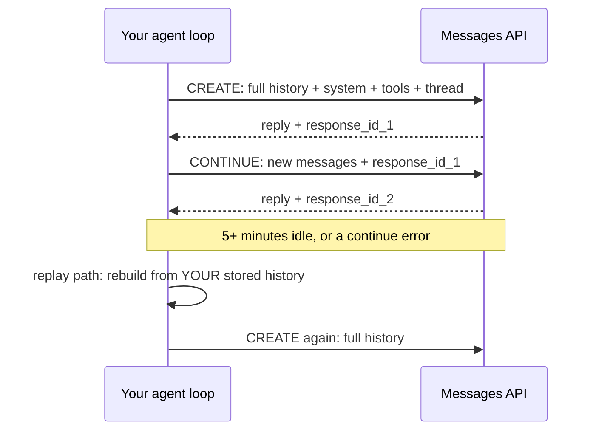

# Message Threads: How Anthropic made long agent sessions ~35% faster without touching the model

## Title options
1. **Message Threads: How Anthropic made long agent sessions ~35% faster without touching the model** (recommended)
2. What the docs don't tell you about Anthropic's message threads
3. Message threads explained: the missing layer between your agent loop and the model

**Subtitle:** Token usage stayed identical. Median time to first token fell about 35% at 500k–1M tokens. Here is what changed, what it costs you, and what to build around it.

---

If you have run a coding agent for an hour, you know the feeling. The first few turns snap back. By turn two hundred, you are staring at a spinner before a single token appears. [PRAVEEN: 1–2 sentences — have you seen long agent sessions slow down in your own work, and what did you suspect first?]

On November 2, Anthropic put a number on that delay. For requests of 500k to 1M tokens, median time to first token (TTFT) dropped about 35% for most Claude Code users, with a new API feature switched on by default. Token usage did not change at all.

**The model didn't get faster. The request got smaller.**

That is the whole story, and it is a good example of where agent performance is actually won right now: in the plumbing around the model.

## Where to find it

- Anthropic, ["Make long-running agents faster with message threads"](https://claude.com/resources/articles/message-threads) and the companion [blog post](https://claude.com/blog/message-threads), announced November 2, 2026 (public beta).
- A secondary write-up with more API detail: [Unite.AI](https://www.unite.ai/anthropic-launches-message-threads-beta-for-long-running-agents) (the page says it was written by an AI research agent and reviewed by editors; it adds no independent testing).
- Surfaced in TLDR Dev's November 5 edition.

## What this post covers

- The problem: resending the whole conversation every turn
- How a thread works: create, continue, expire
- What does not change (tokens, rates, what Claude reads)
- A redrawn diagram of the request lifecycle
- A mental model: sync versus full re-upload
- What the evidence does and doesn't say
- Three limitations I'd name
- What I'd build before turning it on

## The problem: every turn re-ships the past

A stateless chat API has a simple contract. Each request carries the full conversation: system prompt, tool definitions, every earlier message, every tool result. Anthropic's post frames the cost plainly: once a conversation reaches hundreds of thousands of tokens, resending it adds delay before Claude starts responding. A coding agent can make hundreds of requests in one session.

Computer-use agents have it worse. Screenshots ride along in the history, and with threads they stay with the thread instead of being re-uploaded, per Anthropic.

The naive fix is "make the model faster." The better question is "why are we moving 800k tokens of history over the wire to add one tool result?"

**Takeaway: in a long loop, the cost isn't the new turn. It's the old ones.**

## How a thread works

The mechanism is small, and that is the point. As described by Anthropic and detailed by Unite.AI:

### Step 1. Create
You add a `thread` parameter to a Messages API request. The first request sends the full conversation (system prompt and tools included). The API stores the conversation and Claude's reply under a response ID.

### Step 2. Continue
Each later request sends only the messages since the last response, plus that response's ID. It omits the system prompt and tools. Each new response gets a new ID, which you use for the next turn.

### Step 3. Expire
Threads live in memory, encrypted, never written to disk. A thread expires five minutes after its last request. Your client then resends the full conversation and starts a new one.

My version of the diagram adds the part the announcement only implies: the replay path.

*Caption: My version adds the replay path at the bottom. The thread is a cache on Anthropic's side; the source of truth stays in your application.*

**Takeaway: a thread is a shortcut, never the record.**

## What doesn't change

Anthropic is explicit: Claude still reads the full conversation on every turn. Token usage is unchanged. Standard token rates and rate limits apply. You are buying latency, not savings.

The sources I retrieved do not explain how the server makes the continue path faster internally, so I won't guess. What they do establish is the interface: smaller requests, same reading.

## The bridge

Think of a thread like syncing a file instead of re-uploading it. The client sends only the diff. The receiving side still ends up with the whole file, and anything that reads the file still reads all of it. That is why latency drops while token counts stay put.

## What the evidence says

There is one headline number and it comes from the vendor:

- **~35% lower median TTFT**, for requests of 500k–1M tokens, among most Claude Code users, where threads are on by default.
- **Larger contexts benefit more**, per Anthropic; short conversations will see less.
- **Cost is flat.** No token savings.

Practical consequence: if your agent regularly lives past a few hundred thousand tokens, you are likely paying a latency tax you can partly remove. If your sessions are short, this feature is mostly noise.

**Takeaway: the gain scales with context size, so measure your own p50 at your own context length.**

## Limitations I'd name

1. **The number is the vendor's, and it's narrow.** It is a median, for one size bucket (500k–1M), from Claude Code usage. I found no independent benchmark, and I did not run one. Unite.AI says its figure is Anthropic's own.
2. **You inherit new operational work.** Per Unite.AI's reading of the docs (not confirmed against the official documentation, which I did not retrieve): applications must keep their own full history; threads cannot be listed, read or deleted via the API; each response ID can be continued only once; you must wait for the stream-end event before continuing or risk a 404; and Message Batches, token counting, compaction on demand and most context editing are unsupported. Caching isn't automatic either.
3. **The source is thin on the mechanism.** Anthropic's announcement describes the request pattern but not why it is faster, and the only secondary coverage I found is derivative. Treat "35%" as a claim to reproduce, not a constant.

## Closing

The model didn't change. The contract around it did. That fits a pattern I keep writing about: the next gains in agent performance come from the harness, how it carries state, retries, and recovers, not from a bigger model.

Before you flip the switch: build a replay path that rebuilds a full request from your own stored history, and test it by deliberately expiring a thread mid-session.

## Now I want to hear from you

1. At what context length does your agent's TTFT become something users notice, and did you measure it?
2. If a thread expires mid-task, does your harness recover silently or fail loudly?
3. Would you trade automatic prompt caching for the smaller requests, or do you need both?

## References

- Anthropic. "Make long-running agents faster with message threads." claude.com, Nov 2, 2026. https://claude.com/resources/articles/message-threads
- Anthropic. Message threads announcement. claude.com/blog, Nov 2, 2026. https://claude.com/blog/message-threads
- Unite.AI. "Anthropic Launches Message Threads Beta for Long-Running Agents." Nov 2, 2026. https://www.unite.ai/anthropic-launches-message-threads-beta-for-long-running-agents
- TLDR Dev, Nov 5, 2026 (inbox newsletter; link summary).

## Further reading
[link to hub article]. If this was useful, follow for a daily practitioner's read of AI engineering news.
