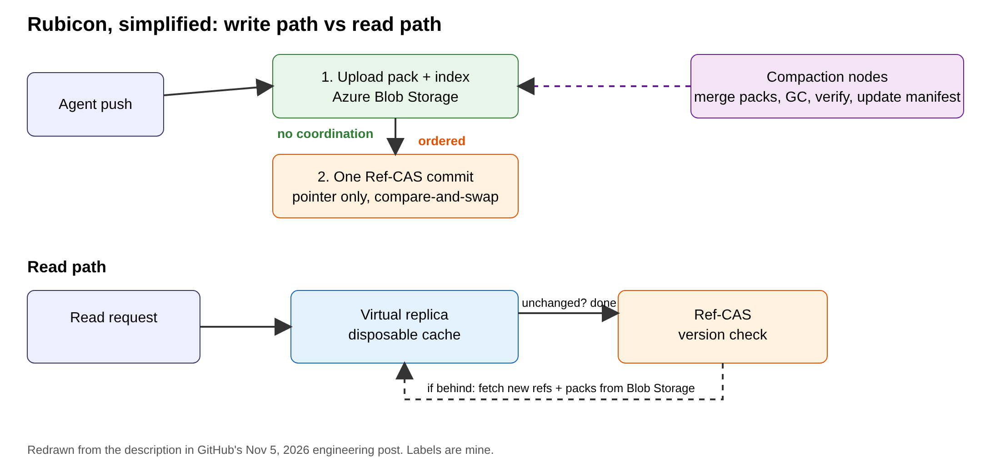

# Rubicon: How GitHub is rebuilding Git storage so 5,000 agents can push to one repo

## Title options
1. **Rubicon: How GitHub is rebuilding Git storage so 5,000 agents can push to one repo** (recommended)
2. What the docs don't tell you about Git at agent scale
3. Ref-CAS explained: the missing layer between Git objects and Git branches

**Subtitle:** In GitHub's internal tests, 5,000 concurrent agents sent 7,200 pushes per second to a single repository. Here is the design choice that makes that possible, and what it means for anyone running agent fleets.

---

If you have pointed a handful of coding agents at the same repository, you have probably watched the pushes queue up. [PRAVEEN: 1-2 sentences — have you seen parallel agents collide on pushes, merges or CI in your own work?]

On November 5, GitHub engineers Karthik Raman and Brian Celenza published the design of a new Git storage layer, internally called Project Rubicon. Their headline number: in internal testing, 5,000 concurrent agents sent 7,200 pushes per second to one repository, with reads staying consistently fast.

**Git didn't get faster. The write path stopped asking everyone to agree.**

That is the whole idea. The rest of this post is how it works, what the evidence does and doesn't show, and what I would watch before building on it.

## Where to find it

- Karthik Raman and Brian Celenza, ["Inside GitHub's new Git storage architecture"](https://github.blog/engineering/architecture-optimization/inside-githubs-new-git-storage-architecture/), GitHub Blog, November 5, 2026.
- Background: Eleanor White and Victoria Dye, ["The bridge to agent-scale Git infrastructure"](https://github.blog/engineering/architecture-optimization/the-bridge-to-agent-scale-git-infrastructure/), October 21, 2026.
- Independent coverage: Joab Jackson, ["So long, Spokes"](https://www.theregister.com/a/5302148), The Register, October 9, 2026.

## What this post covers

- **The problem:** why a quorum per repository breaks under agent load
- **The core insight:** objects need no agreement, references do
- **The components:** Blob Storage, Ref-CAS, virtual replicas, compaction nodes
- **My diagram:** the write and read paths in one picture
- **A bridge analogy** from systems you already know
- **What the evidence says**, and what it doesn't
- **Three limitations** I would name
- **What to do** if you run agent fleets

## The problem it solves

GitHub's existing system, Spokes, commits a write once a majority of replicas agree, but the October 21 post says the quorum waits for every healthy replica to respond, up to a timeout. Each write also holds a repository-wide lock until it commits, so writes to one repository are serialized. The slowest healthy replica sets latency; the lock sets the throughput ceiling. One replica sits roughly 1,000 miles away in Azure, about 25 ms per round trip, and a write needs several.

That worked when most repositories see 100 to 1,000 reads per write, which the same post says is typical. Agents change the shape. GitHub's Rubicon post says traffic to one busy repository grew about 4x between March and May 2026 and kept climbing, and The Register reports commits reached 7.38 billion in September 2026, five times the year before.

**Takeaway: the old design was built for many readers and a few careful writers. Agents are many writers.**

## How it works

The authors name two principles: minimize coordination, and decouple storage from compute. The observation underneath is simple. Most of a Git write is storing objects, and no two writers need to agree about that. Only the reference update, a small pointer saying "this branch now points here", needs an order.

### Component 1. Blob Storage for objects

Packs and indexes live in Azure Blob Storage. A writer uploads its pack first. Nothing else has to happen in agreement with anyone. Why it is interesting: durability becomes a property of the object store, not of a quorum of disks.

### Component 2. Ref-CAS for references

References and the pack manifest live in a dedicated replicated log called Ref-CAS, a per-reference compare-and-swap. It stores pointers only, never object data. After uploading a pack, the writer commits one Ref-CAS transaction. Because the pointer is written after the object is durable, a reference never points at something that isn't there. The post says this log handles tens of thousands of operations per second.

### Component 3. Virtual replicas

These are disposable compute nodes that serve reads and writes. Their local disks are caches that can be rebuilt at any time, so correctness doesn't depend on any one replica. A read compares the repo's version with Ref-CAS; if nothing changed, that check is a single comparison, otherwise the replica fetches the new references and packs.

### Component 4. Compaction nodes

Merging packs and garbage-collecting unreachable objects moves off the serving path. Compaction nodes lease shards of a repo's packs, merge them, verify the new packs contain the same objects, then update the manifest. Packs grow in tiers, so pack count and latency stay roughly flat as pushes increase.

**Takeaway: four jobs, four scaling knobs. Storing, ordering, serving and cleaning no longer share a bottleneck.**

## The diagram

*Caption: My simplified version of the Rubicon paths. I added the "no coordination" and "ordered" labels, which the original text describes but doesn't draw: the pack upload on the left needs no agreement, and only the single Ref-CAS commit on the right is ordered. Reads check one version number first.*

## The bridge

If you have used optimistic concurrency in a database, you already know this. Blob Storage is the content-addressed data plane. Ref-CAS is the control plane: a tiny table of "branch → commit" updated with compare-and-swap. Virtual replicas are stateless caches in front. The data is big and unordered; the pointer is small and ordered.

**Not a faster disk. A smaller agreement.**

## What the evidence says

The post gives a design history. A single write-ahead-log blob capped writes in the mid-hundreds per second. Splitting references across multiple blobs raised write throughput but slowed reads, since a read had to check every segment. Ref-CAS removed both limits.

Ranked by what I think matters most:

1. **Per-reference ordering.** The October 21 post reports 3-4x higher throughput at lower latency for writes to different references in internal tests, when quorums moved from the whole repository to individual references. Consequence: agents on separate branches stop blocking each other.
2. **Moving objects out of the quorum.** The Register reports a 35x write improvement for the overall rebuild, from internal tests. Consequence: that figure is the whole project, not one component, and it comes from a different stage than the 7,200 pushes per second.
3. **Flat compaction cost.** Tiered packs keep pack count roughly flat as pushes grow, so read latency shouldn't degrade over a long agent run.

**Takeaway: the evidence supports the direction. It doesn't yet support planning around specific numbers.**

## Limitations I'd name

1. **The numbers are internal and the product isn't out.** Rubicon is in limited private preview, with broader rollout planned for early next year. The Register notes the 35x figure is internal-only and that no migration timeline was given.
2. **The post doesn't give the shape of the test, in the parts I retrieved.** 5,000 agents pushing to one repository could be 5,000 branches or a handful. Per-reference ordering means a few hot branches would behave very differently from many cold ones. Also, the 35x, 3-4x and 7,200/s figures come from different posts and stages; do not stack them.
3. **Much of the agent story is still on the roadmap.** The authors list planned work: atomic multi-file commits, working without a full clone, event streams, lighter clones in Git itself. The storage layer scales; the agent-facing interface is not finished.

## Closing

The popular reading is "GitHub is adding capacity for AI." The post says something more specific: most of a write never needed agreement, and the design now stops paying for it. That insight, separate what needs ordering from what doesn't, is the thing that sticks, and it applies to any system your agents write into.

If you run agent fleets, give each agent its own branch now, and treat a shared branch as the scarce resource.

## Now I want to hear from you

1. If you run parallel agents on one repo, how many distinct branches are active at once, and where do you see contention first?
2. Would per-reference ordering change how you assign work to agents, for example one branch per task?
3. Which would you trust more for agent-written code: faster pushes, or an atomic multi-file commit API?

## References

- Raman, K., Celenza, B. "Inside GitHub's new Git storage architecture." GitHub Blog, 5 Nov 2026. https://github.blog/engineering/architecture-optimization/inside-githubs-new-git-storage-architecture/
- White, E., Dye, V. "The bridge to agent-scale Git infrastructure." GitHub Blog, 21 Oct 2026. https://github.blog/engineering/architecture-optimization/the-bridge-to-agent-scale-git-infrastructure/
- Jackson, J. "So long, Spokes: GitHub rewrites storage to restore reliability, just in time for agentic hordes." The Register, 9 Oct 2026. https://www.theregister.com/a/5302148
- TLDR Dev, 6 Nov 2026 edition (discovery only).

---

Further reading: [link to hub article]. If this was useful, follow for a daily look at the systems around the models.
