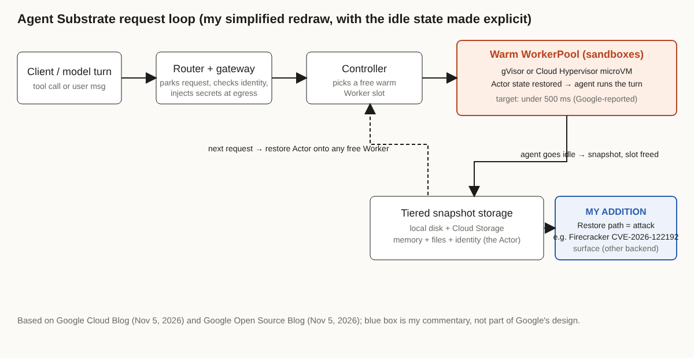

# Title options

1. **(Recommended) Agent Substrate: How Google rebuilt the Pod for agents that spend 90% of their time waiting**
2. What the Agent Substrate announcement doesn't tell you about restoring an AI agent in under 500 ms
3. Agent Substrate explained: the missing layer between Kubernetes Pods and long-running agents

**Subtitle:** Google says scale-to-zero wakes an agent in 20+ seconds and Substrate does it in under 500 ms. Here is the mechanism, the unverified numbers, and the attack surface it creates.

---

[PRAVEEN: 1-2 sentences, only if true: have you seen agent sessions hold expensive compute while doing nothing, or lose state when you scaled them to zero?]

If you have run agents behind an API, you have probably made the same bad choice I would: keep a container alive per session and pay for idle, or scale to zero and make users wait while state is rebuilt. Google's Nov 5 post puts numbers on that trade-off: agents spend 90% to 95% of their time waiting, and a scale-to-zero wake-up takes over 20 seconds. Agent Substrate, which Google says is now at 1.0, targets under 500 milliseconds.

**The model didn't get faster. The Pod stopped being the unit of an agent.**

All of those figures are Google's own. I'll flag what is and isn't verified as we go.

## Where to find it

- Google Cloud Blog, "Agent Substrate, gVisor and OpenRL join the CNCF," Drew Bradstock, Nov 5, 2026.
- Google Open Source Blog, "Sandboxing untrusted AI agents at scale," Mofi Rahman and Brandon Royal, Nov 5, 2026.
- Google Cloud Blog, "Agent Substrate on GKE," Alex Zakonov and Tim Hockin, Sep 15, 2026.

## What this post covers

- The problem: why the Pod model fits agents badly
- The three parts: Actors, Workers, Gateways
- The request loop, step by step
- Isolation choices: gVisor vs Cloud Hypervisor
- What the numbers do and don't prove
- A security note: snapshot-restore is attack surface
- Three limitations I'd name

## The problem: Pods assume a program that keeps running

Google's open-source post argues that the Kubernetes Pod model assumes a continuously running program, while an agent mostly waits on inference, APIs or a human. Two costs follow, according to the same post.

First, idle waste. Holding a Pod per active session gets expensive at scale; the post uses ten thousand active users as its example. Second, control-plane load. Reinforcement-learning and evaluation loops create thousands of short-lived sandboxes, and per-sandbox Pods can overwhelm etcd, saturate the API server and exhaust subnet IPs.

Scaling to zero fixes the bill and breaks the experience, because state has to be rebuilt. That is where the 20-second figure comes from.

*Takeaway: the cost isn't compute per second. It's compute held during waiting.*

## How it works

Google's posts describe three roles. One caveat: the Sep 15 GKE post doesn't formally define them, so some detail below comes from the Nov 5 posts.

### Component 1. The Actor

An Actor holds one agent session's state: filesystem, environment variables, memory and network rules. It also carries a discrete identity. It is the thing you keep when you stop paying for compute. The interesting design choice is that identity travels with state, so any worker can pick the session up.

### Component 2. The Worker and WorkerPool

Workers are pre-warmed Kubernetes Pods in a shared pool that provide the sandbox boundary. Because they are already running, activating an Actor doesn't pay container boot cost. Google's GKE post says the data plane does suspend and resume directly on warm workers and bypasses the normal Pod lifecycle. That bypass is the real trick: you avoid the API server on the hot path.

### Component 3. The gateway

An integrated gateway handles ingress and egress. Per the GKE post, egress proxies enforce network policy and inject credentials from outside the agent's reach. The agent never holds the key it uses. This is the same direction as the scoped-credential advice in Docker's agent-security guidance, which InfoQ summarized on Nov 4.

### The loop

1. A request arrives. The router, which the Nov 5 open-source post calls `atenet-router`, parks it if the Actor is suspended and tells the controller.
2. The controller places the Actor on a warm Worker slot.
3. State restores from tiered storage (local disk and Cloud Storage, per the GKE post).
4. The agent runs its turn.
5. When it goes idle, state is snapshotted and the slot is freed.

*Caption: My simplified redraw. I made the idle path explicit, because the snapshot and restore arrows are the whole product. The blue box is my commentary on the attack surface, not part of Google's design.*

## The bridge

Think of a game console and a save file. The Worker is the console, the Actor is the save, and the router is the "continue" button. You don't keep a console per player; you keep saves and borrow a console when someone presses play.

*Takeaway: stop thinking "one container per agent." Think "one state object per agent, compute on loan."*

## Isolation: gVisor or microVM

Agents run untrusted, model-generated code, so the sandbox matters. Google's posts say Substrate supports gVisor, a user-space kernel written in Go that intercepts system calls, and Cloud Hypervisor microVMs for workloads that need hardware virtualization. The GKE post states the trade-off plainly: microVMs give full kernel compatibility at higher overhead, gVisor is lighter but less compatible. The Nov 5 post also says Anthropic and OpenAI use gVisor to contain code execution. That is Google's statement about them, and I haven't verified it independently.

## What the evidence says

Here is what is claimed, and what each number means in practice:

- **Under 500 ms restore.** For an interactive agent, that is the gap between "feels like a tool call" and "feels like a cold start." Versus 20+ seconds for scale-to-zero, it is a ratio of roughly 40x or better, if the baselines are comparable.
- **10x density versus standard container runtimes.** If true, ten times as many sessions per node, which is the cost lever. The GKE post says the baseline and workload aren't fully specified.
- **500+ activations per second.** This bounds how many agent wake-ups the platform can absorb, which matters for bursty fleets. The same GKE post says "hundreds per second" in its architecture section, so the exact figure is soft.
- **Over 1,000 dormant agents per host** is stated in the GKE post as the zero-idle model.

*Takeaway: the shape of the claim is credible (snapshot beats rebuild). The magnitudes are unverified.*

## A security note nobody is putting in the headline

Snapshot and restore moves a lot of memory around, and that code is delicate. On Nov 4, Coinspect published CVE-2026-122192, a Firecracker guest-to-host-process escape. Per their write-up, a failed memory-mapping replacement during a balloon discard on snapshot-backed RAM left a stale KVM memory slot, so a guest root user could read and modify live VMM memory. Affected versions are v0.23.0 through v1.16.1; v1.16.2 and v1.17.0 fix it. AWS says its own services, including Lambda, are not affected.

To be clear: Substrate's documented backends are gVisor and Cloud Hypervisor, not Firecracker, and I found no evidence it is affected. The point is narrower. Any platform that restores sandboxes from snapshots is relying on memory-ownership code that most teams have never reviewed. If you build this layer yourself, put the restore path in your threat model.

## Limitations I'd name

1. **The numbers are vendor-reported.** Every performance figure comes from Google's posts. I found no published benchmark methodology, hardware or baseline. Treat 500 ms as a design target until someone reproduces it.
2. **The availability story is inconsistent.** The Nov 5 post calls Substrate generally available on GKE. The Sep 15 post says production GA support is by allowlist only, with non-production open to all GKE customers. I couldn't load the GitHub README to check its stated maturity (one secondary summary said it still says early development; I did not verify that). Check the docs before planning around it.
3. **Sandbox status is not maturity.** Substrate, gVisor and OpenRL were accepted into the CNCF Sandbox, the entry level. The Nov 5 post mentions gVisor's I/O performance depends on host kernel patches that upstream Linux hasn't merged, and says CNCF governance may open a path to that. It hasn't happened yet.

## Closing

Back to the thesis: the model didn't get faster, the Pod stopped being the unit of an agent. If a session is mostly waiting, the durable thing is its state and identity, not its container. The part I'd copy even if I never ran Substrate is the gateway pattern: keep credentials outside the thing that executes model output.

If you run agents today, measure what fraction of wall-clock your sessions spend idle before you buy any runtime.

## Now I want to hear from you

1. What share of your agent sessions' wall-clock time is actually idle, and what would a 500 ms resume save you versus keeping a warm container?
2. Would you trust a snapshot-restore path for sandboxes that run untrusted code, and what would you want audited first?
3. Do you prefer gVisor's lighter overhead or a microVM's full kernel compatibility for agent workloads, and why?

## References

- Bradstock, D. "Agent Substrate, gVisor, and OpenRL join the CNCF." Google Cloud Blog, 5 Nov 2026. https://cloud.google.com/blog/products/containers-kubernetes/open-infrastructure-for-autonomous-agents-comes-to-cncf/
- Rahman, M. and Royal, B. "Sandboxing untrusted AI agents at scale." Google Open Source Blog, 5 Nov 2026. https://opensource.googleblog.com/2026/11/sandboxing-untrusted-ai-agents-at-scale.html
- Zakonov, A. and Hockin, T. "Agent Substrate on GKE." Google Cloud Blog, 15 Sep 2026. https://cloud.google.com/blog/products/containers-kubernetes/agent-substrate-available-on-gke
- Coinspect. "Firecracker guest-to-VMM escape (CVE-2026-122192)." 4 Nov 2026. https://www.coinspect.com/blog/firecracker-escape/
- Saunders, M. "Docker urges isolation and governance for AI agent security." InfoQ, 4 Nov 2026. https://www.infoq.com/news/2026/11/docker-ai-agent-security/

---

**Further reading:** [link to hub article]. If this was useful, follow me for a daily read on AI engineering. [PRAVEEN: add your follow/newsletter CTA]
