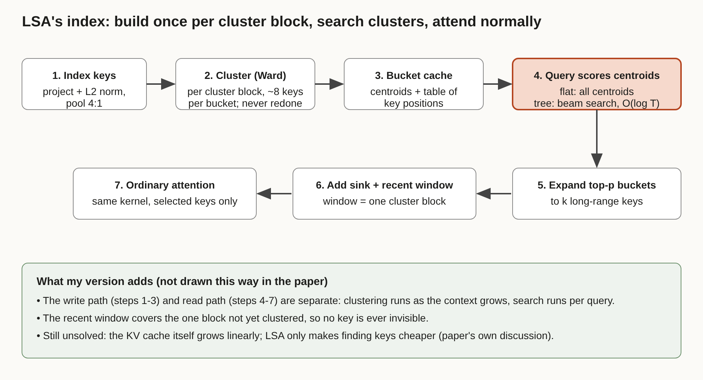

# Title options (recommended first)

1. **Latent Sparse Attention: how a clustering index made 10M-token attention 22.7x faster**
2. What the "9x faster long context" headlines don't tell you about LSA
3. Latent Sparse Attention explained: the missing index between sparse attention and long-running agents

**Subtitle:** At 10 million tokens, picking which keys to read took 98% of an attention layer's time. A retrieval-style index cuts that, and the attention kernel doesn't change.

---

If you've run a coding agent for a few hours, you've watched the context grow until everything slows down. [PRAVEEN: 1-2 sentences, only if true: have you seen first-token latency climb on your own long-running agent sessions?]

Here is the number that explains why. In a 10-million-token experiment on GLM-5.3-Flash, which already uses sparse attention, the step that *chooses* which tokens to read consumed about 98% of an attention layer's prefill time (as reported by the authors, via AlphaSignal's summary). A new paper replaces that scan with a cluster search and reports a **22.7x** faster prefill for that layer.

The attention didn't get cheaper. The *search for what to attend to* did.

## Where to find it

*Latent Sparse Attention: Towards Subquadratic Ultra-Long Context Attention*, Kubicek, Caciolai, Peng, Sumant, Hoover, Greenlee, Battleday, Urban, Hoefler and Whittington, arXiv:2610.42147 (v1 Oct 30, v2 Nov 3, 2026). AlphaSignal's coverage attributes the work to Prefrontal AI and ETH Zurich. The code is on GitHub under Apache-2.0.

## What this post covers

- **The problem:** why sparse attention still goes quadratic
- **How LSA works:** the index, step by step
- **Two ways to adopt it:** distill into a model, or train natively
- **A diagram:** my redrawn version
- **The bridge:** attention as retrieval
- **What the numbers say:** and what they cost you
- **Limitations I'd name**
- **Questions for you**

## The problem: the indexer is the bottleneck

Full attention makes every new query look at every earlier key. Double the context and the work roughly quadruples. Sparse attention fixes that by reading only a fixed budget of keys per query. But something has to pick those keys. Methods like DeepSeek Sparse Attention use a small, cheap indexer to score candidates, and others score blocks of keys instead.

The catch: if the indexer still touches every key or block, its prefill cost still grows quadratically. At 10M tokens that cost swallowed almost the whole layer. The paper's framing is that at ultra-long context, the cost of sparse attention is *finding* the keys, not attending to them.

*Takeaway: after you make attention sparse, the selector becomes the new hot path.*

## How LSA works

LSA organizes keys by content. Instead of scoring every key, a query scores a small set of cluster centroids, then reads only keys from the best clusters. Walking the paper's pipeline:

### Step 1. Prepare the index keys
Each index key is projected and L2-normalised. Consecutive keys are then summed in groups (the paper uses 4:1 pooling, as other recent sparse methods do), so clustering runs over a quarter as many items. *Why it's interesting: pooling shrinks the clustering problem before it starts.*

### Step 2. Cluster in blocks
Keys are clustered in "cluster blocks" of consecutive keys using bottom-up agglomerative clustering (Ward's method), producing buckets of roughly eight keys on average. Once a block is clustered it never changes. *Why it's interesting: clustering is append-only, so the cost is paid as the context grows, not redone per query.*

### Step 3. Cache centroids
A bucket cache stores each bucket's centroid plus a table of which key positions belong to it. The paper reports the index at 246 MiB per layer at 10M tokens for the flat variant, against 331 MiB for GLM-5.3-Flash's own indexer and 642 MiB for QSA.

### Step 4. Score centroids, not keys
The query is normalised and scored against the centroids of all earlier clusters, and the top buckets are chosen. The **Flat** variant compares against every centroid. The **Tree** variant groups buckets into a hierarchy and does beam search, so a query scores on the order of log T centroids and indexing prefill drops from quadratic to O(T log T).

### Step 5. Expand, add the safety nets, attend
Chosen buckets are expanded into key positions until a budget k is filled. The query also always reads a few initial "sink" keys and a recent window set to one cluster block, which covers exactly the keys not yet clustered. Then ordinary attention runs over that set, with one index list shared by all query heads.

*Takeaway: the repo's README puts it plainly: the attention kernel is unchanged, LSA only decides which keys it reads.*

### Two ways to adopt it
**D-LSA (distilled)** adds a learned indexer to an existing model while the model itself stays frozen. **N-LSA (native)** bakes the clustering into training with the plain next-token loss. The released repo ships distilled weights for Qwen3.8-27B and GLM-5.3-Flash plus a SGLang fork.

## The diagram

*Caption: My version of LSA's pipeline. It separates the write path (steps 1-3, run as context grows) from the read path (steps 4-7, run per query), and shows why the recent window exists: it covers the one block not yet clustered. The paper's Figure 3 shows the same components but not this split.*

## The bridge

If you've used a vector database, you've seen this. A flat scan over every vector is exact and slow. An IVF-style index clusters vectors, probes the nearest centroids and scans only those lists. LSA is that idea inside attention: the keys are the corpus, the query is the search, and the centroids are the coarse quantizer. The tree variant is the hierarchical version.

## What the evidence says

Ranked by how much each result matters to a builder:

1. **Speed grows with context.** For one GLM-5.3-Flash layer, the prefill speedup over its own sparse attention rises from 3.5x at 1M tokens to 22.7x at 10M, and is only 2.1x at 512k. Decode is up to 4.6x. *Practical consequence: if your contexts are under a few hundred thousand tokens, expect small gains.*
2. **End to end is smaller than per layer.** Time to first token improved 2.2x on GLM (time per output token 2.1x) and 9.2x on Qwen against full attention. The paper says whole-model gains are smaller because only global-attention layers speed up. *Consequence: budget for the end-to-end number, not the per-layer one.*
3. **Accuracy mostly holds.** On Qwen3.8-27B, D-LSA scores 63.9 on RULER at 10M tokens against 59.9 for full attention, and 29.1 against 19.8 on the paper's PaperTrail suite. On GLM it stays within 3 points of the baseline up to 1M tokens, and within 4 on RULER at 10M.
4. **Native training works at small scale.** A 0.5B hybrid model trained with N-LSA reached the same validation loss as full attention at 128k context (1.085 vs 1.085), while PISA, NSA and sliding window trailed at 1.100, 1.117 and 1.154. Training is 1.6x faster per attention layer at 128k, 1.24x end to end.

## Limitations I'd name

1. **The headline mixes baselines.** The 72.4x figure compares Qwen with full attention, while 22.7x compares GLM with its own sparse attention. Full attention at 10M tokens is a weak opponent. The fairer number is 22.7x, and the end-to-end gain is 2.2x.
2. **It isn't uniformly better.** On GLM, D-LSA trails its baseline by up to 8 RULER points at 2M to 5M tokens (the paper notes that baseline was trained together with the model). Tree search lost accuracy past 1M tokens there, 55.8 vs 66.8 at 10M. The paper also says that at short context the selection costs more than it saves.
3. **It doesn't touch memory growth, and native training is small.** The authors state the KV cache still grows linearly. N-LSA was tested only at about 0.5B parameters, to 128k tokens, with flat search. The repo also notes serving needs prefill CUDA graphs disabled because key selection runs on the host.

## Closing

The surprise isn't clustering. It's where the time was going. Once you sparsify attention, the system *around* the attention, the index that routes queries to keys, decides your latency. That's the same lesson as retrieval systems: the model call is rarely the part you should be optimizing first.

If you run long-context serving, benchmark the selector separately from the attention before you tune anything else.

## Now I want to hear from you

1. What share of your agent sessions' tokens sit in context longer than 500k? Is the 3.5x-to-22.7x curve relevant to you?
2. Would you trade up to 8 RULER points at 2M-5M tokens for a 2.2x faster first token?
3. Does a clustering index you can't update (blocks never change) worry you for contexts that get edited or compacted?

## References

1. Kubicek, A., Caciolai, A., Peng, L., Sumant, S., Hoover, B., Greenlee, F., Battleday, R. M., Urban, R., Hoefler, T., Whittington, J. C. R. *Latent Sparse Attention: Towards Subquadratic Ultra-Long Context Attention.* arXiv:2610.42147v2, 2026. https://arxiv.org/abs/2610.42147
2. Prefrontal AI. *latent-sparse-attention* (README, Apache-2.0). https://github.com/Prefrontal-AI/latent-sparse-attention
3. Dickson, B. "How latent sparse attention tackles the search bottleneck in long-context AI." AlphaSignal, Nov 8, 2026 (newsletter).
4. AlphaSignal. "ETH Zurich's LSA Slashes 10-Million-Token AI Processing by 72x." https://alphasignal.ai/news/eth-zurich-s-lsa-slashes-10-million-token-ai-processing-by-72x

---
Further reading: [link to hub article]. Follow for a daily AI engineering brief: [follow/newsletter link].
