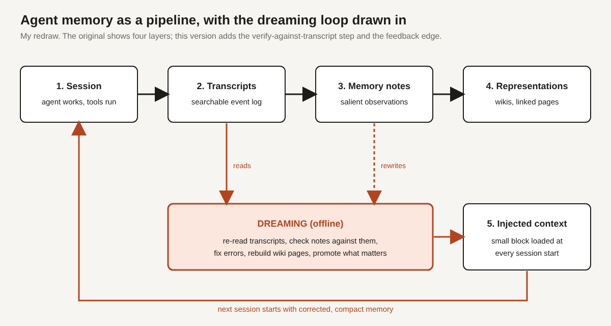

# Title options (recommended first)

1. **Dreaming: how Anthropic's agent memory actually works (and where it doesn't)**
2. What the docs don't tell you about Claude's "dreaming" memory
3. Agent memory explained: the missing layer between a transcript and a wiki

**Subtitle:** A wiki-based score climbed from 13% to 48% after 128 dreaming sessions, and it still trailed plain search. Here is what that means for anyone building agents.

---

If you've shipped an agent that "remembers" things, you've probably watched it write a confident note, trust it three sessions later, and walk off a ledge. [PRAVEEN: 1-2 sentences on a time an agent of yours trusted a stale or wrong note.]

Anthropic published a post on November 6 that puts numbers on that failure and on the fix. In one experiment, a wiki-based score over a large document corpus rose from 13% to 48% of graded criteria as the agent went from 2 to 128 "dreaming" sessions.

**The model didn't get better at remembering. The system around it learned to rewrite what it remembered.**

## Where to find it

"The components of agent memory," Lance Martin, Anthropic Engineering, published November 6, 2026: https://www.anthropic.com/research/components-of-agent-memory. Secondary coverage exists (for example [Let's Data Science](https://letsdatascience.com/news/anthropic-details-how-claude-uses-dreaming-to-organize-agent-86d1704a)), but all numbers below are from the post itself. They are Anthropic's own evaluations.

## What this post covers

- The four layers of memory the post defines, and what each is for
- What "dreaming" is and why it runs offline
- The first result: memory lifts a database benchmark, but only for models that use it well
- Why storing less beat storing more in Pokémon Red
- How wikis compare with search, and where wikis lose
- A bridge from this design to something you already run in production
- Three limitations I'd name
- What I'd build on Monday

## The problem it solves

A stateless agent re-learns the same lesson every session. The obvious fix is to let it write notes. The post shows why that alone isn't enough.

In its Pokémon Red runs, an older model wrote 413 files across 225 folders, earned one badge, and at one point spent 17 steps reorganizing its own files instead of playing. Its records went stale quickly. Fable 5, by contrast, wrote 10 files (about 43,000 characters versus about 978,000 for the older model) and earned four badges. Opus 5.5 kept a small folder of goals and next steps and beat the game.

More memory is not better memory. The unit of value is the note that is correct, small, and findable.

*Takeaway: memory has a quality problem before it has a capacity problem.*

## How it works

The post defines agent memory as knowledge gained from experience and kept between sessions. It deliberately excludes weight updates, in-context learning and compaction. What remains is a four-layer stack.

### Layer 1. Transcripts

A searchable log of what happened in the session. This is the ground truth. Everything else is a claim about it.

### Layer 2. Memory notes

Salient observations the agent writes, either mid-task or into a memory store like a folder. Cheap to write, easy to get wrong.

### Layer 3. Memory representations

Structured forms such as a wiki: linked pages that organize notes into something navigable. The post credits Karpathy's wiki idea as the concept.

### Layer 4. Injected context

A small block loaded at the start of every session. The post notes that Claude Code's auto memory loads only the first 200 lines or 25 KB of its index file, and that longer instruction files reduce adherence. The top layer has to stay small.

### Dreaming: the process that connects them

Dreaming is an offline pass where the agent reflects on logs and transcripts to correct mistakes in notes, create new notes and representations, promote key notes into injected context, and tune memory toward a goal. The post links it to sleep-time compute research (arXiv 2504.13171) and frames it as looking backward through what happened rather than predicting what comes next.

The design choice I find interesting: dreaming runs against transcripts, not against the notes. The notes are never trusted on their own.

*My version of the post's four layers. I added the feedback edge: dreaming reads transcripts, rewrites notes, rebuilds wiki pages and promotes a few items into injected context, so the next session starts from corrected memory. The original describes these pieces in prose; the loop is my reading of how they connect.*

## The bridge

If you run data systems, you already know this one.

Transcripts are the write-ahead log. Notes are rows written on the hot path. The wiki is a materialized view. Injected context is the cache. Dreaming is the nightly job that reconciles the view against the log.

Nobody trusts a cache that never gets validated against its source. Agent memory is the same rule.

## What the evidence says

I'll rank these by how much they should change what you build.

**1. Dreaming repairs wrong memory.** In the post's Mt. Moon example, a wrong note put a Pokémon Center on the wrong side of the map, and the agent fell off a one-way ledge three times. With the raw note it never reached Cerulean City. After dreaming corrected the note, the run reached Cerulean City at action 1,935. A no-memory run also never got there. Practical consequence: a bad note can be worse than no note, so pay for the correction pass.

**2. How you steer writes matters as much as whether you write.** On the CL-Bench database task, mean reward moved from 0.655 to 0.838 for Opus 5.5, and from 0.383 to 0.700 for Opus 4.7. Sonnet 4.6 barely moved (0.330 to 0.364) until it was prompted to read memory and test its theories, which took it to 0.641. A "record only failures" rule cut gains by 0.234 for Opus 5 and 0.150 for Opus 4.7. Practical consequence: tell the agent what memory is for, not a rigid recipe, and check that it reads what it wrote.

**3. Goal-focused dreaming beats a shared scratchpad.** For contract terms, several agents writing one shared table kept 41 of 57 facts (72%). One agent per contract, quoting terms verbatim, kept 57 of 57, and brief coverage rose from 72% to 100%. Practical consequence: parallel writers to one structure lose data. Shard by task.

**4. Wikis help on multi-document reasoning, not lookups.** On a 24-question merger set, wiki scored 87% versus 73% for search. On a task where the criteria sat in one document, the wiki gave no clear gain, and on another it grew to about 1.77 times the size of its source corpus. Practical consequence: don't build a wiki for single-document questions.

**5. Use both.** On a roughly 350,000-file corpus, wiki plus search went from 54% to 61%, versus 53% for search alone, and saved about 20,000 tokens per question.

*Takeaway: the wins come from correction, sharding and pairing, not from storing more.*

## Limitations I'd name

**1. The headline number still loses to a baseline.** The 13% to 48% figure is wiki-only. Plain search scored 53% on the same setup. Read the claim as "a wiki can be grown into something useful," not "wikis beat search." The combined score (61%) is the real result.

**2. It's the vendor's own evidence, on its own models.** The experiments I read are Anthropic's, run on Claude models, and dreaming is a product feature (secondary coverage reports it entered Claude Managed Agents as a research preview in May). That doesn't make the results wrong, but I haven't seen independent replication or comparison against non-Claude memory systems.

**3. Some of the most persuasive evidence is a single run.** The Mt. Moon story is a vivid example of correction working, but it is one trajectory. The post itself says memories can be wrong from the start or drift, that checking all of them may be impractical, and that dreaming needs compute. Nobody has published the cost curve I'd want before turning this on at scale.

## Closing

The insight that sticks: memory is not storage, it is maintenance. The notes are the cheap part. The loop that audits them against the transcript is where the 13% becomes 48%.

If you build one thing from this, build the audit pass before the wiki: a scheduled job that re-reads transcripts and flags notes it can't verify.

## Now I want to hear from you

1. Do you re-validate agent notes against transcripts today, or do you trust whatever was written last?
2. Would you shard dreaming per task, as in the contract example, or keep one shared memory and accept the 72%?
3. What cadence would you pick for dreaming: after every session, nightly, or triggered by how often a note is read?

## References

1. Lance Martin et al., "The components of agent memory," Anthropic Engineering, Nov 6, 2026. https://www.anthropic.com/research/components-of-agent-memory
2. Sleep-time compute, arXiv:2504.13171 (as cited in the Anthropic post).
3. Let's Data Science, "Anthropic details how Claude uses dreaming to organize agent memory." https://letsdatascience.com/news/anthropic-details-how-claude-uses-dreaming-to-organize-agent-86d1704a
4. TLDR AI newsletter, Nov 9, 2026 (summary of the post).

## Further reading

[link to hub article]

Follow for a new teardown of an AI engineering system every day.
