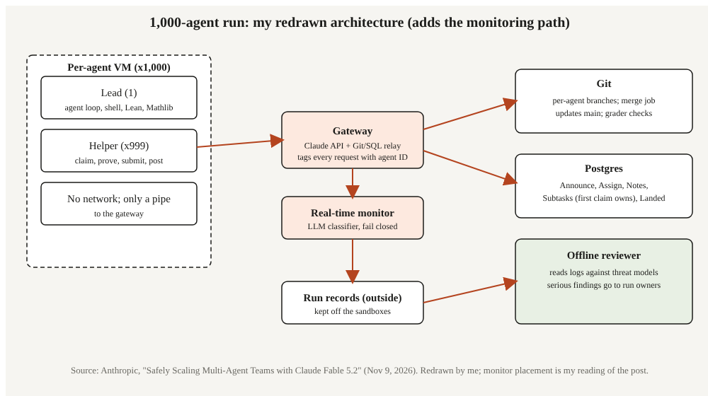

# Title options (recommended first)

1. **1,000 agents, one database: how Anthropic scaled a Fable 5.2 team to a formal proof, and what kept it contained**
2. What the docs don't tell you about running a thousand agents at once
3. Multi-agent coordination explained: the missing layer between a lead agent and a shared database

**Subtitle:** A team of 1,000 agents reproduced a formal Fermat's Last Theorem proof in 28.7 hours, down from 11 days. The model was only part of the story.

---

If you've tried to run more than a handful of agents on one task, you've probably watched them collide: duplicate work, clobbered files, a shared machine falling over. [PRAVEEN: 1-2 sentences on where your own multi-agent setup first broke, if it has.]

Anthropic published a post on November 9 that shows what the fix looked like at 1,000 agents. One lead and 999 helpers, running an early version of Claude Fable 5.2, reproduced a formal Lean proof of Fermat's Last Theorem in 28.7 hours. The September effort that did the same job took 11 days.

**The agents didn't talk to each other. The database did.**

## Where to find it

"Safely Scaling Multi-Agent Teams with Claude Fable 5.2," by Barry Zhang, Tianyi Peng, Elle Najt, Keller Scholl and Lance Martin, published November 9, 2026: https://claude.dev/blog/safely-scaling-multi-agent-teams-with-fable-5-2/. All numbers below come from that post and are Anthropic's own. The September baseline is also covered independently by [TechRadar](https://techradar.com/pro/anthropic-formalizes-fermats-last-theorem-like-never-before-using-claude-but-it-still-took-11-days-to-write-out).

## What this post covers

- **The problem it solves:** why 100 agents on one machine was the wall
- **How it works:** isolation, shared state, and the five coordination tables
- **The diagram:** my redrawn version, with the monitoring path added
- **The bridge:** what a Postgres claim table really is
- **What the evidence says:** which design choices mattered most
- **Limitations I'd name:** three honest critiques
- **Now I want to hear from you:** three questions for builders

## The problem it solves

Anthropic's September run used dozens of agents, a platform called Prove2Me, and researcher direction. It took 11 days and about 6 billion output tokens to produce 13 million lines of Lean, according to the November post. This time the team gave the agents general-purpose tools and a shared database, with no Prove2Me and no researcher steering.

The first obstacle was infrastructure. A single shared machine hit its limits at about 100 agents, and more than half of the 100-agent runs were stopped or restarted because of memory, disk or CPU exhaustion. That is the practical ceiling most of us hit first, long before the model is the problem.

**Takeaway: scaling agents is an operations problem before it is a prompting problem.**

## How it works

### Module 1. The isolation layer

Every agent got its own lightweight virtual machine: one lead, 999 helpers. Each sandbox held the agent loop's harness code, a shell, an editor, the Lean toolchain and Mathlib. Outside the sandboxes sat a gateway that called the Claude API and relayed Git and SQL requests. The only outbound link from a sandbox was a pipe to that gateway.

The interesting choice is the gateway tagging each request with the agent's identity. Agents had no messaging tools, so identity-tagged database rows were the only way one agent could speak to another, and impersonation was blocked at the pipe.

### Module 2. Shared state: Git for code, Postgres for everything else

Each agent pushed to its own branch and could open merge requests into main. A separate merge job integrated changes, refusing only on conflicts or faults, and a grader checked submissions on main. Postgres handled task claims, notes and logs. The authors chose it for transactional handling of concurrent writes and because Claude is fluent in SQL.

The database was fenced: a shared unprivileged role, a five-second limit per statement, and a refusal to accept writes above 256 MiB.

### Module 3. The five tables

The lead created five tables in the first ten minutes: an announcement table for orders to the whole team, an assignment table mapping helpers to statements, an open notes board, a subtask list where the first helper to claim an item owns it, and a log of finished work with commit and check results.

Helpers then ran a loop: find the plan in the notes, claim a subtask, write and check the Lean proof, submit to main, mark it done, post an update. By hour 5.6, 73 helpers had written 756 tasks, while only 16 were captains. Coordination was moving from the lead to the crowd.

For the hardest milestone, Langlands–Tunnell, the team built a task tree of 2,418 tasks up to ten levels deep. A helper that found a piece too big could split it, and hundreds of helpers worked in parallel by assuming the pieces below were proved.

**Takeaway: the lead set the schema once, and the helpers did the rest.**

### Module 4. The monitors

Three layers of safety sat on top, and the authors say none is sufficient alone. Sandboxing is the first. The second is a real-time check: a prompted language-model classifier screened every shell command and file edit before it ran, failing closed. A block on a helper removed only that helper, and a block on the lead would have ended the run. The third is an offline review of run records stored outside the sandboxes.

The post reports more than one million tool calls in the run, none of which met the bar for blocking in the real-time monitor.

## The diagram

*My version adds the monitoring path. The original describes the layers in prose. I drew the real-time classifier as a gate on every command, and the offline reviewer as a reader of logs that live outside the sandboxes.*

## The bridge

If you've built a job queue, you already know most of this. The subtask table is a queue with row-level claims. The notes board is your team channel, but append-only. The merge job is your CI gate. The lead is a scheduler that rewrites the plan when throughput surprises it, which it did: the lead first judged 47 of the 60 statements infeasible within budget, then reversed after early proofs came in faster than expected.

The gateway is the part most teams skip. It is your single egress proxy.

## What the evidence says

Rank the design choices by what the post lets us conclude.

**Per-agent VMs mattered most for scale.** The 100-agent wall was a resource wall, and moving to one VM per agent is what made 1,000 possible. Practical consequence: budget isolation per agent, not per run.

**The task tree mattered most for speed.** A tree of 2,418 tasks let hundreds of helpers work in parallel by assuming lower pieces were done. Practical consequence: let workers split tasks they find too big, rather than waiting for the lead.

**Crew sizing mattered later.** As the lead reassigned helpers to the last ten statements, crews grew from about 17 to between 46 and 139 helpers. Practical consequence: staffing should be dynamic.

On efficiency, the run used one-third as many output tokens as September, and the proof came out one-seventh as long. Taking the September figures, those imply roughly 2 billion tokens and 1.9 million lines. Those are my derived numbers, not ones the post states. The post does not report cost.

## Limitations I'd name

1. **It's the vendor's own toy experiment.** The authors call it a toy experiment themselves. It used an early Fable 5.2 version that may not have completed pre-release alignment assessment, and I did not find an independent replication.
2. **The comparison with September is not controlled.** The models differed, one run had Prove2Me and researcher direction, and this run was restarted from its last save near hour 18 with 12 additional hours. "One-third the tokens" is a headline, not an ablation.
3. **The live monitor only saw actions.** It could not see reasoning. The authors added a chain-of-thought monitor afterward and say it would have come close to blocking only one call. That is a replay by the same team, not an outside test.

## Closing

The model did not get smarter at proofs in the way the headline implies. The system around it gave 1,000 workers a place to claim work, a place to leave notes, and a gate on every command.

If you take one thing: define the coordination schema before you add agents. If you build one thing this week, build the claim table.

## Now I want to hear from you

1. At what agent count did a shared machine or shared repo first fail for you, and what was the limiting resource?
2. Would you trust a fail-closed language-model monitor to halt a whole team, or only the single offending agent?
3. Is a SQL table the right coordination layer for your agents, or would you prefer a queue service with leases?

## References

- Zhang, B., Peng, T., Najt, E., Scholl, K., Martin, L. "Safely Scaling Multi-Agent Teams with Claude Fable 5.2." Anthropic, November 9, 2026. https://claude.dev/blog/safely-scaling-multi-agent-teams-with-fable-5-2/
- "Anthropic 'formalizes' Fermat's Last Theorem like never before using Claude — but it still took 11 days to write out." TechRadar, 2026. https://techradar.com/pro/anthropic-formalizes-fermats-last-theorem-like-never-before-using-claude-but-it-still-took-11-days-to-write-out
- TLDR Dev, November 10, 2026 (newsletter summary that surfaced the post). https://tldr.tech/dev

## Further reading

More of my writing: [link to hub article]. Follow me for a daily read on AI engineering.
