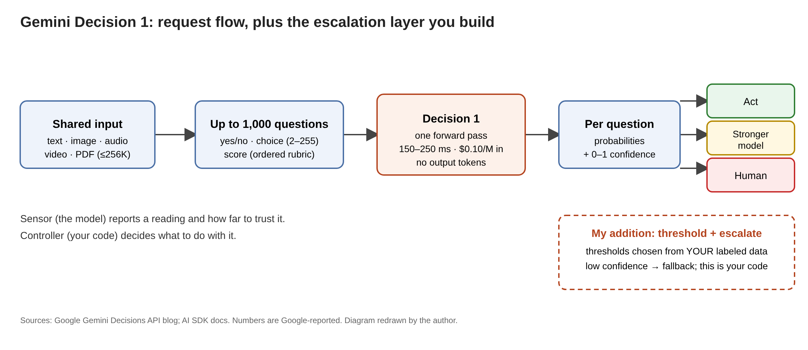

# Title options

1. **Gemini Decision 1: how Google built a model that never writes a word, and why that matters for your agent's router** *(recommended)*
2. What the Gemini Decisions API docs don't tell you about calibration
3. Gemini Decision 1 explained: the missing layer between your classifier and your LLM

**Subtitle:** 150–250 ms, $0.10 per million input tokens, up to 1,000 questions in one request. The catch is on Google's own benchmark table.

---

If you have built an agent, you have probably written a router: a prompt that asks a general model "which tool, which tier, is this allowed?" and then parses the free text that comes back. It works. It is also slow, billed by the output token, and quietly wrong in ways you only see in production. [PRAVEEN: 1–2 sentences on a routing or policy-check step in your own work that was slower or flakier than the task deserved.]

Google just shipped the opposite design. Gemini Decision 1 returns **150–250 ms end-to-end, at $0.10 per million input tokens, with no output-token charges, for up to 1,000 questions in a single request.**

> The model didn't get smarter. The job got smaller.

This post walks through how it works, what Google's own numbers say, and the three things I would check before putting it in a production path.

## Where to find it

- Google blog: "Gemini Decisions API: Fast, calibrated multimodal decisions" (model ID `gemini-decision-1`), launched Nov 11, 2026. [Link](https://blog.google/innovation-and-ai/technology/developers-tools/gemini-decisions-api/)
- Vercel AI SDK docs for `experimental_decide`, which show how the API is shaped across providers. [Link](https://ai-sdk.dev/docs/ai-sdk-core/decisions)
- Independent-ish commentary: Techzine and a Lindy review (Lindy sells a competing agent product, so read it with that in mind).

## What this post covers

- **The problem:** why generative routers are the wrong tool for closed-set questions
- **How it works:** shared input, independent questions, three question types
- **The diagram:** my version, with the escalation layer Google leaves to you
- **The bridge:** a sensor and a controller
- **What the evidence says:** calibration, cost, and where it does not lead
- **Limitations I'd name:** three of them
- **Questions for you**

## The problem it solves

Most "decisions" inside an agent are not open-ended. Is this request allowed? Which of six tools? Is this answer a 3 or a 4 on the rubric? These are closed-set questions with a handful of valid answers.

Asking a generative model them has three costs. You pay for output tokens you throw away. You pay latency for tokens produced one at a time. And you get a string that you must parse and that carries no trustworthy sense of how sure the model was.

Decision models attack all three. According to Techzine, Google is entering a market that already includes TypeSafe AI's Jev model, launched in September, and a similar OpenAI API launched the month before. Google's blog lists the target uses: tool selection, policy checks, model routing, context grading and content grading.

**Takeaway: if the answer set is bounded, generation is overhead.**

## How it works

Google's description is short, so I will walk it in pipeline order.

### Step 1. One shared input

You send a single multimodal input: text, images, audio, video or PDFs, up to 256K tokens. Image and video resolution can be turned down to trade detail for token cost. Why this is interesting: the expensive part, reading the input, happens once.

### Step 2. Up to 1,000 independent questions

Each question is scored in a single forward pass rather than generated token by token. Per the Lindy review, questions are independent: they cannot see each other's answers, so your code combines results with ordinary logic. Billing follows the same shape. Shared input is billed once, and each question adds only its own instruction and criteria tokens.

### Step 3. Three question types

- **Boolean:** a probability that a condition holds.
- **Choice:** 2 to 255 options, returning the winner and a normalized probability for each.
- **Score:** an ordered rubric starting at 0, returning a continuous weighted score with per-level probabilities.

The AI SDK docs add a useful warning on booleans: a probability of 0.98 is a strong yes, and it "is not confidence in either outcome."

### Step 4. A confidence value you can branch on

Every answer carries a 0–1 confidence. Google's stated purpose is that code can send ambiguous cases to a fallback or a human reviewer. The docs for the SDK recommend choosing thresholds from your own labeled data.

**Takeaway: the output is a number you can write an `if` statement against, not a paragraph you have to interpret.**

## The diagram

*My version adds the layer Google leaves to you: the threshold-and-escalate step. The model returns probabilities and a confidence; what happens at low confidence is entirely your code.*

## The bridge

Think of Decision 1 as a sensor and your code as the controller. The sensor reports a reading and how much to trust it. The controller decides: act, retry with a stronger model, or hand off to a person.

A generative router blends both jobs into one text blob. Splitting them lets you tune each separately.

## What the evidence says

Google's blog says Decision 1 has the lowest calibration error across its benchmark suite, and that it is nearly 5x cheaper than Gemini 3.5 Flash-Lite with the Interactions API on the shared suite. The blog shows the detailed benchmark results only as charts.

The Lindy review reads the numbers off Google's table. Top-1 expected calibration error: 0.0250 for Decision 1, 0.0494 for Jev 1.14, 0.0721 for GPT-6 Luna and 0.2104 for Gemini 3.5 Flash-Lite. Practical meaning: when it says 80%, it is closer to right 80% of the time, which is what makes thresholds usable.

Latency is flat from 1 to 100 questions per request per Google, so batching more questions into one call is close to free in time. Cost follows the same logic: a 50-question policy check on one document pays for the document once.

Google also reports production use. Per the blog, Gemini Notebook uses it to route queries to a model tier, with up to 40% lower latency for everyday queries, and Google Search uses it as a safety layer for detecting adversarial behavior in MCP tools. Both claims are Google's own.

**Takeaway: calibration is the feature, and it is the claim you should test first.**

## Limitations I'd name

1. **The headline claims are vendor-reported.** The calibration and cost comparison come from Google's own suite, chosen by Google, and the blog shows them mostly as images. Per Lindy, an independent index (Artificial Analysis) places it about 9th of 18 with a Decision Index of 66, versus leaders in the low 70s, with low Brier score but average raw accuracy and the fourth-highest cost per task. Only one benchmark overlaps between the two sets. Both can be true; neither is your workload.
2. **It does not lead everywhere, and the "5x cheaper" comparison is narrow.** On Google's table, Jev 1.14 scores higher on Mind2Web (86.8 vs 86.2) and When2Call (82.0 vs 79.9) and is cheaper on the shared suite ($0.68 vs $0.88). The 5x claim is only against Gemini 3.5 Flash-Lite.
3. **It is a narrow tool with a rough edge in access and features.** Per Lindy, it cannot generate text or JSON and lacks function calling, structured outputs and context caching; it is not yet on Vertex AI. The AI SDK docs say the Google provider requires Decisions EAP access, while Google's blog says availability through the Gemini API and AI Studio. I could not reconcile the two, so check your account before planning around it. The latency figure also applies to contexts up to 16K tokens, not the full window.

## Closing

Decision 1 is a bet that a lot of agent work is classification wearing a chat interface. If that is true for your system, the win is not a better model. It is a smaller contract between your model and your code.

The insight that sticks: put the uncertainty in a number, then let ordinary code decide what to do with it.

Action for builders: pick one router or policy check you run today, label 200 real cases, and compare thresholded decisions against your current prompt before you believe any table, including mine.

## Now I want to hear from you

1. Which step in your agent is a closed-set decision currently handled by a generative call, and what does it cost you per day?
2. If a model reported 0.8 confidence, what would your fallback be: a stronger model, a retry, or a person?
3. Would you trust vendor-reported calibration enough to skip building your own labeled threshold set? What would change your mind?

## References

- Google, "Gemini Decisions API: Fast, calibrated multimodal decisions," blog.google, Nov 2026. https://blog.google/innovation-and-ai/technology/developers-tools/gemini-decisions-api/
- Vercel AI SDK, "Decisions" (experimental_decide), ai-sdk.dev. https://ai-sdk.dev/docs/ai-sdk-core/decisions
- Techzine Global, "Google introduces Gemini Decision 1 for AI decisions." https://techzine.eu/news/applications/145770/google-introduces-gemini-decision-1-for-ai-decisions
- Lindy, "Gemini Decision 1: What It Is, Pricing, Benchmarks." https://www.lindy.ai/blog/gemini-decision-1
- TLDR AI and TLDR Dev, Nov 12, 2026 (newsletter editions that surfaced the story).

---

Further reading: [link to hub article]. Follow for a daily practitioner read on the system around the model.
