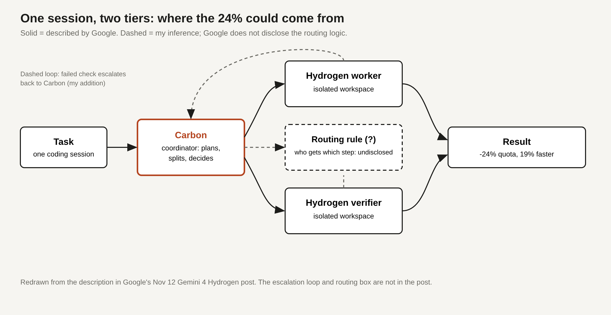

# Title options

1. **Gemini 4 Hydrogen: the model is one point better. The harness is 24% cheaper.** (recommended)
2. What Google's Antigravity Orchestrator tells us about the real cost of agent quality
3. You (probably) don't need Carbon for every step of a coding agent

**Subtitle:** Google says its Orchestrator matches Carbon-level task success with 24% less quota and 19% faster runs. Here is what is solid, what is missing, and how to test it on your own work.

---

If you have ever watched a coding agent spend a frontier-model budget on renaming a variable, you know the problem. Every step costs the same, whether the step is hard or trivial.

[PRAVEEN: 1-2 sentences, only if true for you: have you seen an agent burn expensive-model tokens on trivial steps in your own work?]

Google's Gemini 4 Hydrogen launch has a number that speaks to exactly that. Its Antigravity Orchestrator reportedly delivers near-Carbon task success on Terminal-Bench 4.0 while using 24% less quota and finishing 19% faster.

Hydrogen itself is not the story. On Artificial Analysis's index it scores 51, one point above Argon's 50, per Google's post.

**The model barely moved. The harness around it did.**

## Where to find it

Google's launch post, "Introducing Gemini 4 Hydrogen" by Koray Kavukcuoglu, dated Nov 12, 2026 and updated Nov 13 ([blog.google](https://blog.google/innovation-and-ai/models-and-research/gemini-models/introducing-gemini-4-hydrogen/)). Independent spot-checks come second-hand through the Nov 14 AINews issue from Latent Space. I could not find independent web coverage of Hydrogen yet. All benchmark numbers below are Google's unless I say otherwise.

## What this post covers

- What Hydrogen is and what it costs
- Why one-model-per-session is the wrong default for agents
- How the Orchestrator appears to work, and what Google leaves out
- A redrawn diagram with the missing escalation loop
- A bridge analogy from CPU scheduling
- What the numbers mean for your budget
- Three limitations I would name
- How to test the claim yourself

## What Hydrogen is

Google positions Hydrogen as a fast daily driver for coding and agent work, alongside Carbon and Argon, which it frames for deeper long-horizon reasoning. Pricing is $1.50 per million input tokens and $7.50 per million output tokens, flat across a 1M-token window. There are four thinking levels: low, medium, high (the default) and a new xhigh. Google reports the index score at 51 on high and 54 on xhigh, and about 2.5x faster task completion than Gemini 3.8 Flash.

Those are decent numbers for a cheap tier. They are not why I am writing this.

*Takeaway: Hydrogen is a good cheap model. The interesting claim is about how it gets used.*

## The problem: one model for every step

Most agent setups pick a model and run the whole session on it. That wastes the expensive model on easy steps and risks the cheap one on hard steps.

The effort knob does not fix this by itself. AINews relays two third-party reports that bear on it: on the Hugging Face harness leaderboard, high effort made DeepSeek-V4.1-Flash 28% more expensive with no gain beyond noise, and on a separate agent benchmark, models that intervened unnecessarily spent roughly 80% more time and money (both secondhand, via tweets summarized by AINews). Spending more per step is not the same as spending well.

*Takeaway: Cost per task depends on where you spend, not only on how much.*

## How the Orchestrator works (as far as we are told)

Google's post says the Orchestrator switches between models such as Carbon and Hydrogen inside a single Antigravity session. It also describes a parallel pattern: Carbon coordinates while Hydrogen runs worker and verifier agents in isolated workspaces.

### Component 1. The coordinator

Carbon plans and decides. Putting the expensive model on planning is interesting because plans are short and mistakes in them are costly.

### Component 2. The workers

Hydrogen executes steps in isolated workspaces. Isolation is a quiet but important choice: parallel workers cannot trample each other's files.

### Component 3. The verifier

A separate Hydrogen agent checks results. Checking is often cheaper than generating, so a fast model is a reasonable fit.

### What is missing

Google does not describe the routing logic. We are not told how steps are assigned, when work escalates back to Carbon, or what the baseline is for the 24% and 19% figures. The post also quotes Terminal-Bench 4.0 for the Orchestrator and 4.1 for the Flash comparison.

*Figure 1. My version of the Orchestrator. Solid boxes come from Google's description. The dashed routing box and the escalation loop back to Carbon are my additions: they mark where the undisclosed logic must live.*

## The bridge

If you have used a big.LITTLE CPU, you already know this pattern. A scheduler keeps most work on efficient cores and wakes the fast core only when needed. The Orchestrator is the scheduler. Carbon is the performance core. Hydrogen is the efficiency core. The quota number is the battery life.

## What the evidence says

Rank the claims by how much weight they can bear:

1. **Orchestrator: 24% less quota, 19% faster, near-Carbon success.** Strongest signal, weakest evidence: one vendor-reported benchmark, no method.
2. **Hydrogen speed.** Roboflow's vision bench, relayed by AINews, shows high effort at 29.3 seconds per image against 51.4 for Argon and 132.3 for Carbon. Carbon was more accurate at detection. Faster, not better.
3. **Cost loops.** One 3D-modeling test, also relayed by AINews, found Hydrogen more expensive than Argon because it kept re-verifying its own work.

Translate that into practice. If your agents spend $100 a month of Carbon-equivalent quota, a 24% saving would be $76, if your workload looks like Google's benchmark. The 3D-modeling report shows how it might not: a cheap model that loops can erase its per-token advantage.

The broader cost picture agrees that spread is large. Artificial Analysis's coding-agent update, again via AINews, puts cost per task for configurations scoring 48 or higher between $1.51 and $44.22, a gap of about 29x at similar scores.

*Takeaway: Measure cost per completed task, not price per million tokens.*

## Limitations I'd name

1. **The source is a launch post.** The Orchestrator figures are vendor-reported, lack a stated baseline, and mix Terminal-Bench 4.0 with 4.1 in the same post.
2. **The independent checks are thin and secondhand.** I found them in a newsletter relaying tweets, not in primary reports. One is positive on speed, one negative on cost. That is not a verdict.
3. **"Quota" is not dollars.** It is a product allowance in Antigravity, which is limited to paid Google AI Pro and Ultra subscribers per the post. Do not assume the 24% carries over to API billing.

## Closing

The pattern here is bigger than Google. A strong model does the thinking that matters, a cheap one does the volume, and a checker keeps both honest. The model index moved one point. The system moved the cost.

If you run agents in production, do one thing this week: log cost per completed task for your current setup, then replay a sample with a coordinator-and-worker split and compare.

## Now I want to hear from you

1. In your agent runs, what share of steps would you trust a cheaper model with, and how did you decide?
2. If the verifier is the same model family as the worker, what failure does it miss?
3. Would you accept a 24% saving if it came with one more tier to monitor?

## References

- Kavukcuoglu, K. "Introducing Gemini 4 Hydrogen." Google, Nov 12, 2026 (updated Nov 13). https://blog.google/innovation-and-ai/models-and-research/gemini-models/introducing-gemini-4-hydrogen/
- "[AINews] The No AI Slop Manifesto." Latent Space, Nov 14, 2026 (newsletter; secondary source for third-party checks and Artificial Analysis figures).
- "TLDR AI" and "TLDR Dev," Nov 13, 2026 (newsletters; summaries of the Google post).

## Further reading

[link to hub article]. Follow for a daily look at the system around the model.
