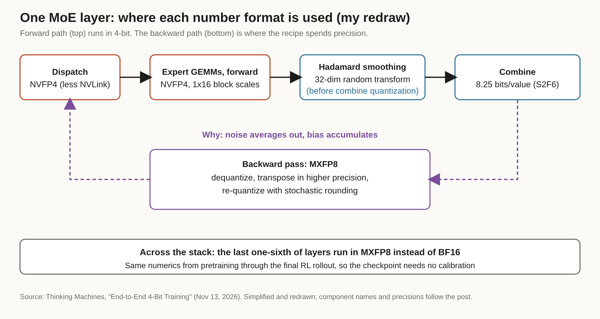

# Title options (recommended first)

1. **Inkling 2 Small's 4-bit recipe: how Thinking Machines trained a model in NVFP4 that actually holds up**
2. What the 4-bit training post doesn't tell you about NVFP4
3. NVFP4 explained: the missing layer between a fast number format and a stable training run

**Subtitle:** About 2% extra compute to match MXFP8, 8% faster pretraining, 20% faster RL, and what that means for anyone budgeting a training run

*Image to upload: `diagram_2026-11-17.png`. Caption: "My version adds the backward path and the Hadamard step, which sit between the expert GEMMs and the combine in the original description."*

---

If you've tried to push a training run below 8 bits, you've probably watched the loss curve drift away from the baseline and wondered whether the format or your setup was to blame. [PRAVEEN: 1-2 sentences — have you hit a low-precision training or quantization wall in your own work? Delete this line if not.]

Here is the number that made me read Thinking Machines' new post twice. Their recipe reaches the same loss as full MXFP8 training with about 2% more FLOPs, while running 4-bit math in the forward pass. In their largest jobs it finishes pretraining about 8% faster and RL about 20% faster than the MXFP8 baseline.

The format didn't change. The recipe around it did.

## Where to find it

"End-to-End 4-Bit Training" by Jack Cook, in collaboration with others at Thinking Machines Lab, published November 13, 2026 on the lab's blog: [thinkingmachines.ai/blog/end-to-end-4-bit-training](https://thinkingmachines.ai/blog/end-to-end-4-bit-training/). It describes training Inkling 2 Small, which the lab calls the largest model it knows of trained end to end with a native 4-bit forward pass.

## What this post covers

- **The problem**: why 4-bit training usually hurts, and what NVIDIA had already found
- **The precision map**: which parts of the model run in NVFP4, MXFP8 and BF16
- **The forward pass**: block scaling and the choices that were rejected
- **The backward pass**: why bias matters more than noise
- **The combine step**: a Hadamard transform and an 8-bit format
- **The evidence**: what 2%, 8% and 20% mean for a budget
- **Three limitations** I'd name
- **What to do with this**

## The problem it solves

NVFP4 stores a value in about 4.5 bits, against 8.25 for MXFP8 and 16 for BF16, according to the post. On NVIDIA's GB300 the post lists peak throughput of 15 PFLOPS for NVFP4, 5 for MXFP8 and 2.5 for BF16. That is up to 6x over BF16 on paper.

The catch is error. The post says full-NVFP4 experiments took very large hits to cross-entropy loss. NVIDIA's own technical blog (February 2026) reports the same pattern: on Llama 3 8B trained on 1 trillion tokens, fully NVFP4 models diverged in its ablations, so NVIDIA keeps the final four transformer layers in BF16. With that fix, NVIDIA reports 1,850 TFLOP/s per GPU for NVFP4 against 1,165 for BF16 (1.59x) on GB200, and downstream scores close to BF16: MMLU 45.64 versus 45.98.

So the raw format buys speed and costs accuracy. The work is deciding where to spend precision.

*Takeaway: 4-bit is a budget, not a switch.*

## How it works

### Module 1. The precision map

Thinking Machines does not use one format. In the mixture-of-experts layers, which are the expensive part, the forward pass runs in NVFP4. The backward pass runs in MXFP8. Dispatch communication uses NVFP4 to cut NVLink traffic. The last one-sixth of the layers run in MXFP8 instead of BF16.

The interesting design choice: the post says MoE layers tolerate quantization better than other layers, and that quantizing only the forward pass gave a better speed and accuracy trade than quantizing the backward pass as well.

### Module 2. The forward pass

Weights and activations use 1x16 block scaling: every 16 values share an FP8 scale, with an FP32 outer scale on top. The team also tried 2D 16x16 tile scaling, which matches the forward and backward representations exactly, and rejected it. It was too coarse and cost more compute efficiency than they would accept.

That choice is worth pausing on. NVIDIA's recipe lists 16x16 2D block scales for weights. Different model, different hardware, different trade-off, and I wouldn't call either wrong. But it shows how much of this is empirical tuning rather than a law.

Other forward-pass details from the post: per-expert outer scales for weights, per-token outer scales for activations (which the post ties to batch invariance), and a scale-selection method called Four Over Six that picks between two candidate scales, used for activations only.

### Module 3. The backward pass

The backward pass is where the reasoning gets sharp. The post argues that backward passes average over many tokens, so random rounding error dilutes. Bias does not dilute. It accumulates.

So the team dequantizes, transposes in higher precision, and re-quantizes to MXFP8 with stochastic rounding, which preserves tensor values in expectation. Blackwell supports stochastic rounding in hardware, per the post.

### Module 4. The combine step

The combine step cuts communication from 16 bits to 8.25 bits per value. Plain MXFP8 combine "impaired performance too much" because it represented outliers poorly. The fix is a 32-dimensional random Hadamard transform before quantization, which smooths outliers, followed by a fixed-point 8-bit format the post calls S2F6. The post reports no measurable accuracy degradation from S2F6, and applies the inverse transform after aggregation.

### The diagram

*My version adds the backward path and the Hadamard step, which sit between the expert GEMMs and the combine in the original description. It is simplified: kernels, scale selection and per-expert scales are left out.*

## The bridge

Think of two sensors. One is noisy: its readings scatter around the truth, and averaging many readings cleans them up. The other is miscalibrated: it reads 3% high every time, and averaging makes you more confident in the wrong answer.

Forward-pass noise in NVFP4 is the first sensor. Gradient bias is the second. The recipe tolerates the noisy sensor and replaces the miscalibrated one.

## What the evidence says

Ranked by how much the post supports each number:

1. **About 2% compute-efficiency cost** versus full MXFP8 pretraining. Practical consequence: you pay roughly 2% more FLOPs for the same loss.
2. **8% faster pretraining wall-clock** in the largest jobs. On a multi-week run, that is days.
3. **20% faster RL end to end** in the largest jobs, with no discernible reward difference. The post gives no reward numbers, so treat this as a claim.
4. **Theoretical roughly 3x** on the MoE forward GEMMs. The post presents this as expected, not measured, which explains why the end-to-end gain is far smaller.

The gap between 3x on a kernel and 8% on a job is the real lesson. Communication, the BF16 and MXFP8 parts, and the backward pass all stay in the loop.

A secondary summary from AlphaSignal reports Inkling 2 Small as a 594B-parameter MoE with 17B active parameters, pretrained on 8.4T tokens, with open weights under Apache 2.0. Those figures are not in the lab's post, so verify them before quoting.

## Limitations I'd name

1. **The post is the lab's own evidence.** It gives no downstream benchmark scores and states the RL result qualitatively. I found no independent replication.
2. **The headline numbers are narrow.** The speedups are for the largest jobs, on one model family, on GB300 hardware. The post says the recipe may change on Vera Rubin, and it does not fully specify precision for non-MoE layers.
3. **"End-to-end 4-bit" oversells it.** The forward pass is native 4-bit. The backward pass stays in MXFP8, and the post says FP4 backward is still being explored.

## Closing

The story isn't that 4-bit works. It is that someone wrote down, component by component, where it doesn't. The model is the same. The precision allocation, the rounding rules and the outlier handling are the system around it.

If you're budgeting a training run on Blackwell, start by classifying every tensor as noise-tolerant or bias-sensitive, then spend your precision on the second group.

## Now I want to hear from you

1. The team rejected 2D 16x16 scaling while NVIDIA's recipe uses it for weights. Which would you test first on your own model, and why?
2. Would you trust a 20% RL speedup with no reported reward numbers?
3. Where in your own stack does bias accumulate while noise averages out?

## References

- Cook, J., et al. "End-to-End 4-Bit Training." Thinking Machines Lab, Nov 13, 2026. https://thinkingmachines.ai/blog/end-to-end-4-bit-training/
- "Thinking Machines' Inkling 2 Small Trains a 594B Model in 68 Hours." AlphaSignal, Nov 2026. https://alphasignal.ai/news/thinking-machines-inkling-2-small-trains-a-594b-model-in-68-hours
- "Using NVFP4 Low-Precision Model Training for Higher Throughput Without Losing Accuracy." NVIDIA Technical Blog, Feb 23, 2026. https://developer.nvidia.com/blog/using-nvfp4-low-precision-model-training-for-higher-throughput-without-losing-accuracy

---

*Further reading: [link to hub article]. Follow me for a daily read on AI engineering.*
