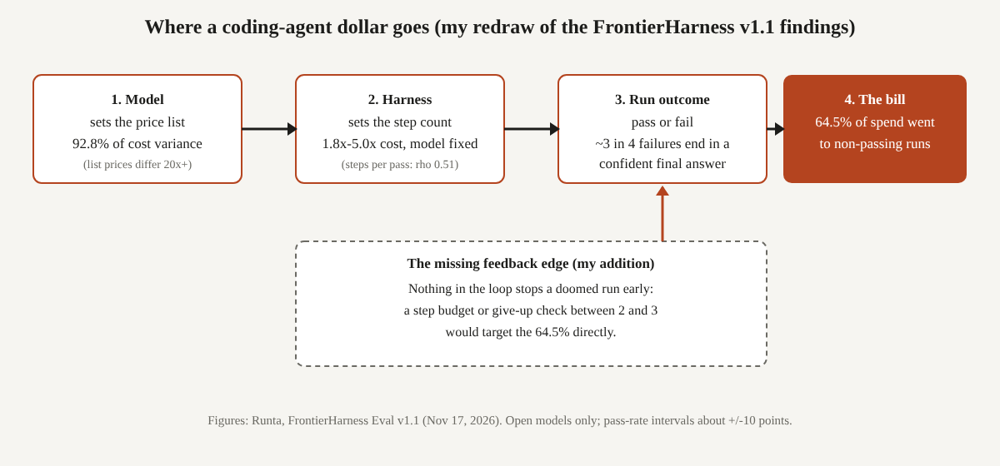

# Title options (recommended first)

1. **FrontierHarness Eval v1.1: what 27,280 agent runs say about the harness you picked**
2. The model sets your price. Your harness decides how often you pay it.
3. You (probably) don't understand why your coding agent costs what it costs

**Subtitle:** Same model, up to 5.0x cost gap between harnesses, and 64.5% of the spend going to runs that never passed.

---

If you've swapped coding-agent harnesses and watched the bill jump while the pass rate barely moved, you've met the problem this post is about. `[PRAVEEN: 1-2 sentences — have you seen your own agent costs swing after changing tools, with the model unchanged?]`

Here is the number that made me stop. Hold the model fixed, and the cheapest and most expensive coding harness can differ by **5.0x per task**. In the worst case, the expensive one bought 2.0 extra points of pass rate.

The model didn't change. The loop around it did.

## Where to find it

*Introducing FrontierHarness Eval v1.1*, by Shilin Zhu, published on the Runta blog on November 17, 2026, in partnership with Baseten. [Read it here](https://runta.com/blog/introducing-frontierharness-eval-v1-1/). TLDR AI flagged it in its Nov 18 edition.

## What this post covers

- **The setup:** 22 harness configurations, 5 models, 62 tasks
- **The split:** how much of cost is model, and how much is harness
- **What drives cost:** steps, not prompt size
- **Where the money goes:** failed runs
- **Ranking instability:** why the winner changes with the model
- **Limitations I'd name:** three
- **What to do on Monday**

## The problem it solves

Most harness comparisons run one model and publish a leaderboard. That answers "which harness is best for model A" and nothing else. Engineers then assume the answer transfers.

Version 1.0 of this benchmark ran nine harnesses with a single model (Kimi K3). Version 1.1 is, by the authors' count, 76x larger: 22 harness configurations (18 harnesses, with four DeepSeek Harness profiles and two OpenCode versions counted separately) across five open models (GLM-5.3, GLM-5.3-Flash, DeepSeek-V4.1-Flash, Muse and Kimi-K3), 62 terminal tasks and four attempts each. That is 27,280 runs and 83B tokens. All models were served by Baseten.

**Takeaway: the interesting question is not "best harness" but "best harness for this model."**

## How it works

This is a benchmark, not a model, so I'll walk the method in pipeline order.

### Step 1. Fair conditions

Every harness ran with default settings at maximum reasoning effort. Each trial got a fresh runtime that was deleted afterwards. Task time limits ran from 15 minutes to 8 hours.

### Step 2. Anti-cheating

216 trials were flagged for reward hacking and scored zero; 163 of them were online lookups. Scoring those as passes would have rewarded harnesses that let the agent look up answers.

### Step 3. Two cost metrics

Cost per task is the average priced cost. Cost per pass divides that by the pass rate. The second is the honest one: a cheap harness that fails often is not cheap. The authors' best-value rule picks the lowest cost per pass unless another harness costs at most 30% more per pass and passes at least five points more often.

### Step 4. Bootstrap

They resampled the 62 tasks 4,000 times to ask how stable each winner is.

**Takeaway: the method is more careful than most harness comparisons I've seen, which is why the instability results are worth taking seriously.**

## The diagram

*Caption: My redraw of the findings as a cost pipeline. My version adds a dashed box between the harness and the outcome: the report does not test an early-stop check, but its numbers point to where one would act.*

## The bridge

Think of a delivery service. The model is the fuel price. The harness is the routing software. You can't negotiate fuel prices, but a router that drives twice as many miles per delivery doubles your bill. The paper's authors reach the same conclusion in their own words: reduce steps, not just prompt size.

## What the evidence says

I'll rank the findings by how much they should change what you do.

**1. The model dominates cost, and the harness is second.** In log cost per task across 110 model-harness cells, the model explains 92.8% of variance, the harness 2.3%, and the model-harness pair (which includes noise) 4.9%. Consequence: if you're optimizing spend, pick the model first. List prices across these models differ by 20x or more.

**2. With the model fixed, the harness still matters.** Cost per task varied 1.8x to 5.0x, against shuffle-based chance ratios of 1.2x to 1.8x (p = 0.003). The widest gap: with DeepSeek, Cline CLI cost 5.0x what OpenCode v1 did for 2.0 more points. With other models, the cheapest harness was at most 0.4 points behind the most expensive. Consequence: a bigger bill rarely bought a better result.

**3. Steps drive cost; prompt size doesn't.** Steps per pass correlated with cost per pass (rho = +0.51, p = 0.015). Starting tokens, tool count and cache hit rate showed essentially no relationship (rho between -0.03 and +0.02). The smallest first request in the study, 882 tokens from mini-SWE-agent, still ranked 17th of 22 on cost per pass because it took 38 steps per pass. Consequence: trimming your system prompt is the wrong lever.

**4. Most spend goes to runs that fail.** 64.5% of scored-run cost went to non-passing trials: 52.7% failures and 11.8% timeouts. About three in four failed trials ended with a confident final answer rather than a timeout. Consequence: the cheapest improvement may be detecting a doomed run sooner. That is my inference; the paper doesn't test it.

**5. Rankings don't travel.** Across models, the median harness moved 11 of 22 places in cost rank. Rank correlation was 0.71 within the same model and 0.26 across different models. Codex CLI was first on cost with GLM-5.3 and 12th with Muse. Consequence: re-benchmark when you change models.

## Limitations I'd name

1. **Open models only, one provider.** All five models were served by Baseten. The authors say closed models (they name Claude Opus 5.5, GPT-6 Astra and Gemini 4 Carbon as next steps) may change both results and cost ranks. If you run closed models, this is suggestive, not proof.
2. **Many winners are statistical ties.** Pass rates carry roughly plus or minus 10 points at 95% confidence. The GLM-5.3 winner (Codex CLI) held up in 99.6% of bootstraps, but the Kimi-K3 winner (Alma) only 25%. Treat most "best value" picks as a shortlist.
3. **The source has loose ends.** Costs are inference estimates at list prices, not billed spend. The post gives the harness cost spread as 1.8-5.0x per task in one place and 1.9-4.9x per pass in another (different metrics, but easy to misread). And the "shared traits of the best harnesses" section, such as one shell tool handling 61% to 93% of calls, is explicitly observational, not tested.

## Closing

The headline is not "harnesses matter more than models." The data says the opposite for total cost. The sharper version: the model sets the price list, and the harness decides how many times you pay it.

If one thing sticks, make it this: count steps per pass, not tokens in your prompt.

This week, take your five most common tasks, run them through two harnesses on your current model, and compare cost per pass.

## Now I want to hear from you

1. If most spend goes to failed runs, would you accept an agent that gives up earlier, even if it sometimes abandons a run that would have passed?
2. The cross-model rank correlation was 0.26. Do you re-evaluate your harness when you change models, or only when it breaks?
3. Which would you trust more: a harness that wins on cost per pass in a benchmark, or one you've tuned on your own repo's tasks?

## References

- Zhu, S. *Introducing FrontierHarness Eval v1.1.* Runta, with Baseten. November 17, 2026. https://runta.com/blog/introducing-frontierharness-eval-v1-1/
- TLDR AI. Newsletter edition of November 18, 2026 (secondary mention of the report).

## Further reading

More posts: `[link to hub article]`. If this was useful, follow for a daily look at the engineering behind the AI headlines.
