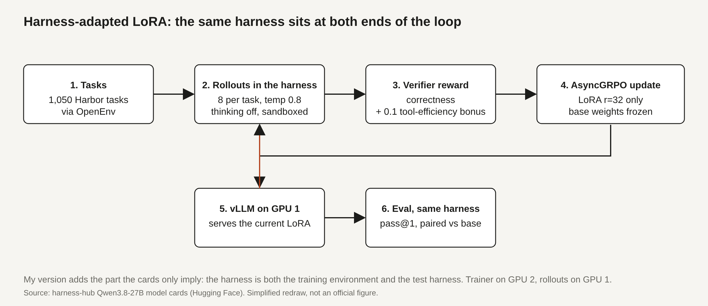

# Title options

1. **harness-hub's Qwen3.8-27B adapters: how a LoRA turned 39.2% into 64.7% by learning one harness (and what it doesn't prove)** *(recommended)*
2. What the model cards don't tell you about harness-adapted LoRAs
3. Harness-adapted LoRA explained: the missing layer between your model and your agent

**Subtitle:** A small LoRA lifted Qwen3.8-27B by 25.5 points on SWE-bench Pro (hard 51) and cut generated tokens about 4.5x. The model didn't change. The fit did.

---

If you've pointed an open-weights model at a coding agent, you've probably watched it burn all 100 of its allowed tool calls re-reading the same files and never finish the job. [PRAVEEN: 1-2 sentences, optional — have you seen an agent run out of its step budget in your own work?]

Hugging Face's harness-hub team just published numbers that explain a lot of that. On the hard 51 tasks of SWE-bench Pro, Qwen3.8-27B went from **39.2% to 64.7%** with thinking off, after a LoRA adapter trained against one specific coding agent (pi). Median generated tokens per solved task fell from 48.8k (base with thinking) to 9.4k.

> The model didn't change. The fit between model and harness did.

## Where to find it

- **Model cards:** [Qwen3.8-27B-pi-adapted](https://huggingface.co/harness-hub/Qwen3.8-27B-pi-adapted) and [Qwen3.8-27B-opencode-adapted](https://huggingface.co/harness-hub/Qwen3.8-27B-opencode-adapted), by Hugging Face's harness-hub team, updated around Nov 18, 2026. Apache-2.0.
- **Secondary coverage:** [AIWeekly's write-up](https://aiweekly.co/alerts/harness-hub-ships-qwen38-27b-pi-adapted-lora-hits-647-on-swe-bench-pro-hard-and) (Nov 18) and Latent Space's Nov 19 AINews, which also reports the correction history. I could not find an independent replication, and there is no paper behind these numbers, only the cards.

## What this post covers

- The problem: why a strong base model underperforms inside a harness it wasn't tuned for
- How the adapter was trained, piece by piece
- A redrawn diagram of the training loop
- A bridge analogy for what the LoRA is really learning
- What the numbers say, and what they don't
- Three limitations I'd name
- Questions for you

## The problem: a good model in the wrong cockpit

A coding agent is a model plus a harness: system prompt, tool schemas, and context handling. The card for the pi adapter notes that the base model often exhausted its 100 model calls, so part of the adapter's gain comes from finishing inside the limits. That is a harness-fit failure, not a knowledge failure.

It also complicates a popular belief. A [recent arXiv paper](https://arxiv.org/abs/2610.04433), "What Does a Harness Buy? Tokens, Mostly" (Liu and Han, v2 Nov 18, 2026), ran seven models through Claude Code, mini-SWE-agent and OpenCode. It found no harness that wins across models, a bound of 2 to 5 points where it could bound the gap, and swings from -8 to +14 points for OpenCode depending on the model. Harness effects depend on the pairing.

Read that next to the adapter cards. If effects depend on the pairing, then training the model *for* the pairing is the obvious move.

**Takeaway: the gap lives in the pairing, not in either half.**

## How it works

### Component 1. The environments

Tasks come from two pools: 750 "scale800" tasks interleaved with 300 TermGrade tasks, packaged as Harbor tasks and served through OpenEnv. Rollouts run in Hugging Face sandboxes, with tool calls screened. Each task gets 8 rollouts at temperature 0.8, thinking off, capped at 50 steps and 1,800 seconds.

What's interesting: the model practices inside the same agent it will be graded in, so tool-call formats and loop behavior are part of what it learns.

### Component 2. The reward

The reward is the verifier's correctness score plus a tool-efficiency bonus weighted at 0.1. Correctness is what you'd expect. The small efficiency term is the quiet design choice: it nudges the policy toward fewer, better tool calls.

That lines up with the outcome. On the pi card, median model calls per task dropped from 61 to 21 on SWE-bench Pro against base-with-thinking.

### Component 3. The trainer

Training uses TRL's experimental AsyncGRPO with a LoRA of rank 32 (alpha 64) on the attention and MLP projections, learning rate 2e-5, on two B200s per harness: one runs vLLM for rollouts, the other trains. The pi checkpoint is step 160; the run was stopped at step 191 of 1,000 planned.

Why it's interesting: this is a small recipe. Two GPUs per harness and a few hundred steps moved the headline numbers. The planned 1,000 steps weren't needed to get there.

### Component 4. The checkpoint choice

The released checkpoint was picked using SWE-bench Pro scores and an 18-task Terminal-Bench subset. The card is upfront about that and reports the remaining Terminal-Bench tasks separately as the less biased comparison.

*Figure: My simplified version of the training loop. It adds the step the cards only imply: the same harness appears at both ends, as the rollout environment and as the evaluation harness. Reward flows back to a LoRA, and the base weights never move.*

## The bridge

Think of it as a driver learning one car. The base model is a competent driver in a rental with unfamiliar controls. The LoRA is two weeks in your own car. Same skill, fewer fumbled mirrors.

The harness is the cockpit. The adapter is the muscle memory.

## What the evidence says

Ranked by how much I'd trust each number:

1. **Terminal-Bench 2.1, 68 held-out tasks (pi):** 39.7% to 55.9%, p = 0.0074. This is the cleanest result, because those tasks weren't used to pick the checkpoint. Practical meaning: roughly one extra task in six solved.
2. **SWE-bench Pro hard 51 (pi):** 39.2% to 64.7%, +25.5 ± 14.2, 15 tasks newly solved and 2 lost, p = 0.0023. Large, but 51 tasks is a small set and the checkpoint was chosen on it.
3. **Tokens:** the card reports about 4.5x fewer tokens. Its own medians give about 5.2x on SWE-bench Pro and 4.5x on Terminal-Bench. For anyone paying per token, that is the number that changes the bill.
4. **Thinking on:** with xhigh thinking, base and adapter tie at 74.5% on SWE-bench Pro. The adapter's advantage is getting there without paying for thinking.

The OpenCode adapter is more modest. SWE-bench Pro rose from 35.3% to 51.0% (+15.7 ± 13.9, p = 0.057, not significant at 0.05), and Terminal-Bench on 66 held-out tasks rose from 45.5% to 59.1% (p = 0.035). Median turns on commonly solved SWE-bench Pro tasks fell from 48 to 13.

**Takeaway: the reliable gain is efficiency; the headline accuracy gain is real but small-sample.**

## Limitations I'd name

1. **The numbers have already been corrected once.** The pi card's first version reported 29.4% to 62.7%. A tunnel outage between the sandboxes and the model server had failed nine base-model rollouts; after rerunning, the baseline became 39.2%. A thinking-on result was also revised from 64.7%/66.7% to 74.5% after a 16k output cap was lifted. Credit to the team for documenting it, but it means the evaluation setup is fragile.
2. **Self-reported, small sets, single attempts.** 51 SWE-bench Pro tasks and 86 Terminal-Bench tasks, one attempt each, no independent replication that I could find. The cards also say results aren't comparable with the base model's own card, which used other harnesses and budgets.
3. **It may not transfer.** The adapters were tuned for specific harnesses, served text-only. The cards say the GGUF version hasn't been re-evaluated and that lower-bit quantization is expected to drift further from trained behavior. And the arXiv paper's reversals suggest a gain in one pairing says little about another.

## Closing

The base model's weights stayed fixed and a few hundred steps of RL in the target harness bought a large efficiency gain. If you run an open model inside a fixed agent, the cheapest upgrade may be training against the cockpit you already have.

Before you swap models, measure your own agent loop's call budget exhaustion rate. If it's high, you have a fit problem, not a model problem.

## Now I want to hear from you

1. If your agent regularly exhausts its step budget, would you rather raise the budget or train for the harness?
2. The pi adapter ties the base model at xhigh thinking (74.5%). Is "same accuracy, about a fifth of the tokens" enough to justify maintaining a per-harness adapter?
3. The arXiv paper says harness effects reverse by model. Would you trust a single-harness benchmark result for your stack?

## References

1. harness-hub (Hugging Face). *Qwen3.8-27B-pi-adapted* model card. 2026. https://huggingface.co/harness-hub/Qwen3.8-27B-pi-adapted
2. harness-hub (Hugging Face). *Qwen3.8-27B-opencode-adapted* model card. 2026. https://huggingface.co/harness-hub/Qwen3.8-27B-opencode-adapted
3. Liu, Y. and Han, Z. *What Does a Harness Buy? Tokens, Mostly.* arXiv 2610.04433, v2, Nov 18, 2026. https://arxiv.org/abs/2610.04433
4. AIWeekly. *harness-hub ships Qwen3.8-27B pi-adapted LoRA.* Nov 18, 2026. https://aiweekly.co/alerts/harness-hub-ships-qwen38-27b-pi-adapted-lora-hits-647-on-swe-bench-pro-hard-and
5. Latent Space AINews, Nov 19-20, 2026 (inbox edition).

---

**Further reading:** [link to hub article]

Follow for a daily look at the system around the model. [follow/newsletter link]
