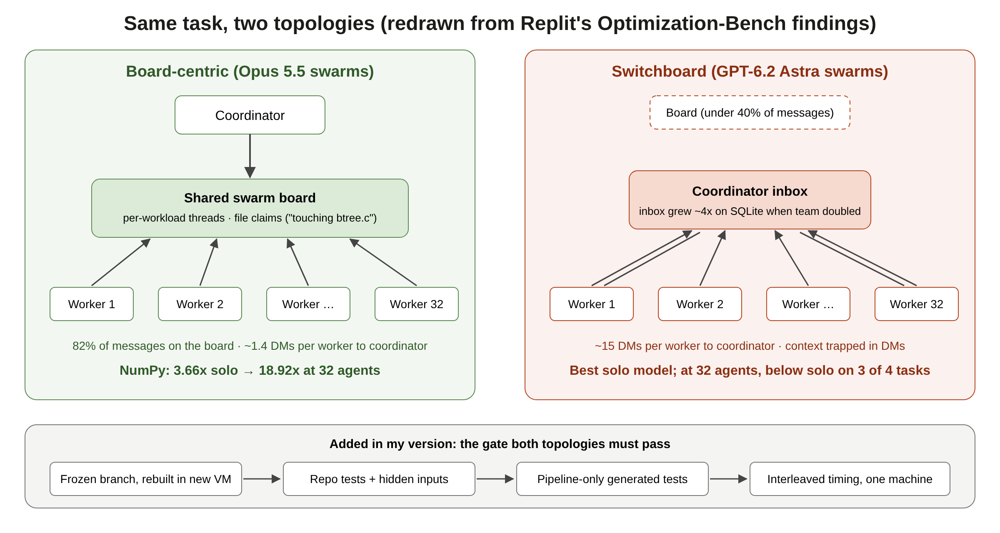

# Title options

1. **Replit's agent-swarm study: why 32 agents made one model 5x faster and made the best solo model worse** *(recommended)*
2. What the leaderboards don't tell you about multi-agent coding
3. Agent swarms explained: the missing layer between a strong model and a working team

**Subtitle:** On NumPy, 32 Opus 5.5 agents reached 18.92x where one reached 3.66x. The strongest solo model went backwards. The difference was the coordination topology, not the model.

---

If you've tried to speed up an agent by running more copies of it, you've probably seen the second half of this story: twice the agents, the same files edited twice, and a coordinator that spends its whole budget answering messages. [PRAVEEN: 1-2 sentences, optional: have you seen parallel agents collide or stall in your own work?]

Replit just published a careful measurement of that. On 13 NumPy workloads, one Claude Opus 5.5 agent made the code **3.66x** faster in two hours. A swarm of 32 made it **18.92x** faster. Meanwhile GPT-6.2 Astra, which had the strongest solo run on every task, fell below its own solo score on three of four libraries once it had 32 agents.

> The model's solo score didn't predict the swarm. The topology did.

## Where to find it

- **Post:** ["Throwing Headcount at the Problem"](https://frontier.replit.com/throwing-headcount-at-the-problem/), Replit Frontier, Nov 19, 2026. Nine authors, including Vaibhav Kumar and Michele Catasta.
- **Context:** It accompanies Replit Missions, a product for running budgeted agent swarms, which [The New Stack](https://thenewstack.io/replit-missions-agent-swarms/) covered with the rounded "up to 19x" figure. TLDR AI summarized the study on Nov 20.
- **Caveat up front:** every number below is Replit's own. I found no independent replication.

## What this post covers

- The problem: why "more agents" is not a free speedup
- How the benchmark works: tasks, sandbox, coordination tools, and grading
- A redrawn diagram comparing the two coordination styles
- A bridge analogy from distributed systems
- What the numbers say, ranked by what matters most
- Three limitations I'd name
- Questions for you

## The problem: headcount isn't throughput

Optimization is a good test for swarms. A library like NumPy has many workloads, and each one can be sped up somewhat independently. That's the ideal case for parallel work.

The catch is the same one human teams hit. Workers need to know who owns which file, what has already been tried, and what is finished. If that information goes through one person, that person becomes the limit.

Most agent benchmarks never test this. They score one agent on one task. So the solo leaderboard is the only signal teams have when they pick a model for a multi-agent setup.

**Takeaway: a solo benchmark measures the worker, not the team.**

## How it works

### Component 1. The task suite

Optimization-Bench is a prerelease set of 14 open-source libraries. The post discusses four: NumPy (13 workloads), SQLite (12), SQLGlot (4) and Git (7). The goal is lower wall-clock time with identical outputs, error handling and public interfaces.

Replit banned the usual shortcuts: caching, special-casing inputs, precomputation and changing process-wide runtime settings. That matters. Without those rules, a speedup benchmark mostly measures how well an agent can cheat.

### Component 2. The sandbox

Each agent got its own VM with 8 vCPUs, 16 GiB of RAM, no network access, and two hours. Teams of 1, 8, 16 and 32 were compared across six models, mostly at medium reasoning effort.

The interesting choice is fixed time with growing headcount. You're measuring what extra agents buy within the same deadline, which is the question a team lead actually asks.

### Component 3. The coordination tools

The coordinator got the task requirements and **no organizational instructions**. Agents could use a shared swarm board (threads, replies, addressed posts, status), direct messages and transcripts.

This is the design choice that makes the study useful. Replit didn't prescribe a structure, so each model's swarm built its own. The structures turned out to be very different.

### Component 4. The grading gate

Final branches were frozen and rebuilt in a fresh VM. A candidate had to pass the repo's tests, match outputs on public and hidden inputs, and pass extra generated tests. Timing ran one evaluation at a time on a dedicated c4-standard-32 machine, interleaving original and candidate runs.

That gate is why I trust the speedups more than most agent numbers. A swarm that "won" by breaking behaviour would fail here.

**Takeaway: the harness made the swarm's own structure the variable under test.**

## The diagram

*My redrawing of the two coordination styles Replit describes. The original post shows these as message statistics; I've drawn them as topologies and added the bottom row, the grading gate every swarm had to pass, which is what makes the comparison fair.*

## The bridge

If you've run distributed systems, you've seen this before.

The board is a pub/sub log. The switchboard coordinator is a single broker that every request goes through. Logs scale with writers; a central broker scales with its own capacity.

And Git's seven workloads all touching the same 15 files is lock contention. Adding threads to a contended lock doesn't help.

## What the evidence says

Ranked by how much each finding should change what you build:

**1. Topology beats solo strength.** Opus swarms put 82% of their messages on the board, mostly in per-workload threads, and posted file claims such as "touching btree.c". Workers sent the coordinator about 1.4 direct messages each. GPT-6.2 Astra put under 40% on the board, and each worker sent about 15 DMs to the coordinator, whose inbox grew about fourfold on SQLite when the team doubled. Astra's swarms peaked at 8 agents. Practical consequence: before you scale out, count messages per worker to the coordinator. If that number grows with team size, adding agents will cost you.

**2. Separability sets the ceiling.** At 32 agents Opus reached 18.92x on NumPy, but 1.52x on SQLite, 1.38x on SQLGlot and 1.29x on Git. Same model, same harness. Practical consequence: a 5x gain on one codebase says almost nothing about another. Estimate how independent your work units are before you budget for a swarm.

**3. The real changes were real engineering.** One NumPy change to `searchsorted` batched 256 keys to stay in cache and skipped NaN-safe comparisons when no NaN was present. It ran 8.7 to 13.1x faster on large float64 inputs, with identical results. Practical consequence: swarms can find genuine optimizations, not only benchmark tricks, if the grading gate is strict.

**4. Weak coordinators fail in odd ways.** Replit says one GPT-6 Luna coordinator polled the board over 200 times, another did the work itself, and some told workers to stay idle. Practical consequence: log coordinator behaviour, not just final scores.

**Takeaway: measure the coordination layer as carefully as the model.**

## Limitations I'd name

1. **No cost data.** The post doesn't report total compute or dollars. 32 agents for two hours is 32 times the agent-hours of one. The 18.92x speedup is impressive; whether it beats one agent running 32 times as long is not answered.
2. **The source is the vendor, and the sample is small.** Replit sells Missions, a swarm product, and the study accompanies its launch. Only 4 of 14 libraries are discussed, results come from Replit's own prerelease benchmark, and I found no independent replication.
3. **One reasoning setting, one prompt, no instructions.** Most models ran at medium effort, and coordinators got no organizational guidance. A one-paragraph instruction to use the board might close much of the GPT gap. The study shows each model's default behaviour, not its ceiling.

## Closing

The headline is 18.92x. The lesson is the line next to it: the best solo model got worse as its team grew.

That's the argument I keep making about agents. The value sits in the system around the model: who owns what, where shared state lives, how work gets claimed. Vercel shipped [Board](https://vercel.com/blog/introducing-vercel-board), a harness-agnostic board for agent teams, the day before this study came out. The industry is starting to build the coordination layer as its own product.

If you run parallel agents, put a shared board between them and track messages per worker to the coordinator before you add the next one.

## Now I want to hear from you

1. In your multi-agent setups, does work flow through a shared log or through a coordinator's inbox, and did you choose that or did the model?
2. Would a single instruction like "post claims and status to the board" fix the switchboard pattern, or is it something deeper in how the model was trained?
3. How would you price a 5x speedup that costs 32x the agent-hours: per task, per deadline, or not at all?

## References

1. Kumar, V., Sheikh, I., Zhong, P., Joshi, S., Ma, P., Dellaluce, J., Patel, D., MacEachron, P., Catasta, M. "Throwing Headcount at the Problem." Replit Frontier, Nov 19, 2026. https://frontier.replit.com/throwing-headcount-at-the-problem/
2. The New Stack. "Replit Missions: agent swarms." Nov 2026. https://thenewstack.io/replit-missions-agent-swarms/
3. Vercel. "Introducing Vercel Board." Nov 18, 2026. https://vercel.com/blog/introducing-vercel-board
4. TLDR AI, Nov 20, 2026 edition (newsletter summary of reference 1).

---

**Further reading:** all my articles in one place: [link to hub article]

*If this was useful, follow for a daily breakdown of what actually changed in AI engineering.*
